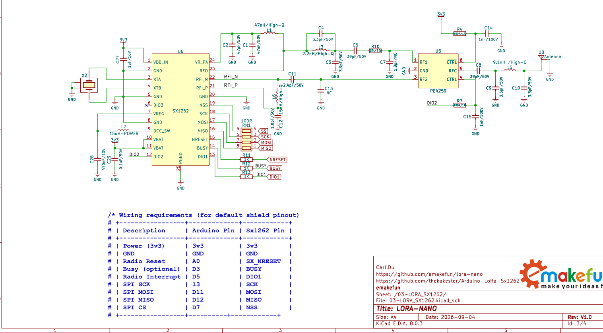
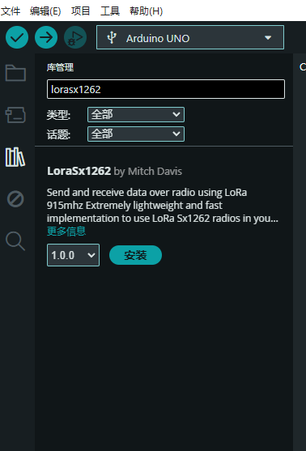
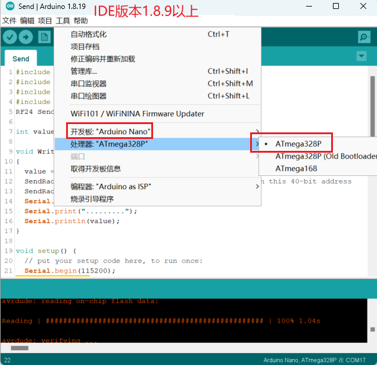
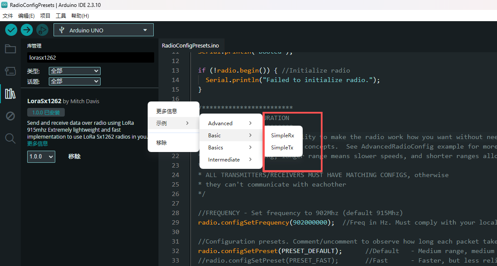
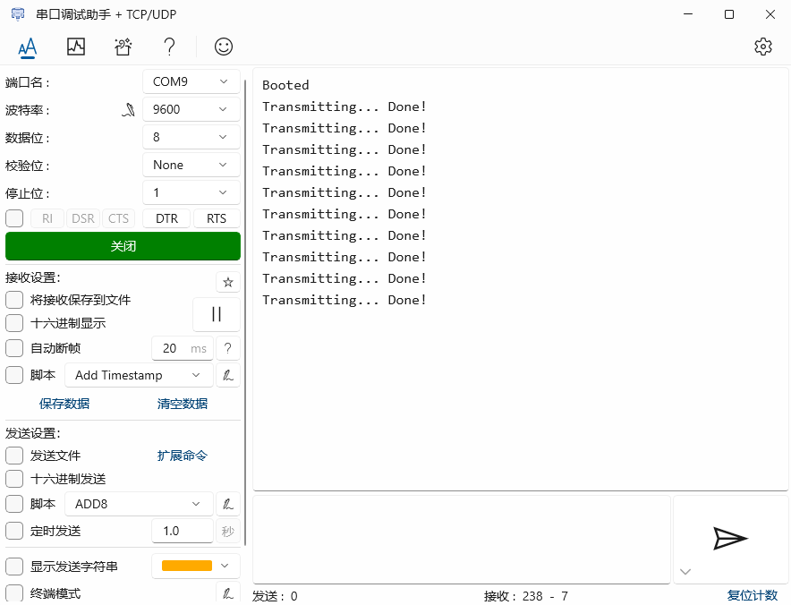
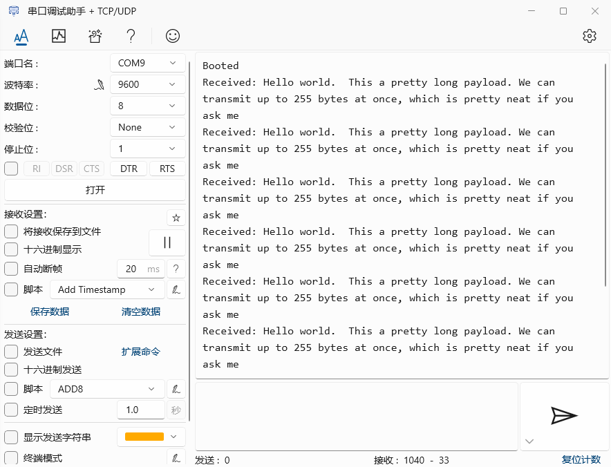

# lora-nano

[**淘宝购买链接**]( )

## 简介

 lora-nano是emakefun公司基于官方标准Arduino Nano V3.0主板集成sx1262无线芯片而开发一款915MHz的无线开发板 。它的尺寸，引脚完全兼容标准nanoV3.0开发板，直接兼容[lorasx1262开源库](https://github.com/thekakester/Arduino-LoRa-Sx1262)，该板卡兼顾了NANO丰富的开发生态与SX1262卓越的远距离、低功耗通信能力;板载IPEX1代贴片天线座，使用外置天线可远距离传输。可广泛于智慧农业、工业物联网、环境监测、智能家居/安防等方面。

### 主要技术参数

- 处理器:ATmega328P-AU
- 工作电压:5V建议  VIN输入电压:6V ~ 15V
- 数字IO引脚:22个(其中6个用作PWM输出)
- 模拟输入引脚:8 (A0~A7)
- IO引脚直流电流:40mA
- 5V 引脚电流：VIN输入时1000mA
- 3.3V引脚电流 :  50mA
- Flash内存:32KB(其中0.5KB用于引导加载程序)
- SRAM: 2KB
- EEPROM: 1KB
- USB转串口芯片: CH340G芯片 外置晶振
- 工作时钟:16 MHZ

## 引脚标注图

## 原理图

<a href="zh-cn/arduino_products/nano/lora-nano/schematic/LORA_NANO-03-LORA_SX1262.pdf" target="_blank">点击下载原理图</a>

<a href="zh-cn/arduino_products/nano/lora-nano/datasheet/LORA_NANO-03-LORA_SX1262.pdf" target="_blank">点击下载sx1262数据手册</a>

## 机械尺寸标注

## Arduino和sx1262芯片引脚连接如下

| ATmega328P | sx1262 |
| ---- | ---- |
| A0 | NRESET |
| D3 | BUSY |
| D5 | DIO1 |
| D12 | MISO |
| D13 | SCK |
| D11 | MOSI |
| D7 | NSS |

**注 ：lora-nano上面表格中的IO口不推荐被复用**

## CH340G驱动安装

[CH340G驱动下载链接](https://www.wch.cn/downloads/CH341SER_ZIP.html)

## lorasx1262库安装

### lora-nano主板选择

## 关键函数说明

### 基础函数

| 函数名 | 说明 |
| ------------------------------------------------------------ | ------------------------------- |
| bool begin() | 初始化无线模块 |
| void transmit(byte* data, int dataLen) | 向指定通道发送数据 |
| int lora_receive_async(byte* buff, int buffMaxLen) | 异步接收数据包 |
| int lora_receive_blocking(byte* buff, int buffMaxLen, uint32_t timeout) | 阻塞接收数据包 |

### 配置函数

| 函数名 | 说明 |
| ------------------------------------------------------------ | ------------------------------------------------------------ |
| bool configSetPreset(int preset) | 配置预设 |
| bool configSetFrequency(long frequencyInHz) | 设置通信频率 |
| bool configSetBandwidth(int bandwidth) | 设置通信宽带 |
| bool configSetCodingRate(int codingRate) | 设置编码速率 |
| bool configSetSpreadingFactor(int spreadingFactor) | 设置扩频因子 |

### sx1262芯片无线通信注意点

**通信频道**

915MHz属于全球通用的免许可ISM频段（如北美US915频段），SX1262在该频段下的核心物理层特征是线性调频扩频（LoRa CSS）调制，其信道带宽并非像FSK那样固定间隔对齐，而是支持多种带宽配置（常用125kHz、250kHz、500kHz），带宽越宽则单次承载的数据传输速率越高、空中传输时间越短，但抗干扰性能和接收灵敏度会对应降低。

在配置时，收发双方的载波中心频率、信道带宽（Bandwidth）以及扩频因子（SF）必须完全一致才能建立通信。如果中心频率有漂移或带宽配置不匹配（例如一端使用125kHz而另一端使用250kHz），通信会直接失败。

**接收及发射**

SX1262采用半双工射频收发架构，同一时刻只能处于纯发送（TX）、纯接收（RX）或待机监听状态。在多对一或复杂组网场景中，SX1262内置了信道活动检测（CAD，Channel Activity Detection）模式，能在发送前或休眠定时唤醒时快速扫描信道是否有LoRa前导码存在。

当信道繁忙时，CAD模式可以避免盲目发送撞包；检测完成后再切回RX模式监听有效数据。此外，在实际接收中断处理中，接收端需要预留足够的处理余量，在DIO引脚触发数据就绪中断后及时读取芯片内部的FIFO缓存，避免因为读取延迟导致缓冲区满溢而截断后续数据帧

## 点对点收发测试

如图所示，可直接从库中获取对应简易发送和接收代码

**点对点收发测试结果如下：**

**发送:**

**接收：**

**注 ：代码中的波特率需与串口助手中的保持一致**

### 图像化编程软件支持

开发中......

## 联系我们

**技术+合作**  wechat号: jundi0808(<ken@emakefun.com>)
