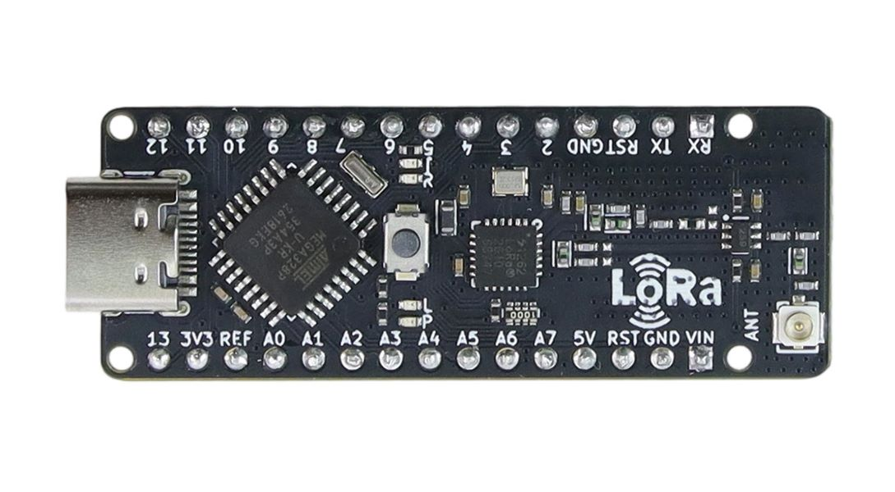
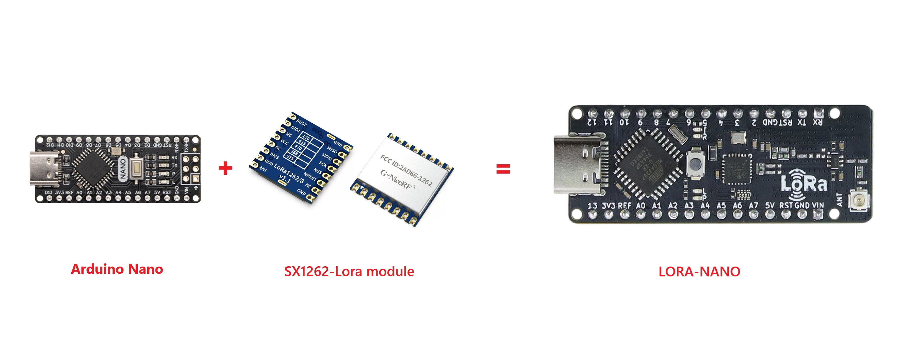
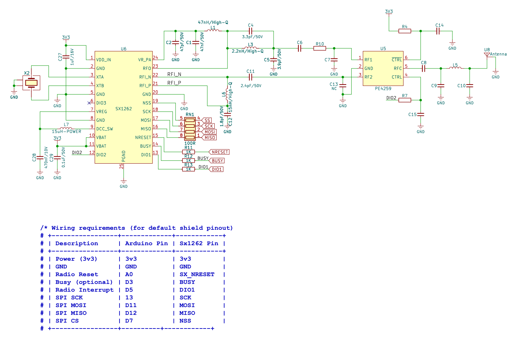
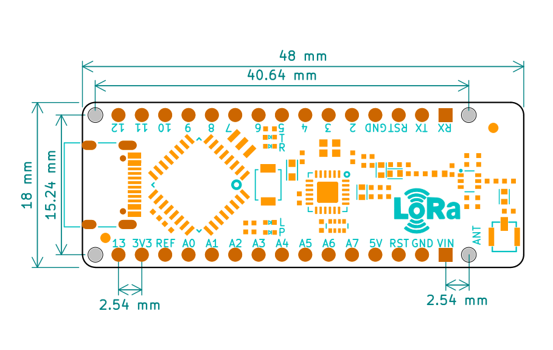
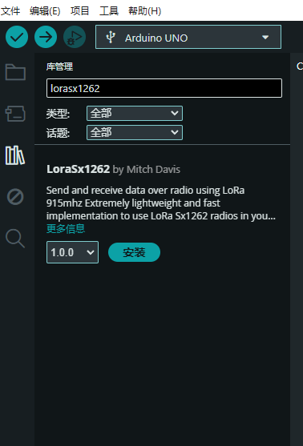
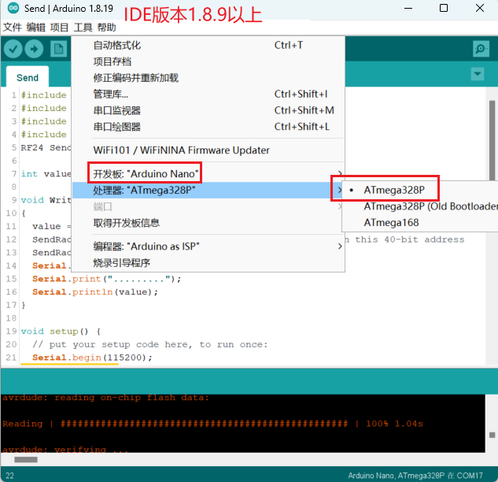
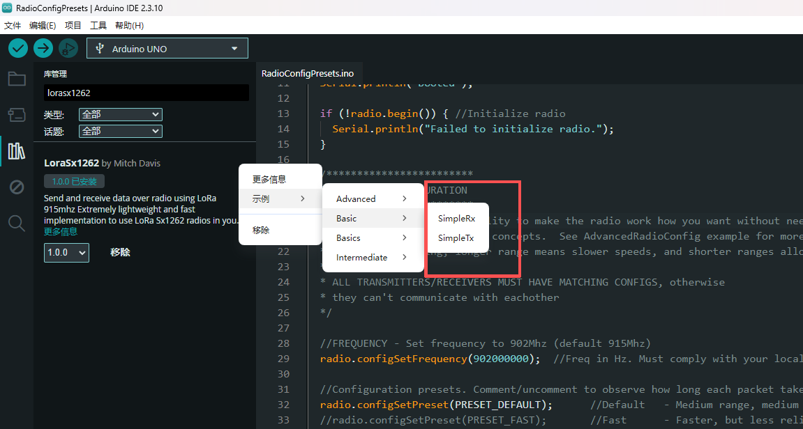
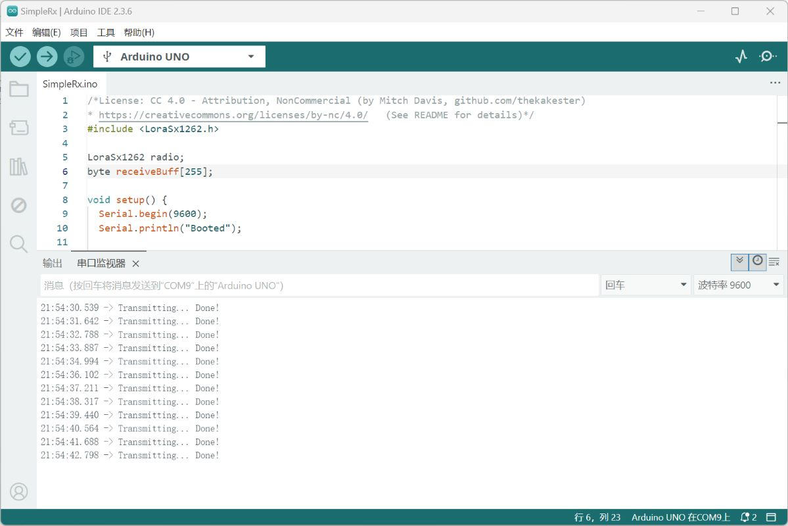
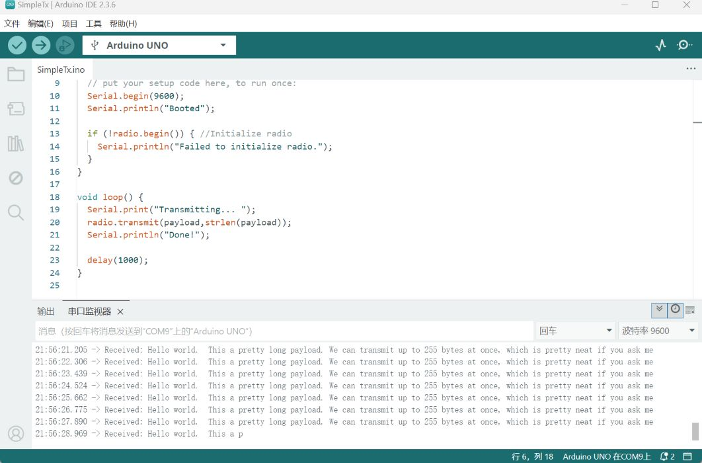

# lora-nano

## 简介

lora-nano是emakefun公司基于官方标准[Arduino Nano V3.0](https://store.arduino.cc/products/arduino-nano)主板集成Semtech公司推出的远距离低功SX1262无线芯片而开发一款915MHz频段的无线开发板 。它的引脚完全兼容标准nano V3.0开发板，软件直接兼容[Arduino lora sx1262库](https://github.com/thekakester/Arduino-LoRa-Sx1262)，该板卡兼顾了Arduino丰富的开发生态与SX1262卓越的远距离、低功耗通信能力，板载IPEX 1代贴片天线座，使用外置天线IPEX远距离传输。可广泛于智慧农业、工业物联网、环境监测、智能家居/安防等方面。

## 主控MCU参数

- 处理器：ATmega328P-AU QFP32（7x7mm）
- 数字IO引脚：22个（其中6个用作PWM输出）
- 模拟输入引脚：8 （A0~A7）
- IO引脚直流电流：40mA
- Flash内存：32KB(其中0.5KB用于引导加载程序)
- SRAM：2KB
- EEPROM: 1KB
- 工作时钟：16 MHZ

## 无线芯片参数
- 无线型号：Semtech SX1262 QFN24（4x4mm）
- 通信方式：
- 通信接
  - 主接口：‌SPI 串行接口‌，同步全双工协议，CPOL=0/CPHA=0。
  - 最大 SPI 时钟速率：16-18MHz。
  - 控制引脚：BUSY 引脚指示芯片忙状态，DIO 引脚可配置中断映射，DIO2 可控制天线开关  DIO3 可用作 TCXO 开关。
  - 复位引脚：NRESET 拉低超过 50μs 可完成芯片复位

- 工作频率与调制方式
  - 频率范围150MHz 至 960MH连续覆盖，支持全球主要 sub-GHz ISM 频段
  - 调制方式：支持 LoRa、(G)FSK 及 Long Range FHSS 调制，LoRa 速率 0.018~62.5Kbps，(G)FSK 速率 0.6~300Kbps
  - 扩频因子：SF5~SF12 可配置
- 发射与接收性能
  - 芯片最大发射功率：+22dBm
  - 接收灵敏度低至-148dBm
  - 最大链路预算：170dB
- 功耗表现
  - 有源接收电流：‌4.2mA‌（芯片级），模块级约 5.3-11mA。
  - 发射电流：32~118mA（芯片级，随功率等级变化），模块级约 45-100mA。
  - 睡眠电流：‌0.9~2.35μA‌，支持低功耗定时唤醒。
  - 工作电压：芯片 3.3V 

## 开发板参数

- USB转串口芯片： CH340G芯片，外置晶振
- 工作电压：TypeC 5V，VIN输入电压:6V ~ 12V
- 5V引脚电流：VIN输入时800mA
- 3.3V引脚电流 :  500mA
- 总发射功率： 芯片+22dBm + 天线3.5dBi增益
- 尺寸：48x18mm 
- 重量：6g

## 引脚标注图

## 原理图

<a href="zh-cn/arduino_products/nano/lora-nano/schematic/LORA_NANO.pdf" target="_blank">点击下载原理图</a>

<a href="zh-cn/arduino_products/nano/lora-nano/datasheet/LORA_NANO-03-LORA_SX1262.pdf" target="_blank">点击下载SX1262数据手册</a>

## 机械尺寸标注

## Arduino Nano和sx1262芯片引脚连接如下

| ATmega328P | sx1262 |
| ---- | ---- |
| A0 | NRESET |
| D3 | BUSY |
| D5 | DIO1 |
| D12 | MISO |
| D13 | SCK |
| D11 | MOSI |
| D7 | NSS |

⚠️  **lora-nano上面表格中的IO口不推荐用作其他功能**

## Arduino使用示例

### 驱动安装

串口芯片使用CH340G芯片，驱动安装请参考此文档：[CH340G驱动安装](zh-cn/driver/ch340_driver/ch340_driver.md)

### LoraSx1262库安装

### lora-nano主板选择

### 关键函数说明

#### 基础函数

| 函数名 | 说明 |
| ------------------------------------------------------------ | ------------------------------- |
| bool begin() | 初始化无线模块 |
| void transmit(byte* data, int dataLen) | 向指定通道发送数据 |
| int lora_receive_async(byte* buff, int buffMaxLen) | 异步接收数据包 |
| int lora_receive_blocking(byte* buff, int buffMaxLen, uint32_t timeout) | 阻塞接收数据包 |

####  配置函数

| 函数名 | 说明 |
| ------------------------------------------------------------ | ------------------------------------------------------------ |
| bool configSetPreset(int preset) | 配置预设 |
| bool configSetFrequency(long frequencyInHz) | 设置通信频率，默认为915MHZ |
| bool configSetBandwidth(int bandwidth) | 设置通信宽带 |
| bool configSetCodingRate(int codingRate) | 设置编码速率 |
| bool configSetSpreadingFactor(int spreadingFactor) | 设置扩频因子 |

####  sx1262芯片无线通信注意点

**通信频道**

 902-928MHz（中心915MHz）是国际电联第二区（美国、加拿大、 澳大利亚 等）指定的ISM频段，**中国属第三区，‌未在100MHz-1GHz范围指定用于ISM应用的频段**‌。 

SX1262在该频段下的核心物理层特征是线性调频扩频（LoRa CSS）调制，其信道带宽并非像FSK那样固定间隔对齐，而是支持多种带宽配置（常用125kHz、250kHz、500kHz），带宽越宽则单次承载的数据传输速率越高、空中传输时间越短，但抗干扰性能和接收灵敏度会对应降低。

在配置时，收发双方的载波中心频率、信道带宽（Bandwidth）以及扩频因子（SF）必须完全一致才能建立通信。如果中心频率有漂移或带宽配置不匹配（例如一端使用125kHz而另一端使用250kHz），通信会直接失败。

**接收及发射**

SX1262采用半双工射频收发架构，同一时刻只能处于纯发送（TX）、纯接收（RX）或待机监听状态。在多对一或复杂组网场景中，SX1262内置了信道活动检测（CAD，Channel Activity Detection）模式，能在发送前或休眠定时唤醒时快速扫描信道是否有LoRa前导码存在。

当信道繁忙时，CAD模式可以避免盲目发送撞包；检测完成后再切回RX模式监听有效数据。此外，在实际接收中断处理中，接收端需要预留足够的处理余量，在DIO引脚触发数据就绪中断后及时读取芯片内部的FIFO缓存，避免因为读取延迟导致缓冲区满溢而截断后续数据帧

#### 点对点收发测试

如图所示，可直接从库中获取对应简易发送和接收代码

**点对点收发测试结果如下：**

**发送:**

**接收：**

**注 ：Arduino IDE串口请设置波特率为9600，和代码中保持一致**