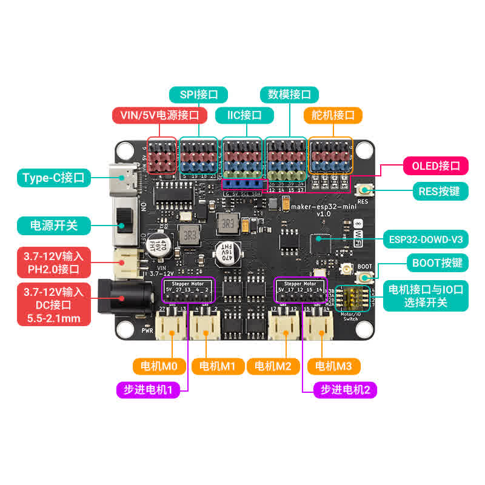
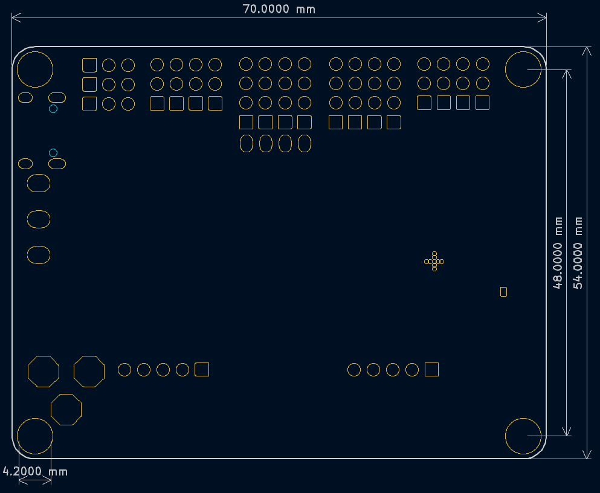

# Maker-ESP32-Mini 使用说明书

## 产品图

## 产品简介

Maker-ESP32-Mini是基于乐鑫科技的 <a href="https://documentation.espressif.com/esp32_datasheet_cn.pdf">ESP32-DOWD-V3</a> 芯片基础上开发的一款适用于创客教育的标志性产品，板载4MB Flash，集成2.4 GHz、Wi-Fi 和蓝牙双模的单芯片方案。板载四路直流电机驱动芯片，电机输出端分别采用 PH2.0 卧式贴片插座与2.54mm 标准排针双接口设计，可直接驱动TT直流电机、乐高积木电机等各类通用马达；预留4路独立舵机接口，单路舵机输出峰值电流可达1A。相较前代Maker-ESP32开发板实现全方位升级：将IO0也就是BOOT引脚单独引出到轻触开关；整板带外壳尺寸压缩至`56×72mm`，完美适配`7×9`规格乐高积木网格，可直接拼装固定。供电方案同步升级，新增PH2.0电源输入接口，搭载专用升降压电源管理芯片；日常轻载场景（无需驱动大功率电机、大电流舵机）下，单节`3.7V`锂电池或标准电池包即可稳定供电。

## ESP32-D0WD-V3芯片参数

- 芯片：ESP32-D0WD-V3（双核 Xtensa® LX6，ECO V3 版本）
- 处理器：双核，最高 240 MHz，600 DMIPS
- 芯片存储: 448 KB ROM / 520 KB SRAM / 16 KB RTC SRAM
- 无线：Wi-Fi 802.11 b/g/n 2.4 GHz + Bluetooth 4.2 (BR/EDR + BLE)
- PWM: 16 通道 LEDC
- 工作电压: 3.0 – 3.6 V（推荐 3.3 V）
- 封装尺寸: QFN 5×5 mm，48 pin，0.4 mm 间距
- 温度：-40 ℃ ~ +85 ℃

!> 注：使用WIFI时，请一定使用2.4G频段的WIFI

## 产品参数

* 板载天线和IPEX天线座
- 接口
   - 电机： 4个, 电流最大达到4A(支持TT直流电机、乐高积木电机等各类通用马达)
   - 步进电机：2个
   - 舵机：4个
   - I2C：5个
   - SPI: 1个
   - IO: 8个
   - 天线：IPEX1代天线接口
   - VIN插针接口：3个
   - 5V插针接口：3个
   - PH2.0供电接口: 1个
- Flash: 4 MB
- 晶振: 40 MHz 主晶振
- 驱动芯片：CH340G
- 上传接口：Type C
- DC头(5.5-2.1mm)输入电压： 3.7-12V
- 5V接口最大输出电流：3A
- 电机接口最大输出电流：4A
- 产品尺寸：70mm×54mm；PCB厚度：1.6mm；净重：26g
- M4定位孔直径：4.6mm，兼容乐高
- 软件支持Arduino IDE、Mixly、Micropython、Mind+
- 对比MAKER-ESP32，在不需要大电流时，可由3.7V电池包直接供电即可带动系统运行

> **⚠️ 重要**：若需要满载时，务必保证供电电流大于等于4A,且输入电源电压不低于7.4V，否则可能会出现主控复位现象！

## 引脚说明

| 功能 | 引脚 |
| -------- | ---------- |
| 电机M0       | 27，13   |
| 电机M1       | 4，2   |
| 电机M2       | 17，12        |
| 电机M3       | 14，15    |
| 舵机       | 25，26，32，33    |
| 步进电机1       | 27，13，4，2   |
| 步进电机2       | 17，12，15，14   |
| I2C       | SDA:21, SCL: 22   |
| SPI       | 5, 18, 19, 23    |
| IO       | 12、14、15、17、34、35、36、39     |
| BOOT按键  |    0             |

> ⚠️ **注意**  
> 1. Motor and IO Switch: 当拨码开关打到IO口端时，M2、M3电机端口不工作，不能驱动电机，引脚为普通端口；当拨码开关打到M3A/M3B/M4A/M4B时，M2、M3为电机端口，可以驱动电机。 
> 2. 因为ESP32芯片特性，在Arduino框架下，主板的34、35、36、39引脚不能作为输出；并且34、35、36、39引脚做为输入时，不能设置上拉或下拉模式。 
> 3. 在同时使用电机和舵机时，请保持PWM通道不要冲突。 

<a href="zh-cn\esp32\maker-esp32-mini\maker-esp32-mini_sch.pdf" target="_blank">点击查看Maker-ESP32-Mini原理图</a> 
<a href="zh-cn/esp32/maker_esp32_pro/maker-esp32-mini_3D.zip" target="_blank">点击下载Maker-ESP32-Mini三维模型图</a>

## 板载陶瓷天线和IPEX天线切换

如图所示，该电感朝1方向贴时为板载天线工作，朝2方向贴时为IPEX天线座子工作

## Maker-ESP32-Mini驱动安装

驱动安装请参考此文档：[CH340G驱动安装](zh-cn/driver/ch340_driver/ch340_driver.md)

## Maker-ESP32-Mini上传程序方法

各平台程序上传方法请参考：[ESP32系列上传程序方法](zh-cn/esp32/esp32_software_instructions/esp32_software_instructions.md)

**注意**：使用Arduino IDE开发时，请将esp32更新至最新版本。

## 示例程序

参考Maker-ESP32[点击此处跳转](https://docs.emakefun.com/#/zh-cn/esp32/maker_esp32/maker_esp32)

## 机械尺寸图

## FAQ

**Q**: Mixly下载程序不成功？

**A**：1.Mixly的安装路径不要包含中文、空格等特殊字符；放在电脑的根目录下，层级目录不要太深；比如 D:\mixly2.0-win32-x64就是根目录安装；  

2.查看串口是否选择正确，如果没有串口，请先安装CH340G驱动；串口不要被其他应用占用；

3.检查程序是否有错误；

**Q**: 电机程序上传成功，但是电机不转？

**A**: 1.电机需要DC头供电，3.7-12V，建议使用两节3.7V锂电池，电源开关是否打到ON；

2.第一步已经完成的话，还出现问题，请检查Motor and IO Switch开关是否拨到电机方向(即 标有ON的方向)；

3.检测程序设置的电机引脚是否和电机实际引脚一一对应；

## 参考链接

[ESP32 技术规格书](https://documentation.espressif.com/esp32_datasheet_cn.pdf) 
[快速入门 - ESP32 - — ESP-IDF 编程指南 latest 文档](https://docs.espressif.com/projects/esp-idf/zh_CN/latest/esp32/get-started/index.html) 
[适用于 VS Code 的 ESP-IDF 扩展 - - — ESP-IDF Extension for VSCode latest 文档](https://docs.espressif.com/projects/vscode-esp-idf-extension/zh_CN/latest/index.html#) 
[Getting Started - - — Arduino ESP32 latest documentation](https://docs.espressif.com/projects/arduino-esp32/en/latest/getting_started.html)
