# MAKER-ESP32-PRO 使用说明书

## 产品实物图

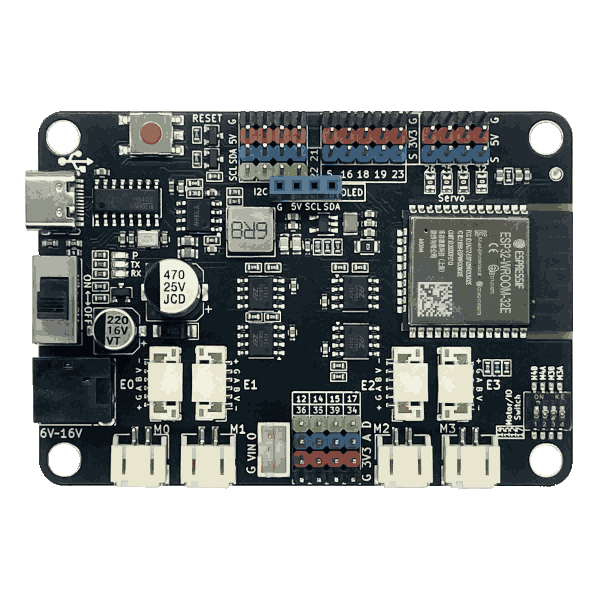

## 概述

   MAKER-ESP32-PRO是基于乐鑫科技的 <a href="https://www.espressif.com/sites/default/files/documentation/esp32-wroom-32_datasheet_cn.pdf" target="_blank">ESP32-WROOM-32E</a> 模组基础上开发的一款适用于创客教育的标志性产品，Flash大小4MB，集成 2.4 GHz、Wi-Fi 和蓝牙双模的单芯片方案。板载4路编码电机和直流电机，最大驱动电流3A，编码电机和直流电机复用驱动引脚，即同一个端口，不能同时驱动编码电机和直流电机。

## ESP32-WROOM-32E模组参数
- 模组芯片：ESP32-D0WD-V3（双核 Xtensa® LX6，ECO V3 版本）
- 处理器：双核，最高 240 MHz，600 DMIPS
- 芯片存储: 448 KB ROM / 520 KB SRAM / 16 KB RTC SRAM
- 模组Flash: 4 MB SPI Flash
- 晶振: 40 MHz 主晶振
- 无线：Wi-Fi 802.11 b/g/n 2.4 GHz + Bluetooth 4.2 (BR/EDR + BLE)
- GPIO: 25 个可用（GPIO6–11 保留给 Flash）
- PWM: 16 通道 LEDC
- 工作电压: 3.0 – 3.6 V（推荐 3.3 V）
- 封装尺寸: 25.5 × 18.0 × 3.1 mm，38 引脚，引脚间距 1.27 mm
- 温度：-40 ℃ ~ +85 ℃
- 天线：板载 PCB 天线，增益约 2 dBi

!> 注：使用WIFI时，请一定使用2.4G频段的WIFI

## 产品参数
- 接口
   - 电机： 4个, 电流最大达到3.5A
   - 编码电机：4个
   - 舵机：4个
   - I2C：5个
   - SPI: 1个
   - IO: 8个
- 驱动芯片：CH340G
- 上传接口：Type C
- DC头(5.5-2.1mm)输入电压： 6-16V
- 产品尺寸：80 × 57mm；PCB厚度：1.6mm；净重：40g
- M4定位孔直径：4.6mm，兼容乐高
- 软件支持Arduino IDE、Mixly、Micropython、Mind+

## 引脚说明

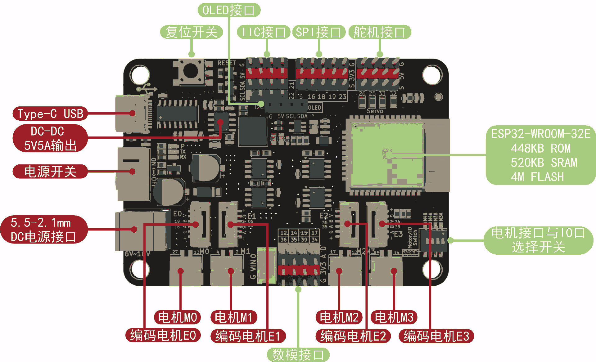

| 功能 | 引脚 |
| -------- | ---------- |
| 电机M1       | 27，13   |
| 电机M2       | 4，2   |
| 电机M3       | 17，12        |
| 电机M4       | 14，15    |
| 舵机       | 25，26，32，33    |
| 编码电机E0       | 27(-)，13(+)，18(A)，19(B)   |
| 编码电机E1       | 4(-)，2(+)，5(A)，23(B)   |
| 编码电机E2       | 17(-)，12(+)，35(A)，36(B)   |
| 编码电机E3       | 15(-)，14(+)，34(A)，39(B)   |
| I2C       | SDA: 21, SCL: 22   |
| SPI       | 5, 18, 19, 23    |
| IO       | 12、14、15、17、34、35、36、39     |

> ⚠️ **注意**  
> 1. Motor and IO Switch: 当拨码开关打到IO口端时，M2、M3电机端口不工作，不能驱动电机，引脚为普通端口；当拨码开关打到M3A/M3B/M4A/M4B时，M2、M3为电机端口，可以驱动电机。 
> 2. 因为ESP32芯片特性，在Arduino框架下，主板的34、35、36、39引脚不能作为输出；并且34、35、36、39引脚做为输入时，不能设置上拉或下拉模式。 
> 3. 在同时使用电机和舵机时，请保持PWM通道不要冲突。 

<a href="zh-cn/esp32/maker_esp32_pro/maker-esp32_pro_sch.pdf" target="_blank">点击查看Maker-ESP32-Pro原理图</a> 
<a href="zh-cn/esp32/maker_esp32_pro/maker-esp32-pro_3D.zip" target="_blank">点击下载Maker-ESP32-Pro三维模型图</a>

## Maker-ESP32-Pro驱动安装

驱动安装请参考此文档：[CH340G驱动安装](zh-cn/driver/ch340_driver/ch340_driver.md)

## Maker-ESP32-Pro Arduino，mixly，mind+使用方法

各平台程序使用方法请参考：[ESP32系列上传程序方法](zh-cn/esp32/esp32_software_instructions/esp32_software_instructions.md)

**注意**：使用Arduino IDE开发时，请将esp32更新至最新版本。

## Mixly示例程序

Mixly云端导入易创空间Maker-ESP32-Pro库和PS3蓝牙手柄库，如下图
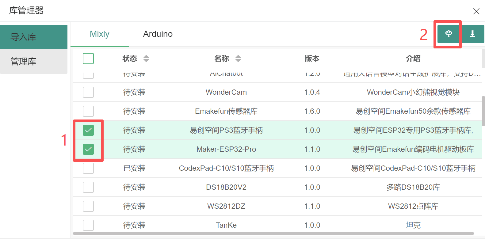

或者
<a href="https://gitee.com/emakefun_mixly_lib/maker_esp32_pro/releases/download/V1.0.0/maker-esp32-pro-mixly.zip" download>点击下载编码电机Mixly库</a>   <a href="https://gitee.com/emakefun_mixly_lib/ps3-bluetooth-handle/releases/download/V1.0.0/ps3-bluetooth-handle.zip" download>点击下载PS3蓝牙手柄Mixly库</a>再本地导入库，如下图 
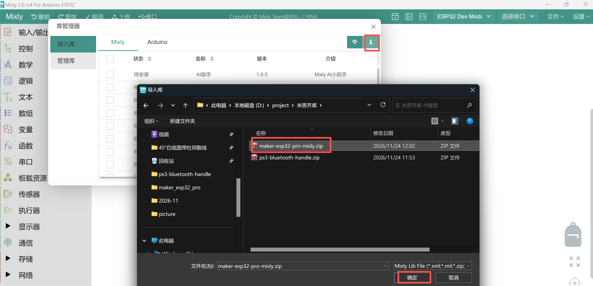

米思齐示例如下，点击对应的案例就可以看到示例程序。

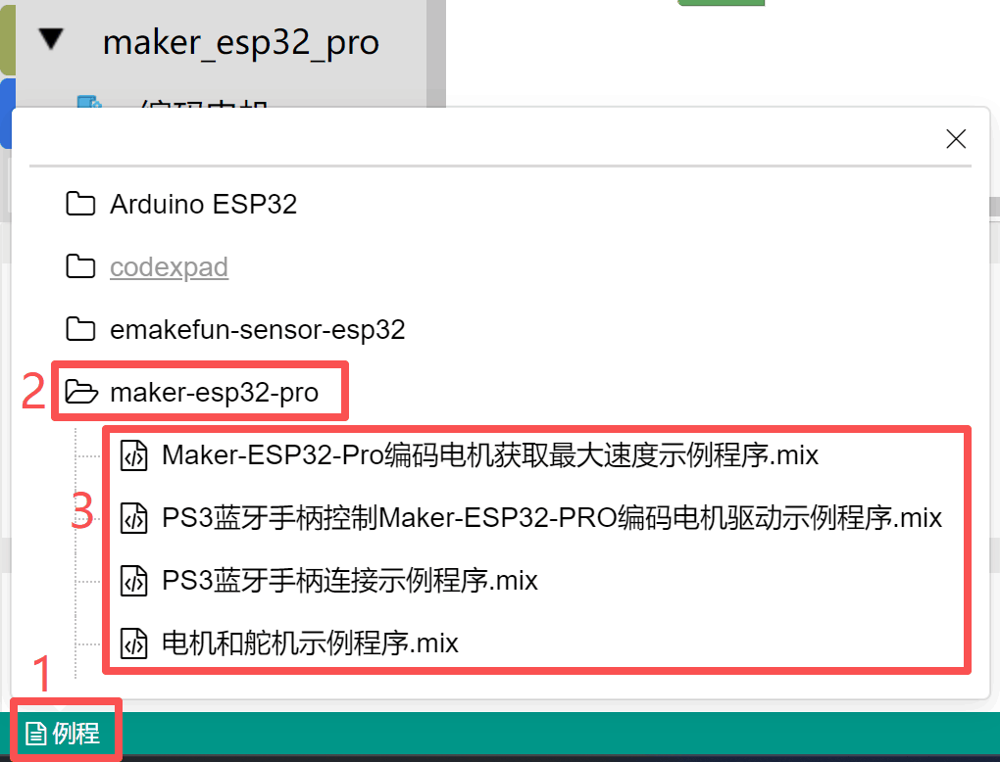

## Mind+示例程序

<a href="zh-cn/esp32/maker_esp32_pro/esp32_mindplus/esp32MindplusMotor.zip" download>点击下载电机示例程序</a> 
<a href="zh-cn/esp32/maker_esp32_pro/esp32_mindplus/emakefun-em_maker_esp32-thirdex-V0.0.2.mpext" download>点击下载Maker-ESP32-Pro Mind+库文件</a>

## Arduino示例程序

<a href="zh-cn/esp32/maker_esp32_pro/esp32_arduino/servoTest.zip" download>点击下载舵机示例程序</a> 
<a href="zh-cn/esp32/maker_esp32_pro/esp32_arduino/oledTest.zip" download>点击下载OLED示例程序</a>

### 驱动编码电机与直流电机

[点击查看编码电机以及直流电机库和示例程序](https://emakefun-arduino-library.github.io/em_esp32_encoder_motor/html/zh-CN/index.html) 
点击上述链接此处即可下载库文件

#### 驱动电机示例文件以及常用函数说明

##### 示例文件说明( [Emakefun Encoder Motor: 示例文件](https://emakefun-arduino-library.github.io/em_esp32_encoder_motor/html/zh-CN/examples.html) )

详情可查看上述链接的如下位置：

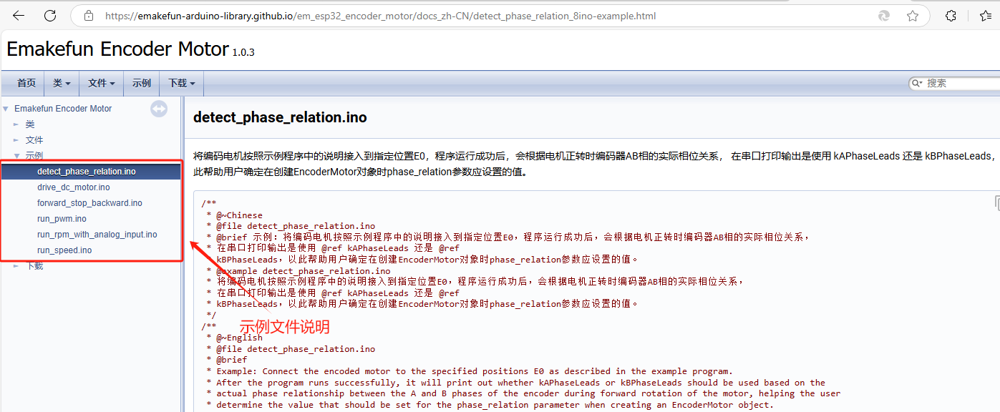

##### 常用函数说明( [Emakefun Encoder Motor: 类成员 - 函数](https://emakefun-arduino-library.github.io/em_esp32_encoder_motor/html/zh-CN/classem_1_1_encoder_motor.html#a69db8b9fc364d4d8f2509473d759ed0f) )

更多函数可以参考上方链接的如下位置：

#### 使用Arduino IDE调试编码电机

##### 接线说明

将编码电机的信号线连接到电机驱动板的对应引脚，并外接DC电源，通过typeC接口连接电脑。如下图所示：

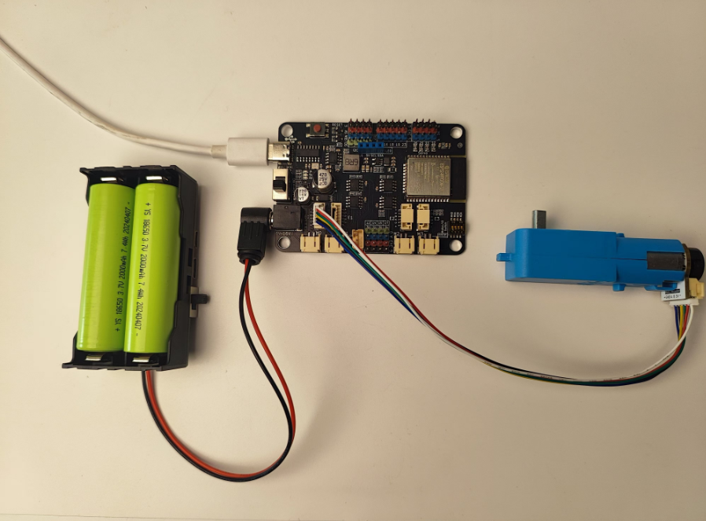

##### 添加库文件

打开Arduino IDE，点击项目->导入库->添加.ZIP库，选择下载好的库文件，点击打开，然后点击确定。

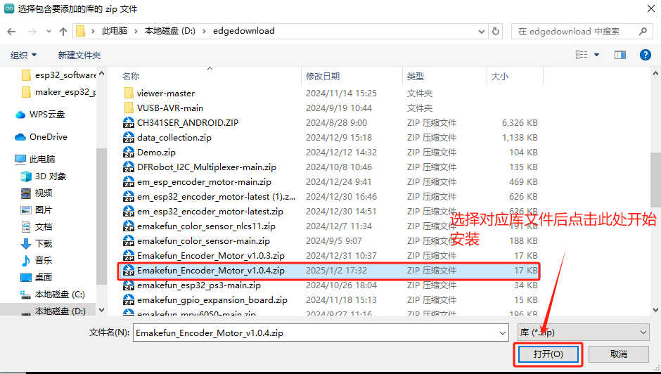

等待库文件安装完即可。

选择主板型号，比如我的是ESP32 Dev Module，然后点击确定。

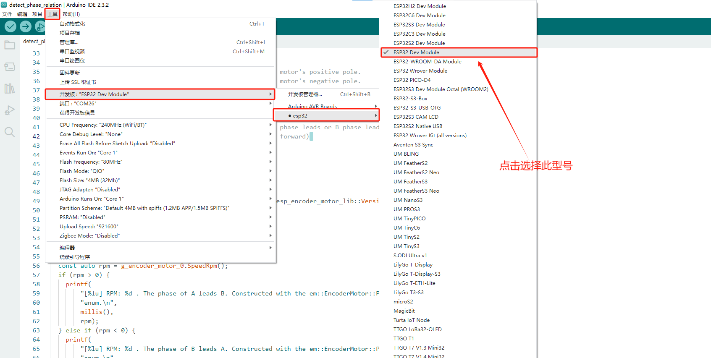

#### 打开示例程序

打开Arduino IDE，点击文件->示例->Emakefun Encoder Motor->detect_phase_relation，然后点击打开。

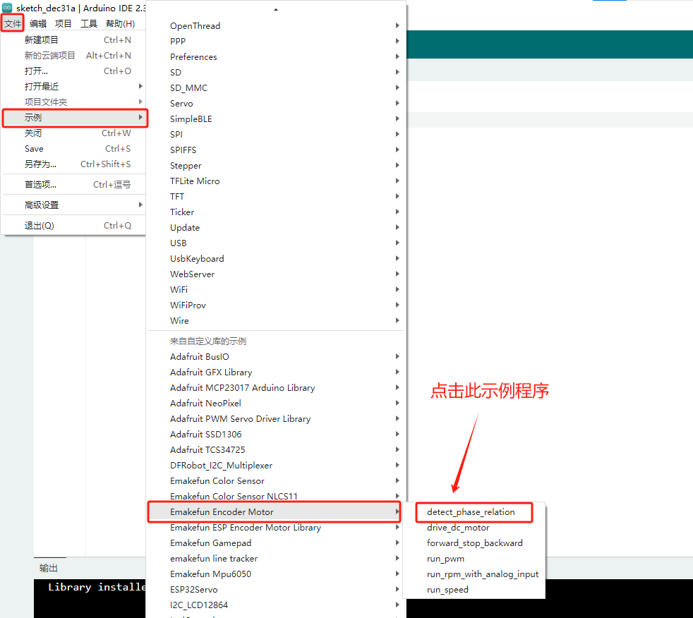

选择COM口，然后点击上传。

打开电源开关。

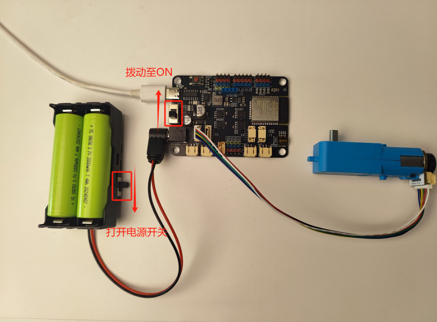

打开串口监视器。

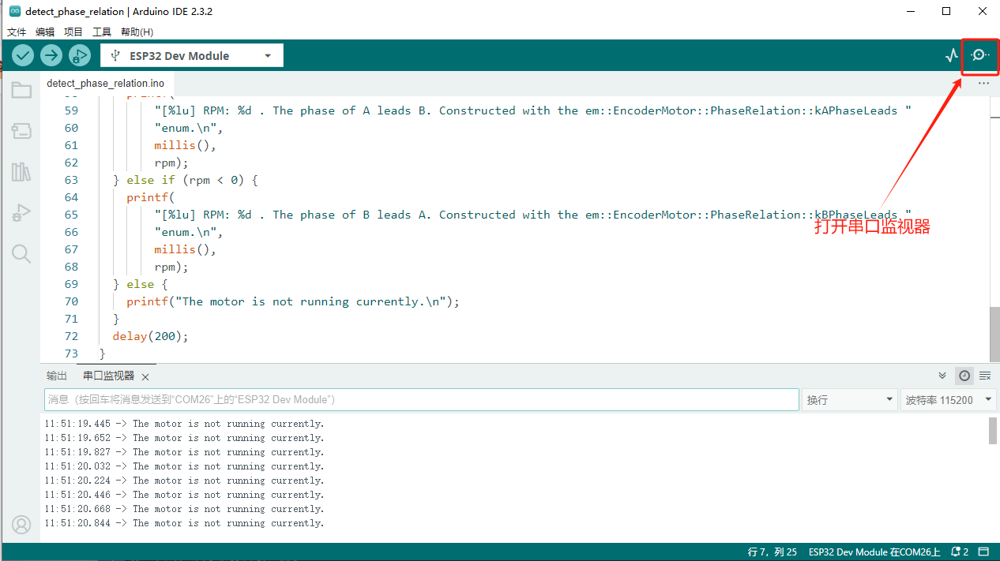

我们发现电机开始转动，串口监视器中的RPM为负值。而我们设置的PWM为正值，所以我们应该将构造函数中的phase_relation参数应设置为em::EncoderMotor::kBPhaseLeads。

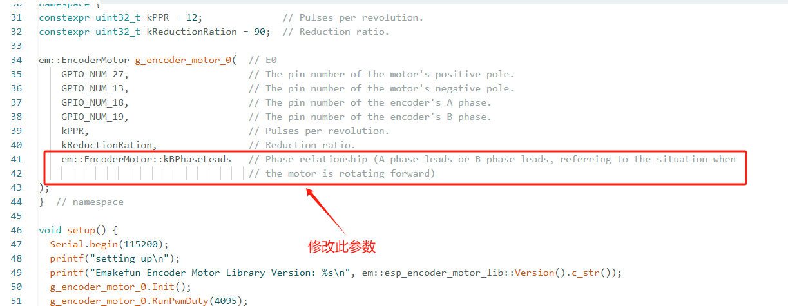

修改参数后，我们在上传程序，后发现电机开始转动，串口监视器中的RPM为正值。

至此，我们这个示例函数的任务就结束啦。以后我们使用这个编码电机构造函数时，用现在这个参数就可以了。例如下个程序：
.
打开示例程序run_speed。

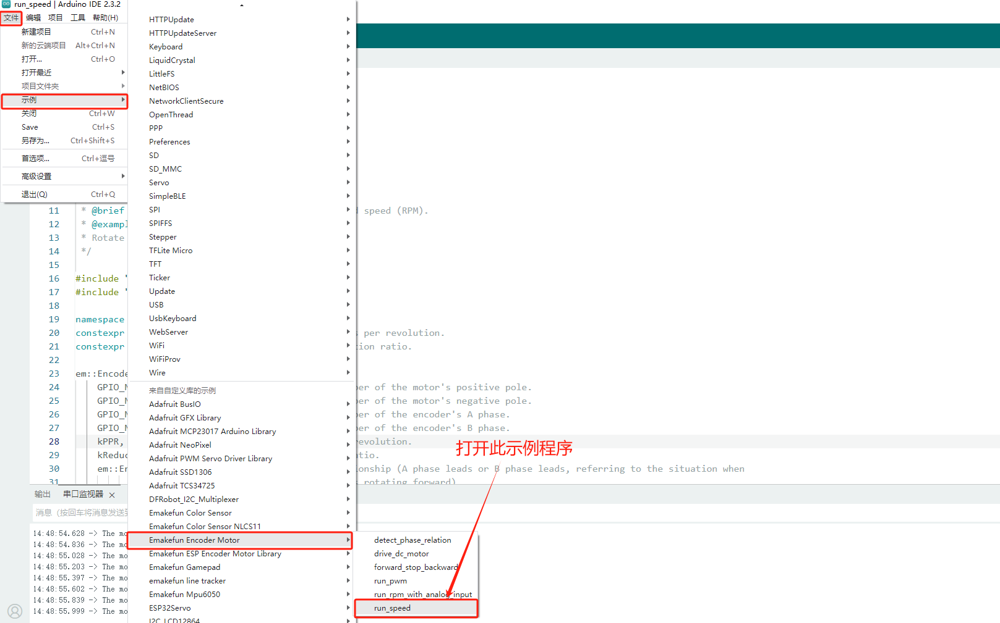

我们用一个编码电机E0并以上面的示例参数为例，我们应该将构造函数中的phase_relation参数设置为em::EncoderMotor::kBPhaseLeads。

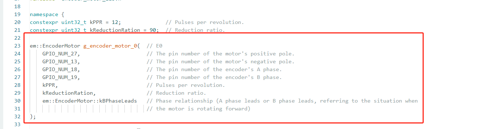

修改参数后，我们在上传程序。后发现我们RPM的输出和我们设置的RPM值基本一致。

我们在将目标速度设置为-20，看看效果。

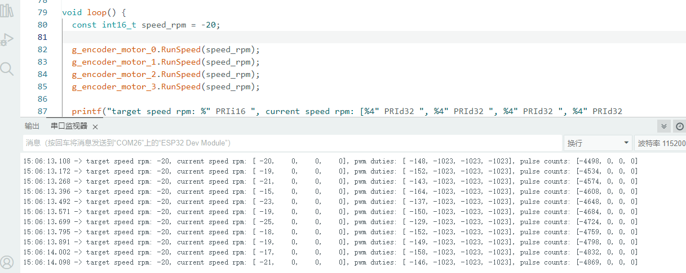

观察到与我们设置的RPM值基本一致，电机方向也正确。

至此我们编码电机已经调试结束。若发现与我们的预期不符，请再次检查电机连接是否正确，电机驱动板是否有问题，以及电机是否有问题。

### 使用CodexPad-S10手柄控制外设

演示如何使用CodexPad-S10手柄进行控制直流电机、编码电机、舵机等外设，您可以点此链接查看详细说明：[点击查看详细说明](https://gitee.com/nulllab_1/docs_examples_gamepad_peripheral_control/blob/main/examples_description_maker_esp32_pro_base.zh-CN.md#codexpad-s10手柄控制示例maker-esp32-pro开发板基础示例说明)。

## ESP32系列连接使用PS3蓝牙无线手柄

[点击查看Maker-ESP32-Pro与PS3手柄的连接使用说明](zh-cn/peripheral/bluetooth_gamepad_ps3/bluetooth_gamepad_ps3.md)

## FAQ

**Q**: Mixly下载程序不成功？

**A**：

1. Mixly的安装路径不要包含中文、空格等特殊字符；放在电脑的根目录下，层级目录不要太深；比如                          D:\mixly2.0-win32-x64就是根目录安装；  

2. 查看串口是否选择正确，如果没有串口，请先安装CH340G驱动；串口不要被其他应用占用；

3. 检查程序是否有错误；

**Q**: 电机程序上传成功，但是电机不转？

**A**:

1. 电机需要DC头供电，6-16V，建议使用两节3.7V锂电池，电源开关是否打到ON；

2. 第一步已经完成的话，还出现问题，请检查Motor and IO Switch开关是否拨到电机方向(即标有M2A、M2B、M3A、M3B的方向)；

3. 检测程序设置的电机引脚是否和电机实际引脚一一对应；
