# MAKER-ESP32-PRO 使用说明书

## 1. 模块实物图


## 2. 概述

   MAKER-ESP32-PRO是基于乐鑫科技的 <a href="https://www.espressif.com/sites/default/files/documentation/esp32-wroom-32_datasheet_cn.pdf" target="_blank">ESP32-WROOM-32</a> 模组基础上开发的一款适用于创客教育的标志性产品，Flash大小4MB，集成 2.4 GHz、Wi-Fi 和蓝牙双模的单芯片方案。板载4路编码电机和直流电机，最大驱动电流3A，编码电机和直流电机复用驱动引脚，即同一个端口，不能同时驱动编码电机和直流电机。

## 3. ESP32模组参数

* 448 KB ROM,520 KB SRAM,16 KB RTC SRAM
* QSPI 支持多个 flash/SRAM
* 内置 8 MHz 振荡器
* 支持自校准
* 内置 RC 振荡器，支持自校准
* 支持外置 2 MHz 至 60 MHz 的主晶振（如果使用 Wi-Fi/蓝牙功能，则目前仅支持 40 MHz 晶振）
* 支持外置 32 kHz 晶振，用于 RTC，支持自校准
* 2 个定时器群组，每组包括 2 个 64-bit 通用定时器和 1 个主系统看门狗
* 1 个 RTC 定时器
* RTC 看门狗
* 34 个 GPIO 口 • 12-bit SAR ADC，多达 18 个通道
* 带有专用 DMA 的以太网 MAC 接口，支持 IEEE 1588
* 双线汽车接口（TWAI®，兼容 ISO11898-1） • IR (TX/RX)

## 4. 原理图

<a href="zh-cn/esp32/maker_esp32_pro/maker-esp32_pro.pdf" target="_blank">点击查看原理图</a>

## 5. 产品参数

* 4个编码电机端口（E0、E1、E2、E3）；4个直流电机端口（M0、M1、M2、M3）端口与编码电机复用；电流最大达到3A
* 其中E0(A:18 B:19 +:27 -:13)，E1(A:5 B:23 +:4 -:2)，E2(A:35 B:36 +:17 -:12)，E3(A:34 B:39 +:15 -:14)
* 5个I2C插针接口,1个SPI插针接口
* 4个舵机接口（25、26、32、33）
* 13个IO引脚(5、12、14、15、16、17、18、19、23、34、35、36、39)
* 输入电压： 6-16V
* 产品尺寸：80mm×57mm；PCB厚度：1.6mm；净重：35g
* M4定位孔直径：4.6mm，兼容乐高
* 软件支持Mixly、Arduino IDE、MicroPython

## 6. 引脚说明

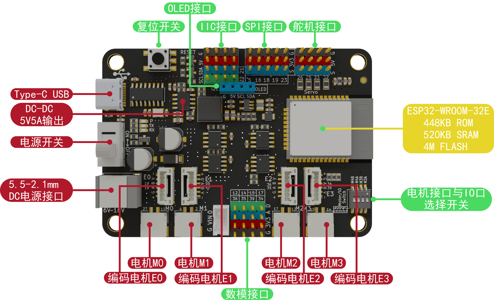

## 7. MAKER-ESP32-PRO驱动安装

驱动安装请参考此文档：[CH340G驱动安装](zh-cn/driver/ch340_driver/ch340_driver.md)

## 8. MAKER-ESP32-PRO Arduino，mixly，mind+使用方法

各平台程序使用方法请参考：[ESP32系列上传程序方法](zh-cn/esp32/esp32_software_instructions/esp32_software_instructions.md)

**注意**：使用Arduino IDE开发时，请将esp32更新至最新版本。

### 8.1 Mixly示例程序

<a href="zh-cn/esp32/maker_esp32_pro/maker-esp32-pro-mixly.zip" download>点击下载编码电机库</a>

<a href="zh-cn/esp32/maker_esp32_pro/esp32_mixly/esp32_motor_servo_test.zip" download>点击下载电机舵机示例程序</a>

<a href="zh-cn/esp32/maker_esp32_pro/esp32_mixly/esp32_servo_test.zip" download>点击下载舵机示例程序</a>

<a href="zh-cn/esp32/maker_esp32_pro/esp32_mixly/esp32_oled_test.zip" download>点击下载OLED示例程序</a>

<a href="zh-cn/esp32/maker_esp32_pro/esp32_mixly/esp32_encoder_motor_test.zip" download>点击下载编码电机示例程序</a>

### 8.2 Mind+示例程序

<a href="zh-cn/esp32/maker_esp32_pro/esp32_mindplus/esp32MindplusMotor.zip" download>点击下载电机示例程序</a>

<a href="zh-cn/esp32/maker_esp32_pro/esp32_mindplus/emakefun-em_maker_esp32-thirdex-V0.0.2.mpext" download>点击下载Maker-ESP32-Pro Mind+库文件</a>

### 8.3 Arduino示例程序

<a href="zh-cn/esp32/maker_esp32_pro/esp32_arduino/servoTest.zip" download>点击下载舵机示例程序</a>

<a href="zh-cn/esp32/maker_esp32_pro/esp32_arduino/oledTest.zip" download>点击下载OLED示例程序</a>

#### 8.3.1 驱动编码电机与直流电机

[点击查看编码电机以及直流电机库和示例程序](https://emakefun-arduino-library.github.io/em_esp32_encoder_motor/html/zh-CN/index.html)

点击上述链接此处即可下载库文件

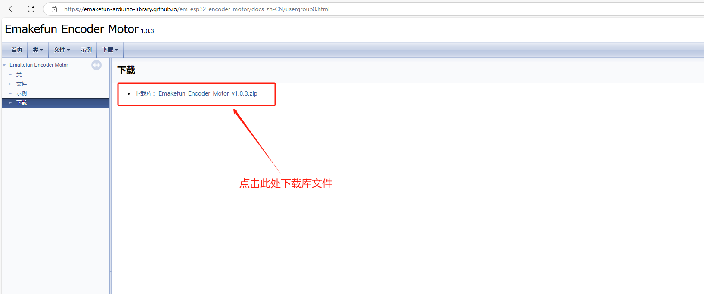

##### 8.3.1.1 驱动电机示例文件以及常用函数说明

###### 8.3.1.1.1 示例文件说明( [Emakefun Encoder Motor: 示例文件](https://emakefun-arduino-library.github.io/em_esp32_encoder_motor/html/zh-CN/examples.html) )

详情可查看上述链接的如下位置：


###### 8.3.1.1.2 常用函数说明( [Emakefun Encoder Motor: 类成员 - 函数](https://emakefun-arduino-library.github.io/em_esp32_encoder_motor/html/zh-CN/classem_1_1_encoder_motor.html#a69db8b9fc364d4d8f2509473d759ed0f) )

更多函数可以参考上方链接的如下位置：

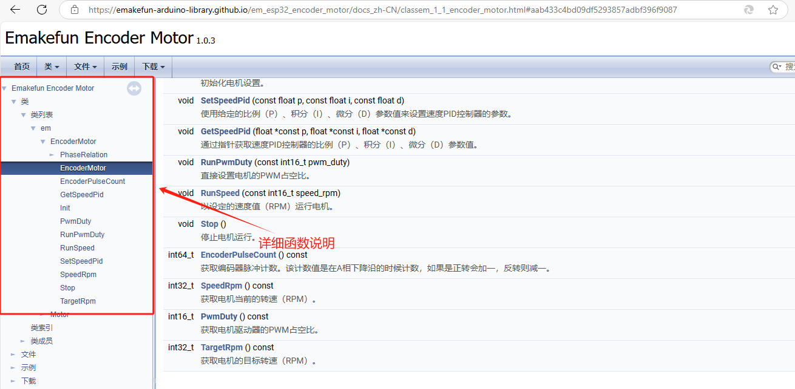

##### 8.3.1.2 使用Arduino IDE调试编码电机

###### 8.3.1.2.1 接线说明

将编码电机的信号线连接到电机驱动板的对应引脚，并外接DC电源，通过typeC接口连接电脑。如下图所示：


###### 8.3.1.2.2 添加库文件

打开Arduino IDE，点击项目->导入库->添加.ZIP库，选择下载好的库文件，点击打开，然后点击确定。

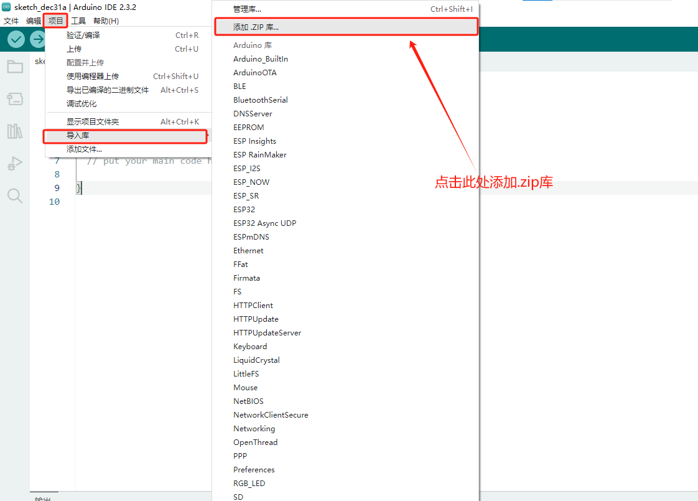


等待库文件安装完即可。

选择主板型号，比如我的是ESP32 Dev Module，然后点击确定。


##### 8.3.1.3 打开示例程序

打开Arduino IDE，点击文件->示例->Emakefun Encoder Motor->detect_phase_relation，然后点击打开。


选择COM口，然后点击上传。

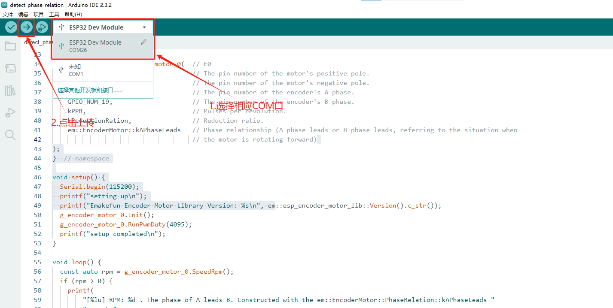

打开电源开关。


打开串口监视器。


我们发现电机开始转动，串口监视器中的RPM为负值。而我们设置的PWM为正值，所以我们应该将构造函数中的phase_relation参数应设置为em::EncoderMotor::kBPhaseLeads。

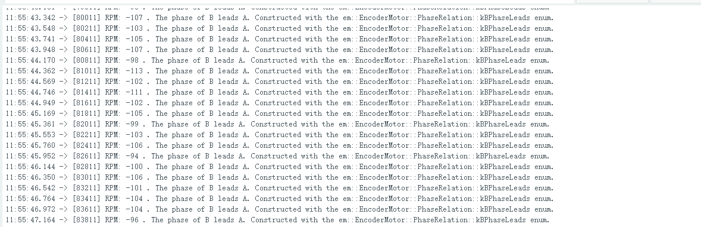


修改参数后，我们在上传程序，后发现电机开始转动，串口监视器中的RPM为正值。

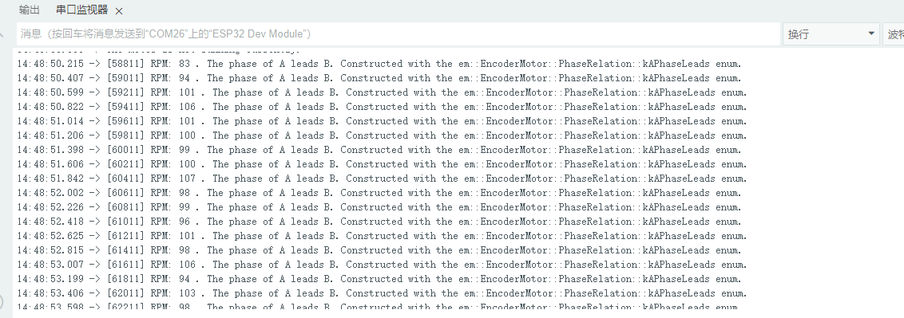

至此，我们这个示例函数的任务就结束啦。以后我们使用这个编码电机构造函数时，用现在这个参数就可以了。例如下个程序：
.
打开示例程序run_speed。


我们用一个编码电机E0并以上面的示例参数为例，我们应该将构造函数中的phase_relation参数设置为em::EncoderMotor::kBPhaseLeads。


修改参数后，我们在上传程序。后发现我们RPM的输出和我们设置的RPM值基本一致。

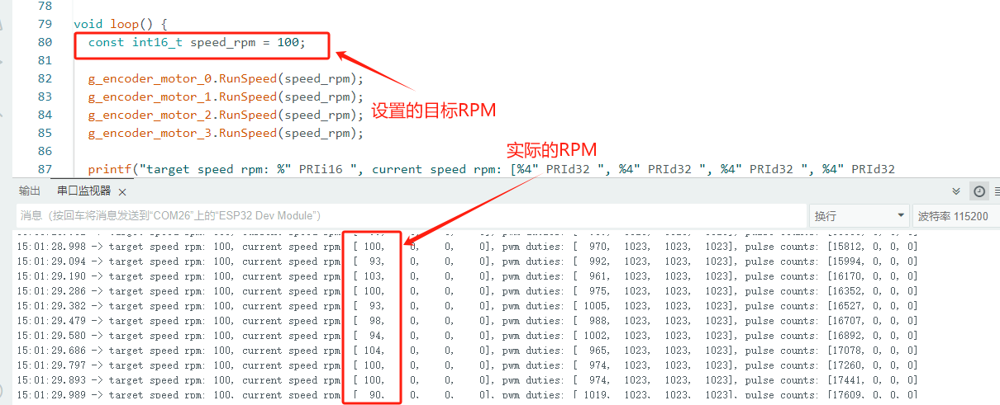

我们在将目标速度设置为-20，看看效果。


观察到与我们设置的RPM值基本一致，电机方向也正确。

至此我们编码电机已经调试结束。若发现与我们的预期不符，请再次检查电机连接是否正确，电机驱动板是否有问题，以及电机是否有问题。

#### 8.3.2 使用CodexPad-S10手柄控制外设

演示如何使用CodexPad-S10手柄进行控制直流电机、编码电机、舵机等外设，您可以点此链接查看详细说明：[点击查看详细说明](https://gitee.com/nulllab_1/docs_examples_gamepad_peripheral_control/blob/main/examples_description_maker_esp32_pro_base.zh-CN.md#codexpad-s10手柄控制示例maker-esp32-pro开发板基础示例说明)。

### 8.4 MicroPython示例程序

<a href="zh-cn/esp32/maker_esp32_pro/esp32_micropython/encoder_motor_micropython_v0.2.0.zip" download>点击下载 MicroPython 编码电机库与示例程序（v0.2.0）</a>

> 运行环境：MicroPython ≥ 1.29（ESP32 端口）  
> 配套库：`encoder_motor.py`（v0.2.0，emakefun em_esp32_encoder_motor 的 MicroPython 移植）

本节以「第一次把电机转起来」为目标，从接线走到闭环调速，每一步都给出可观察的现象。如果你只想驱动一个不带编码器的直流电机，接线见下文 8.4.3.2「直流电机（可选）」，示例可运行程序包中的 `examples/drive_dc_motor/main.py`。

Thonny 的下载安装、驱动安装与固件烧录请参考：[Thonny开发环境配置](zh-cn/software/thonny/thonny.zh-CN.md)。

#### 8.4.1 软件清单

| 软件 | 用途 |
|---|---|
| Thonny 4.x | 编辑、运行、看串口输出（推荐） |
| 或 mpremote | 命令行上传与运行 |

Thonny 首次连接需要选解释器：`运行 → 配置解释器 → MicroPython (ESP32) → 端口选 COMx → 安装官方固件`。

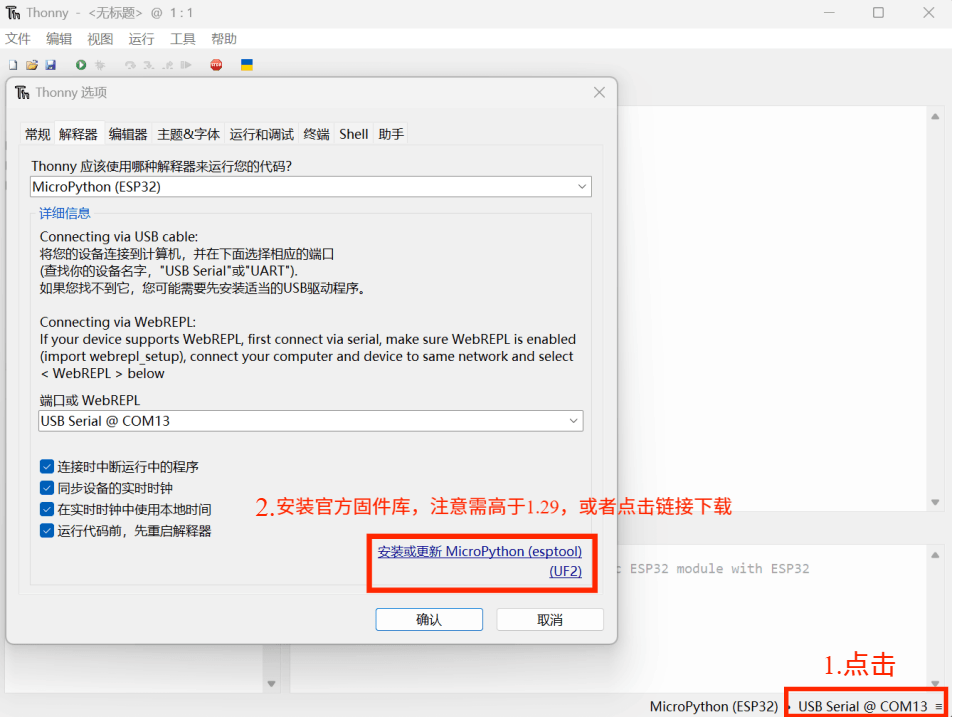

#### 8.4.2 确认固件版本

在 Thonny 的 Shell 里输入：

```python
import sys
print(sys.implementation.version)
```

输出应类似 `(1, 29, 0, '')`。

**这个版本号很关键**：`1.29` 起才有 `machine.Encoder`（PCNT 硬件正交解码）。低于 1.29 时库会自动退回软件中断解码，功能能跑，但高速下方向判断不可靠。

如果版本过低，请按 [Thonny开发环境配置](zh-cn/software/thonny/thonny.zh-CN.md) 的「烧录固件」一节重刷固件后再继续。

#### 8.4.3 接线

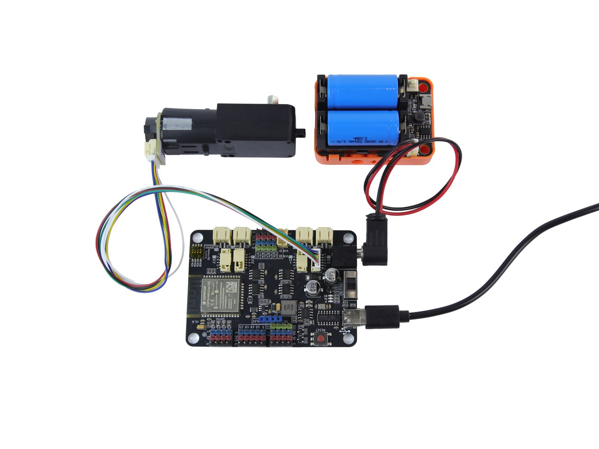

##### 8.4.3.1 编码电机

把编码电机的 **6 芯插头**插到板子上标有 `E0` 的插座：

| 板上丝印 | 引脚 | 接到 |
|---|---|---|
| `+` | GPIO27 | 电机正极 |
| `−` | GPIO13 | 电机负极 |
| `A` | GPIO18 | 编码器 A 相 |
| `B` | GPIO19 | 编码器 B 相 |

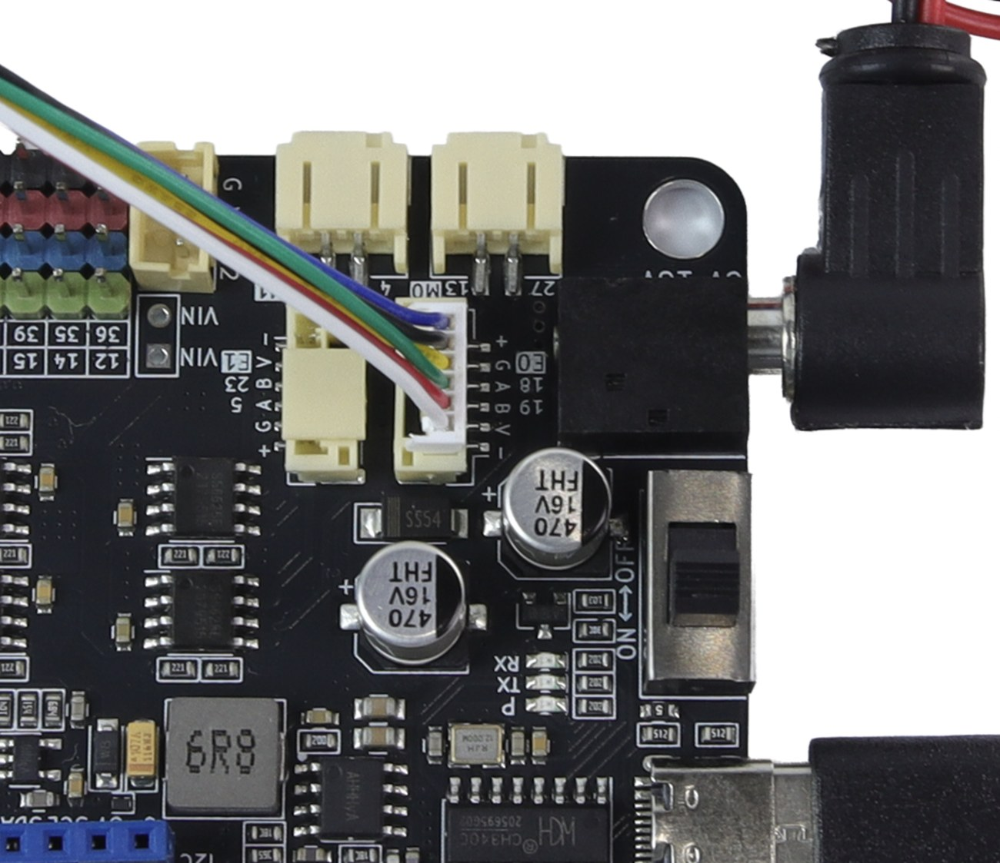

插头有防呆结构，插不进时**换个方向**，不要硬插。

##### 8.4.3.2 直流电机（可选）

不带编码器的电机插到 `M1` 的 **2 芯**插座，引脚是 GPIO4(+) / GPIO2(−)。

> `E1` 和 `M1` 是**同一路**驱动的两个插座，二选一，不能同时接。

##### 8.4.3.3 连接电脑

Type-C 线接电脑，Thonny 右下角能看到 `MicroPython (ESP32) · COMx` 即为连接成功。

#### 8.4.4 把库放到板子上

库只有**一个文件**：`encoder_motor.py`。

##### 8.4.4.1 方法一：Thonny 拖拽（推荐）

1. 打开 Thonny，选择 `视图 → 文件`，左侧出现「本机」和「MicroPython 设备」两栏；
2. 解压下载的程序包，在本机找到 `lib/encoder_motor.py`；
3. 右键 → `上传到 /`，或直接拖到右侧设备栏；
4. 设备栏出现 `encoder_motor.py` 即成功。

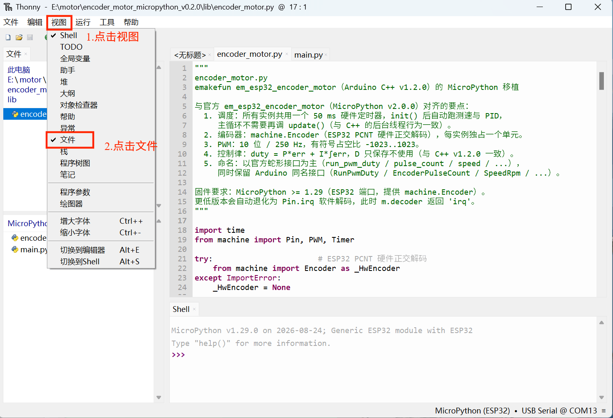

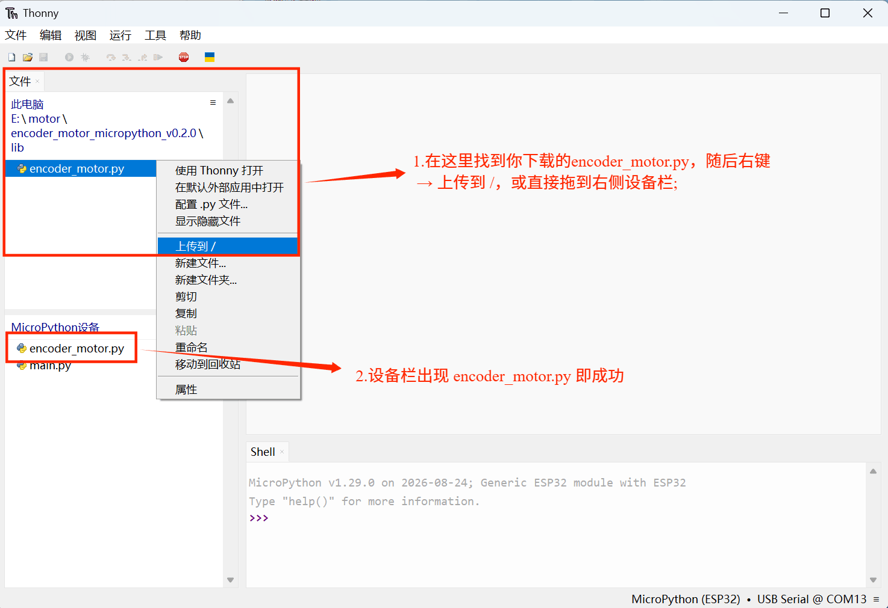

##### 8.4.4.2 方法二：mpremote

```bash
mpremote fs cp lib/encoder_motor.py :encoder_motor.py
```

##### 8.4.4.3 验证

在 Shell 里：

```python
import encoder_motor as em
print(em.__version__)
```

输出 `0.2.0` 即部署成功。

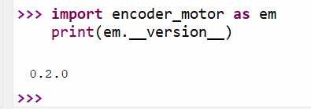

#### 8.4.5 示例一：检测相位关系

编码器的 A、B 两相谁领先谁，取决于电机型号和接线方式。**这一步不做，后面的闭环可能会飞车。**

##### 8.4.5.1 打开示例

在 Thonny 中打开 `examples/detect_phase_relation/main.py`，按 **F5** 运行。

（不用先把文件拷到板子上——Thonny 会把当前文件直接送到板子上执行，库已经在板子里。）

##### 8.4.5.2 第一次运行：看到负值

```text
example version: 1.0.0 lib version: 0.2.0
pins: POS=27 NEG=13 A=18 B=19
speed with +1023: -87 RPM, pulses: -2231
PHASE: B_PHASE_LEADS is required, switching at runtime ...
set_phase() -> True  speed now: 83 RPM (pulses keep counting, no reset)
motor shut down
```

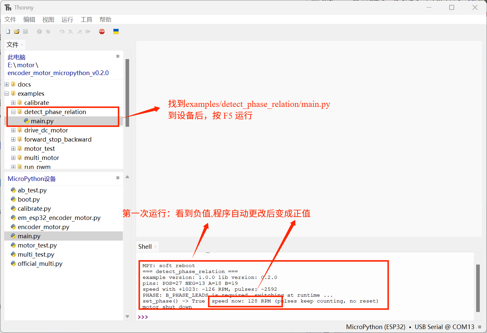

**现象解读**：我们给的是正占空比，电机在正转，但转速读数是负的——说明相位参数填反了。

##### 8.4.5.3 让参数生效

示例里已经演示了运行期切换：

```python
ok = motor.set_phase(em.PHASE_RELATION_B_PHASE_LEADS)
```

返回 `True` 表示切换成功，之后的读数立刻变正，**而且计数不会归零**。

如果要在工程代码里固定下来，直接在构造函数里写：

```python
m = em.EncoderMotor(27, 13, 18, 19, 12, 90,
                    em.PHASE_RELATION_B_PHASE_LEADS)   # ← 这一项
```

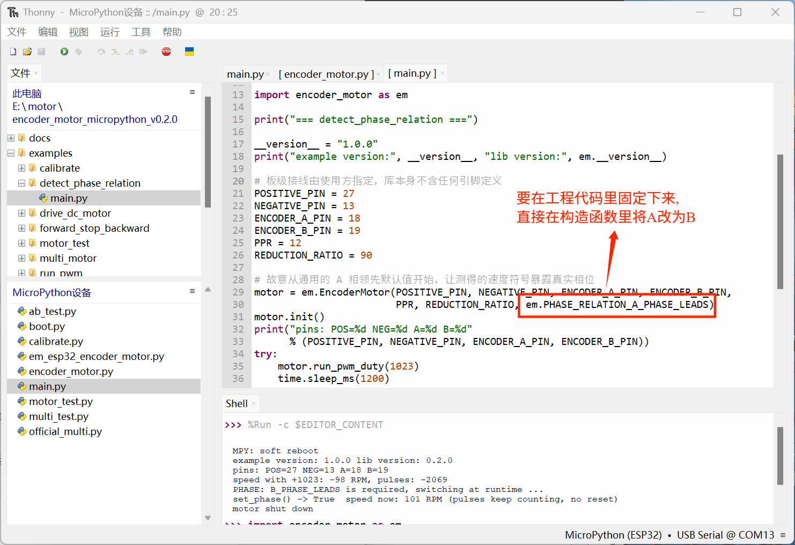

> 换电机、换通道后都需要重做这一步。库的默认值是 `A_PHASE_LEADS`（与 Arduino 原库一致），  
> 这块板上的电机通常是 `B_PHASE_LEADS`。

##### 8.4.5.4 调速度：改 main.py 里的目标转速

检测完相位后，把 `examples/motor_test/main.py` 拷到板子上运行（或在 Thonny 里直接按 F5）。要改速度，就改文件里 `run_speed()` 括号里的数字：

```python
motor.run_speed(50)      # 目标 50 RPM
motor.run_speed(80)      # 改成 80 RPM
motor.run_speed(-30)     # 负数 = 反转
```

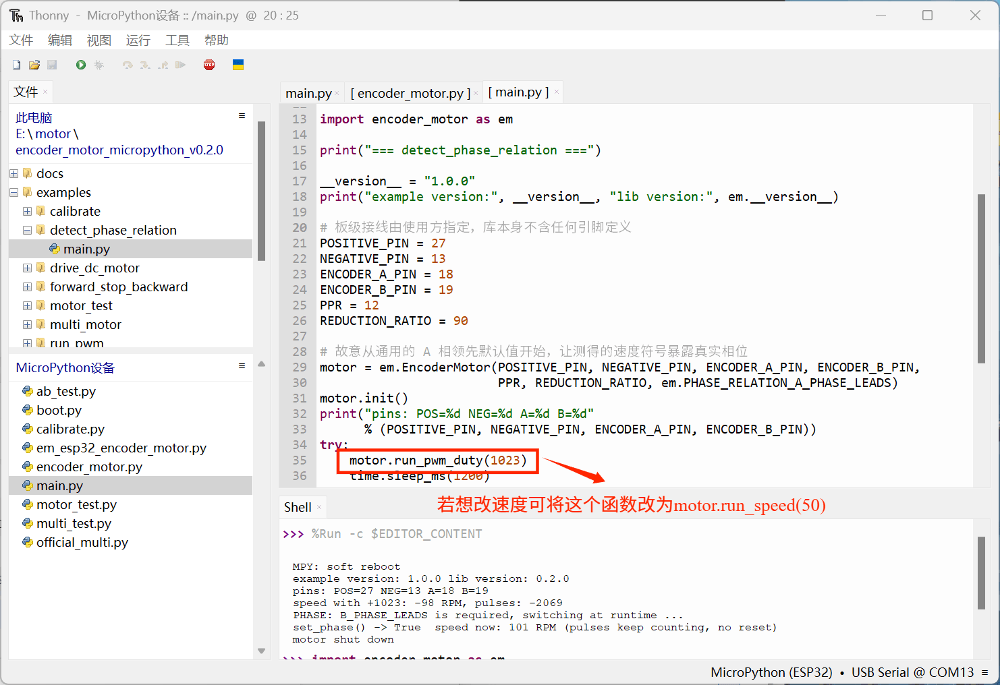

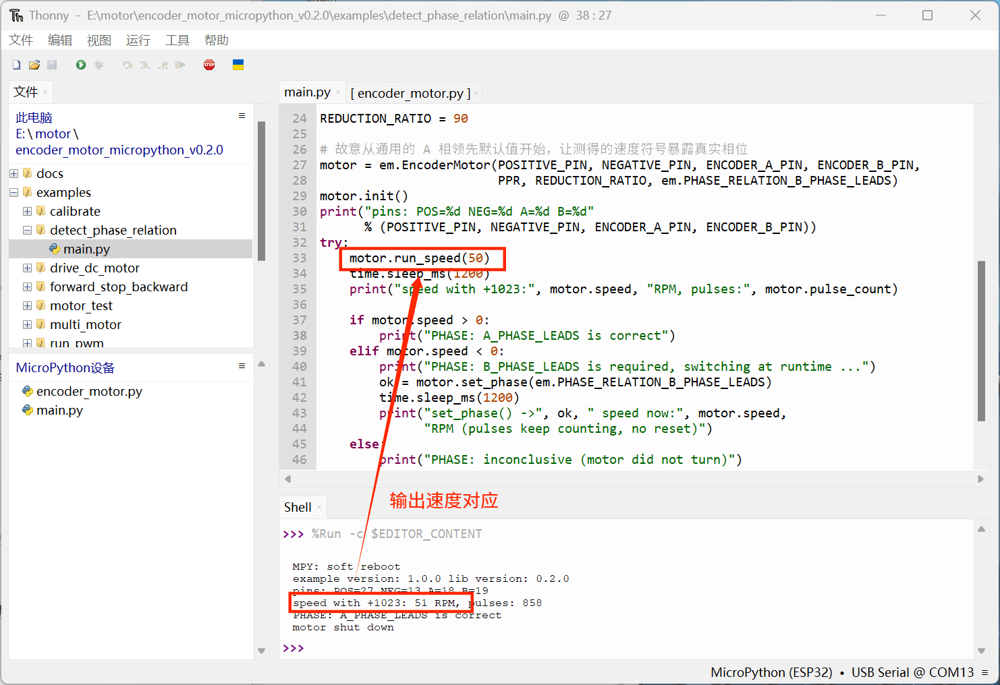

括号里填的是转速（RPM），不是占空比。控制器会自动调整占空比去逼近这个值，电压下降或负载变化时也会自动补回来。

可用范围：约 10 ~ 110 RPM（7.4 V 供电）、10 ~ 190 RPM（12 V 供电）。设为 0 或绝对值小于 10 会直接停机。

如果只想给固定电压、不要闭环，把 `run_speed()` 换成 `run_pwm_duty()`：

```python
motor.run_pwm_duty(600)  # 60% 占空比，开环
```

注意占空比低于约 150~200 时电机不会转（死区），调试时别设太小。

调试中的常见问题（pulses 一直为 0、库导入失败、闭环飞车等）见文末 FAQ。

### 8.5 ESP32系列连接使用PS3蓝牙无线手柄

[点击查看Maker-ESP32-Pro与PS3手柄的连接使用说明](zh-cn/peripheral/bluetooth_gamepad_ps3/bluetooth_gamepad_ps3.md)

## 9. FAQ

**Q**: Mixly下载程序不成功？

**A**：

1. Mixly的安装路径不要包含中文、空格等特殊字符；放在电脑的根目录下，层级目录不要太深；比如                          D:\mixly2.0-win32-x64就是根目录安装；  

2. 查看串口是否选择正确，如果没有串口，请先安装CH340G驱动；串口不要被其他应用占用；

3. 检查程序是否有错误；

**Q**: 电机程序上传成功，但是电机不转？

**A**:

1. 电机需要DC头供电，6-16V，建议使用两节3.7V锂电池，电源开关是否打到ON；

2. 第一步已经完成的话，还出现问题，请检查Motor and IO Switch开关是否拨到电机方向(即标有M2A、M2B、M3A、M3B的方向)；

3. 检测程序设置的电机引脚是否和电机实际引脚一一对应；

4. 编码电机的 6 芯插头是否插到位、有无插反（插头有防呆结构，插不进时换个方向，不要硬插）；

**Q**: 电机转了，但 `pulses` 一直是 0？

**A**: 编码器信号没进来：

1. 插头是否插到底；
2. A/B 两根线是否接反（接反只会导致方向相反，不会导致 0）；
3. 用万用表量一下编码器的 5 V 供电是否正常。

如果 `pulses` 偶尔跳几个数但不连续，通常是插头接触不良。

**Q**: `ImportError: no module named 'encoder_motor'`？

**A**: 库没放到板子上，或者放到了子目录。**必须放在板子根目录**（`/encoder_motor.py`）。

**Q**: 闭环时电机猛转、占空比冲到 1023？

**A**: 相位参数配反了，PID 变成正反馈。回到 8.4.5「示例一：检测相位关系」一节重新检测相位。

**这是最危险的一种**——轮子着地时会飞车，调试时务必架空。

**Q**: `RuntimeError: no free hardware timer`？

**A**: 板上有其他库也占用了硬件定时器。调用 `em.use_timer(False)` 关掉自动调度，改在主循环里手动调 `m.update()`。
