# LGT-Maker-Nano

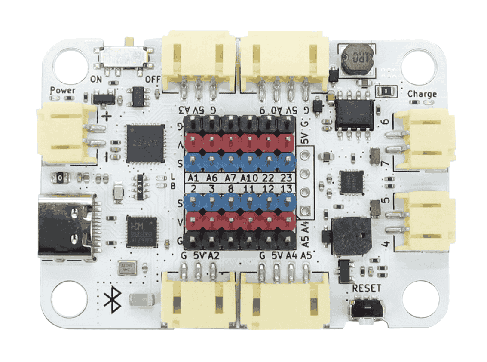

## 概述

LGT-Maker-Nano是一款基于LGT（国内唯一兼容Atemgea328P）LGT8F328P芯片采用QFN32封装的开发板，支持锂电池直供，自带电源开关、复位键，预留两路电机控制引脚。模拟口、IC2接口齐全，适配绝大多数科创传感器。Mixly / Arduino IDE / BlockCode均可直接编程下载。

## 原理图

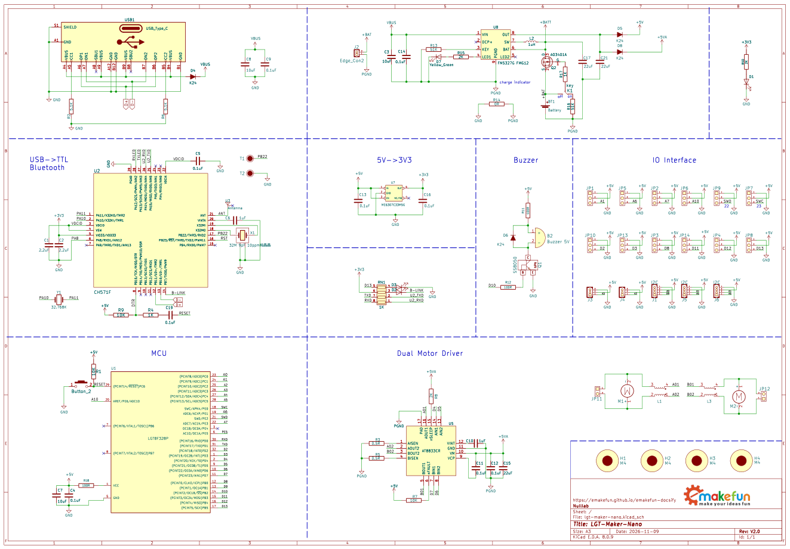

点击查看：[原理图](zh-cn/lgt-arduino/LGT-Maker-Nano/LGT-Maker-Nano_Schematic.pdf ':ignore :target=_blank')、[LGT8F328P芯片规格书](zh-cn/lgt-arduino/LGT-Mini-Nano/LGT-Maker-Nano_Datasheet（LGT8F328P）.pdf ':ignore :target=_blank')

## 尺寸图

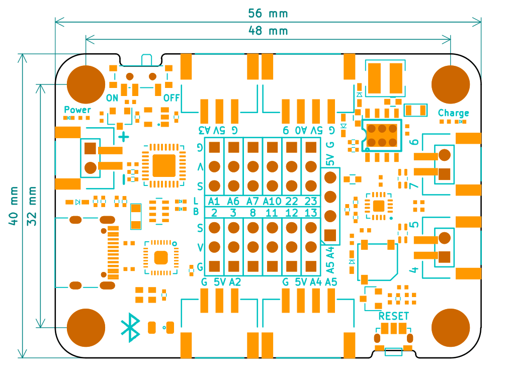

## 功能图

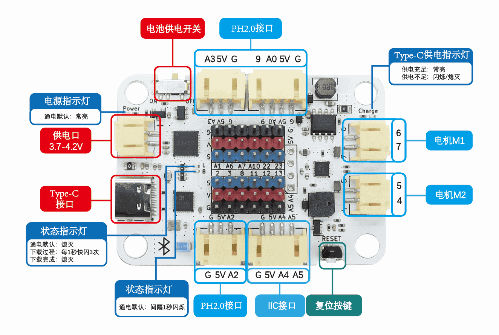

点击下载：[2D文件](zh-cn/lgt-arduino/LGT-Maker-Nano/LGT-Maker-Nano_2D.zip ':ignore')、[3D文件](zh-cn/lgt-arduino/LGT-Maker-Nano/LGT-Maker-Nano_3D.zip ':ignore')

## 特点

- 国产LGT8F328P-QFP32封装；
- 采用[nulllab软件包](https://github.com/nulllaborg/arduino_nulllab)相对于其他所谓兼容arduino芯片，LGT芯片兼容arduino生态达到99%；

- PH2.0电池接口供电，供电电压3.7 ~ 4.2V(建议使用3.7V锂电池供电使用)
- 板载3.7V锂电池充电电路，直接TypeC接口下载和充电。
- 板子蓝牙芯片，支持蓝牙下载和蓝牙遥控，蓝牙数据传输等
- 提供1个PH2.0的I2C接口，以及多个PH2.0通用IO接口
- 支持同时驱动2路300mA电机
- 板载无源蜂鸣器

## Windows安装Arduino Uno R3（官方版、官方兼容版）驱动

请点击查看[Arduino Uno官方驱动程序](zh-cn/driver/arduino_official_driver/arduino_official_driver.md)

## Mixly示例测试

点击跳转：[Mixly说明文档](zh-cn/software/mixly/mixly)，示例使用Mixly2.0。  

步骤1：下载程序直接连接typeC数据线至电脑（如左图接法），避免下载过程失败。运行程序使用时推荐电池供电（如右图接法）。

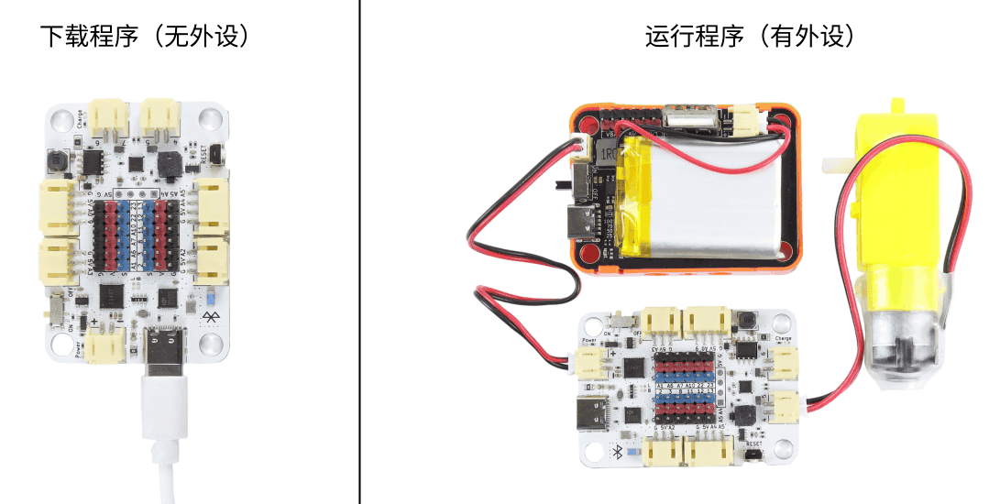

步骤2：然后打开Mixly软件，点击云端导入**Nulllab LGT8F328P**板卡。

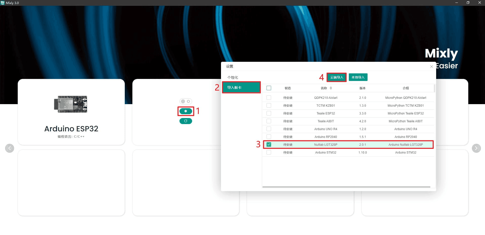

步骤3：选择刚才安装的板卡，进入编程界面。

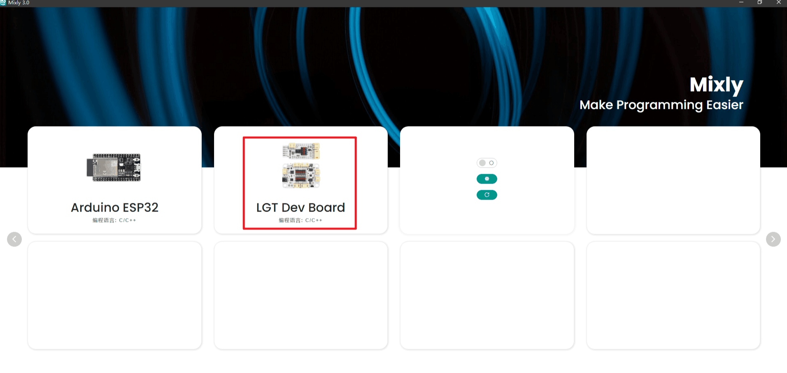

步骤4：选择Nulllab Nano/Maker Nano主板，然后搭建图形程序，最后点击上传，也可[点击下载示例程序](zh-cn/lgt-arduino/LGT-Maker-Nano/LGT-Maker-Nano_Mixly.zip ':ignore')，测试现象为电机每间隔1s正反转。

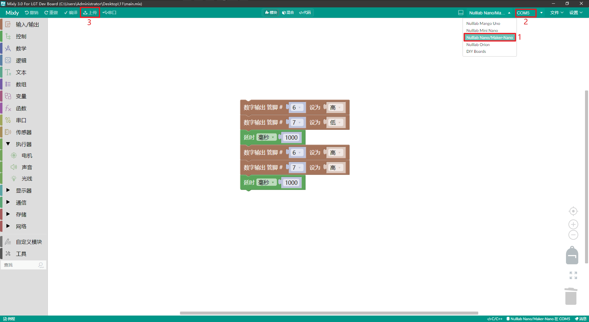

## BlockCode示例测试

点击进入：[BlockCode在线编程主页](https://make.blockcode.fun/ ':target=_blank')  

步骤1：硬件连接参考Mixly示例，然后点击下图LGT8F328P系列板卡，进入编程界面。

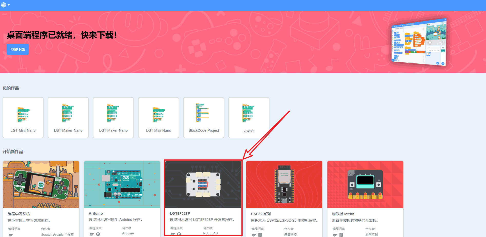

步骤2：选中**LGT-Nano**主板，然后搭建图形程序，最后点击下载程序，也可[点击下载示例程序](zh-cn/lgt-arduino/LGT-Maker-Nano/LGT-Maker-Nano_BlockCode.zip ':ignore')，测试现象为电机每间隔1s正反转。

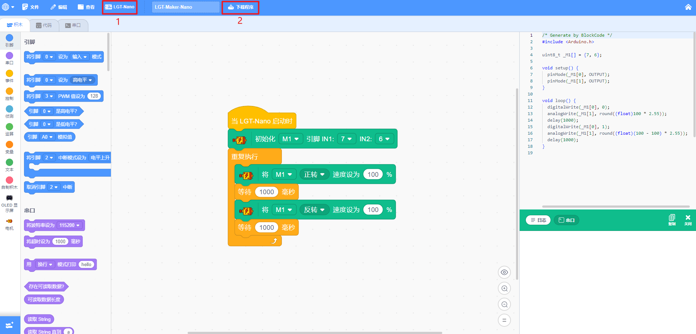

## Arduino IDE示例测试

步骤1：在开发板管理器地址栏输入：<https://download.null-lab.com/package_nulllab_boards_index_zh.json>

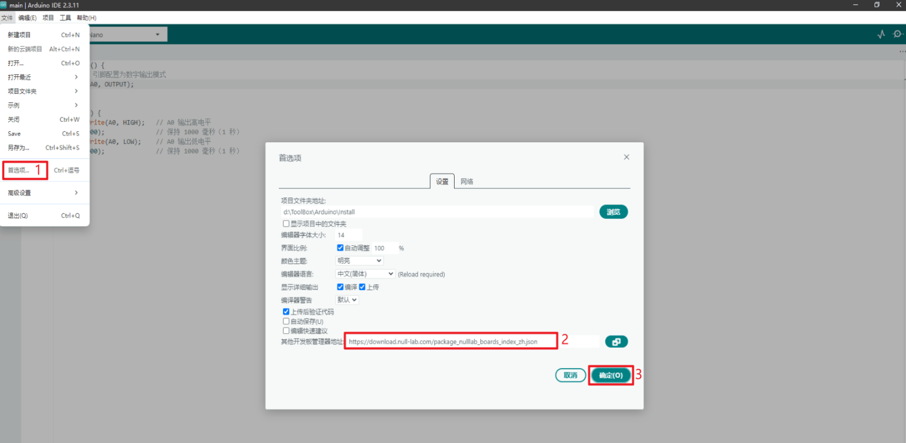

步骤2：选择**Nulllab Nano/LGT Nano**开发板及对应的COM端口后，点击上传程序，也可[点击下载示例程序](zh-cn/lgt-arduino/LGT-Maker-Nano/LGT-Maker-Nano_Arduino.zip ':ignore')，测试现象为电机每间隔1s正反转。

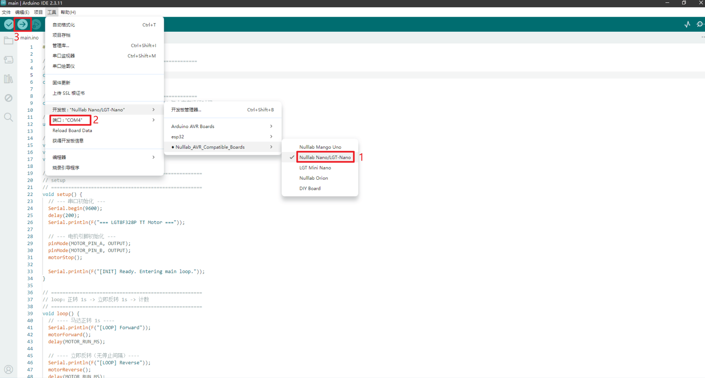
