# LGT-Mini-Nano

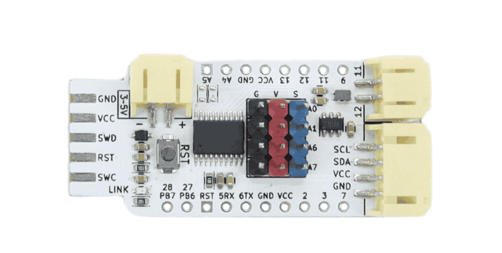

## 概述

这是一款简化部分功能并大幅度缩小体积后的Arduino Nano主控板。支持锂电池/外接电源，设有一个电机接口，四个数字输出管脚，可直插舵机、传感器模块。支持Mixly / Arduino IDE / BlockCode等软件编程使用。

## 原理图

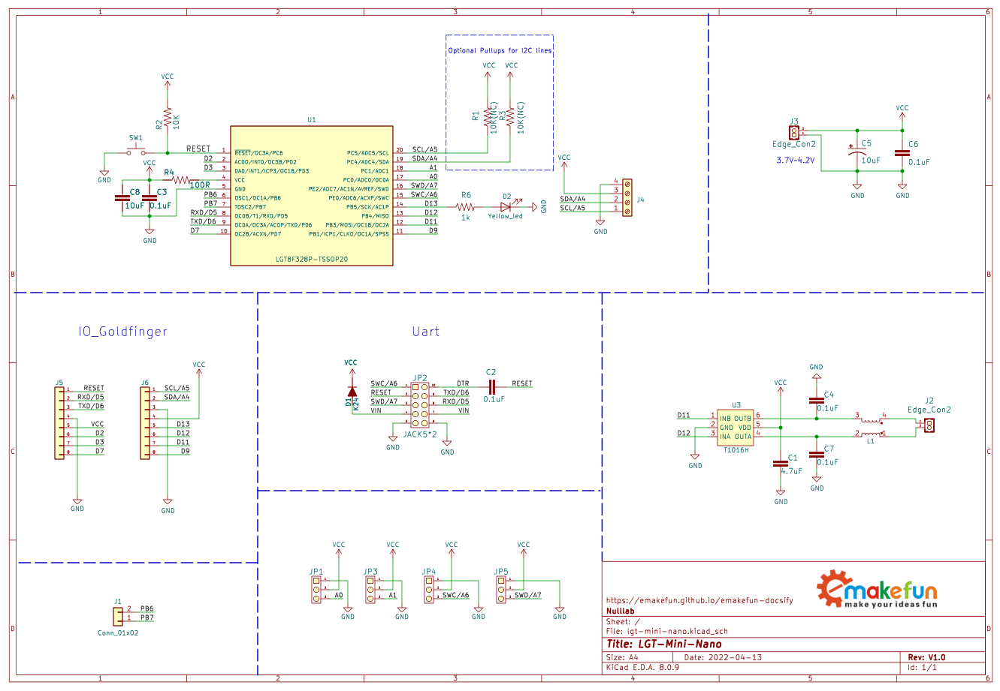

点击查看：[原理图](zh-cn/lgt_arduino/LGT-Mini-Nano/LGT-Mini-Nano_Schematic.pdf ':ignore :target=_blank')、[LGT8F328P芯片规格书](zh-cn/lgt_arduino/LGT-Mini-Nano/LGT-Mini-Nano_Datasheet（LGT8F328P）.pdf ':ignore :target=_blank')

## 尺寸图

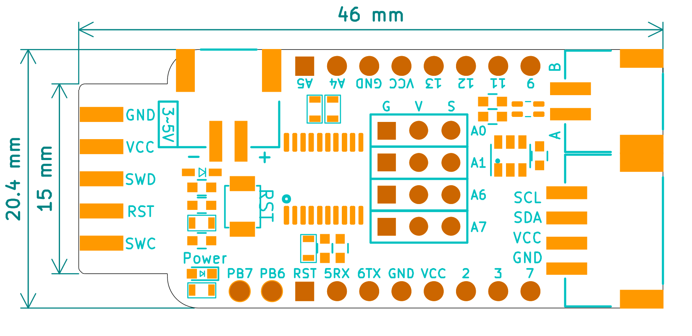

点击下载：[2D文件](zh-cn/lgt_arduino/LGT-Mini-Nano/LGT-Mini-Nano_2D.zip ':ignore')、[3D文件](zh-cn/lgt_arduino/LGT-Mini-Nano/LGT-Mini-Nano_3D.zip ':ignore')

## 功能图

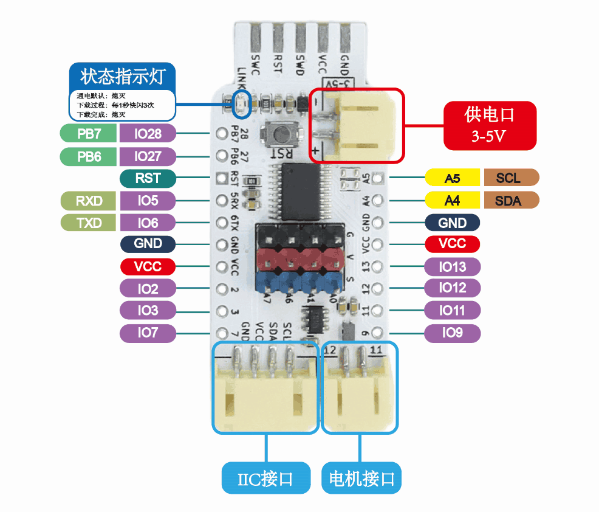

## 特点

- 供电电压3 ~ 5V，(建议使用3.7V锂电池供电使用)
- 开发板I2C作为主机使用
- 预留1个I2C接口，1个电机接口

## Mixly示例测试

点击跳转：[Mixly说明文档](zh-cn/software/mixly/mixly)，示例使用Mixly2.0。  

步骤1：下载程序必须采用左图接法（无外设），避免下载过程失败。运行程序采用右图接法（有外设），使用时推荐电池供电。

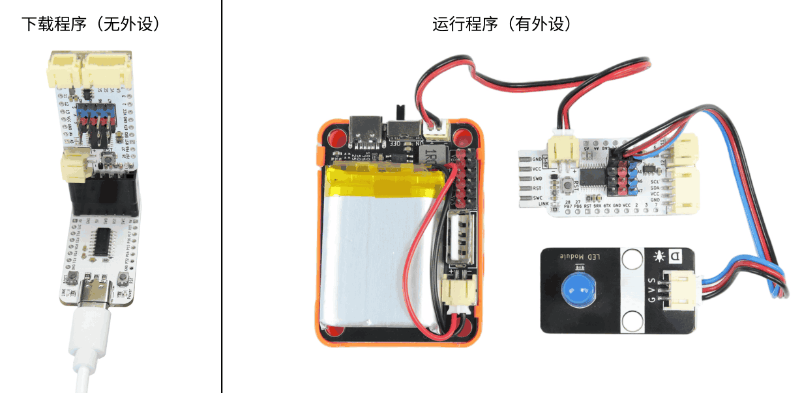

步骤2：按上面左图接法连接电脑，然后打开Mixly软件，点击云端导入Nulllab LGT328P板卡。

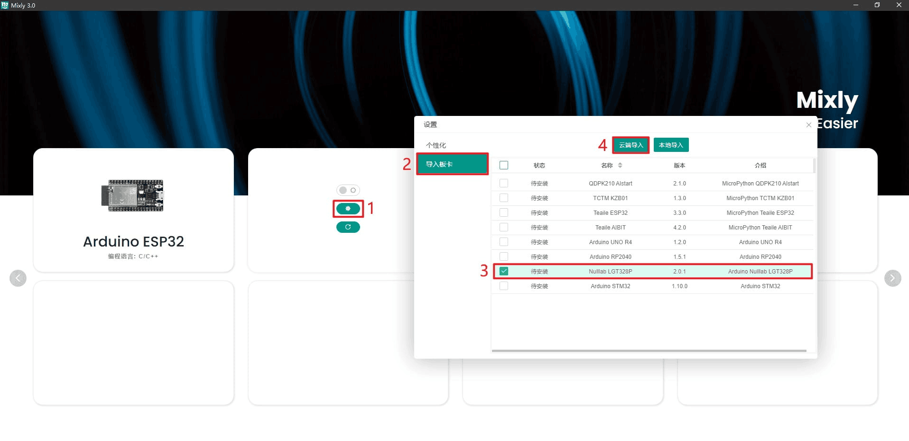

步骤3：选择刚才安装的板卡，进入编程界面。

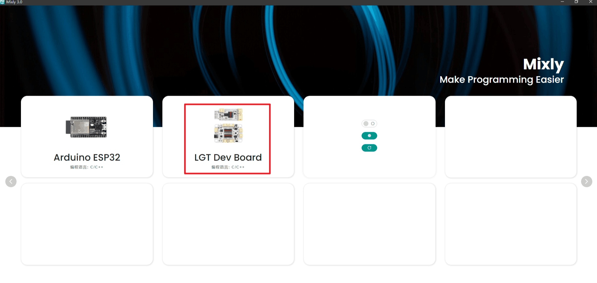

步骤4：选择Nulllab Mini Nano主板，然后搭建图形程序，最后点击上传，也可[点击下载示例程序](zh-cn/lgt_arduino/LGT-Mini-Nano/LGT-Mini-Nano_Mixly.zip ':ignore')，测试现象为LED会间隔1s循环闪烁。

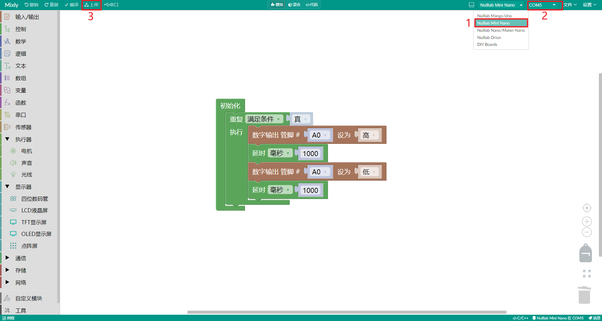

## BlockCode示例测试

点击进入：[BlockCode在线编程主页](https://make.blockcode.fun/ ':target=_blank')  

步骤1：硬件连接参考Mixly示例，然后点击下图LGT8F328P系列板卡，进入编程界面。

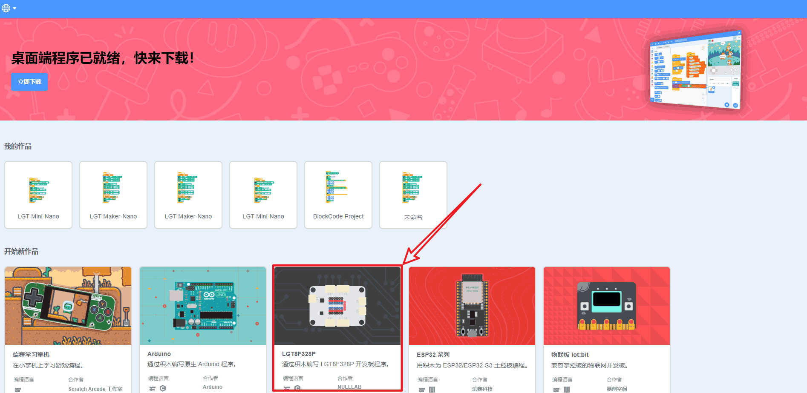

步骤2：选中LGT-Mini-Nano主板，然后搭建图形程序，最后点击上传，也可[点击下载示例程序](zh-cn/lgt_arduino/LGT-Mini-Nano/LGT-Mini-Nano_BlockCode.zip ':ignore')，测试现象为LED会间隔1s循环闪烁。

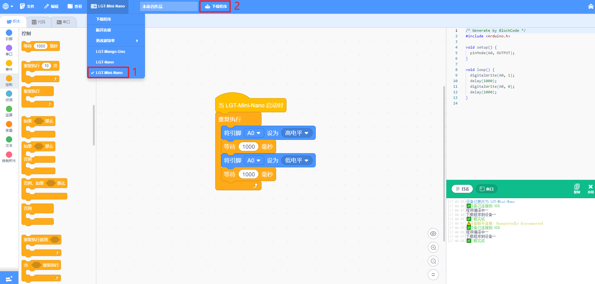

## Arduino IDE示例测试

步骤1：在开发板管理器地址栏输入：<https://download.null-lab.com/package_nulllab_boards_index_zh.json>

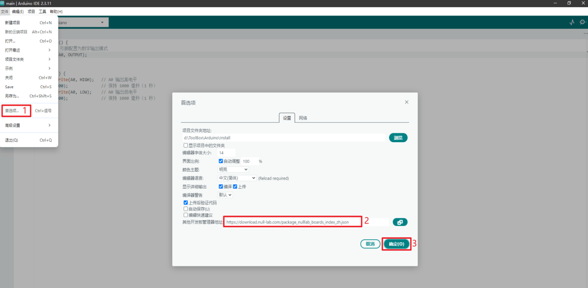

步骤2：选择LGT Mini Nano开发板及对应的COM端口后，点击上传程序，也可[点击下载示例程序](zh-cn/lgt_arduino/LGT-Mini-Nano/LGT-Mini-Nano_Arduino.zip ':ignore')，测试现象为LED会间隔1s循环闪烁。

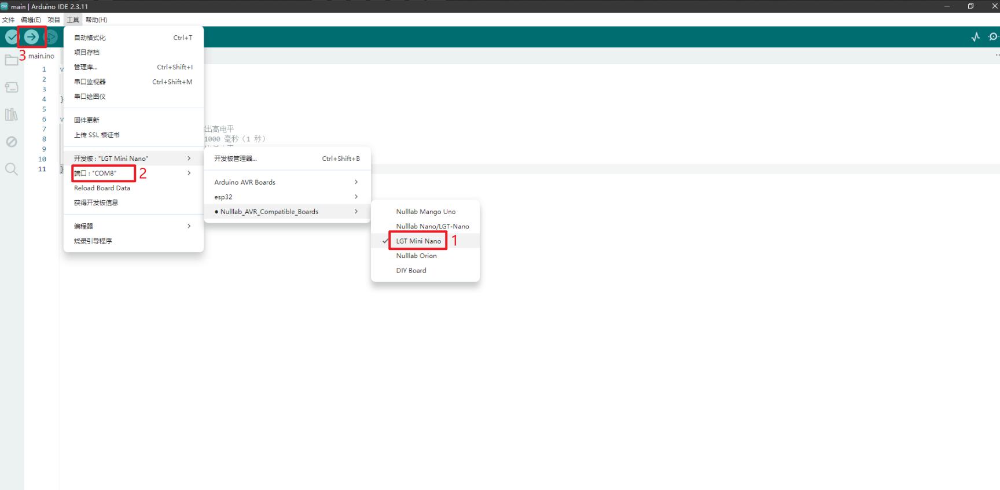
