# Geekservo积木舵机

## 概述

· Geeksevo系列舵机采用优质电机和电刷材料外壳，在结构上设有乐高插销孔和砖块安装凹点，兼容乐高结构，输出轴为乐高十字轴。兼容市面上的舵机控制方式协议、控制方式与常见舵机相同-PWM信号控制；

## 产品特性

### 外观

· 积木卡扣外壳，兼容乐高孔位，方便直接拼装；

· 输出轴为乐高标准十字轴，有部分产品为十字轴沉孔-可自由插入不同长度的十字轴；

### 线材

· 标准三线：棕/黑（GND）、红（VCC-5V)、橙/黄（PWM信号)

### 驱动信号

· 标准舵机PWM，50HZ（周期20ms）

### 优势

采用了优质电机和电刷材料、在输出轴最后一级做了极力齿-设定扭矩范围下正常工作，超出最大扭矩范围后有跳齿保护。相对于普通9G电机，实用性和耐用性更强。

## 主要产品

### 灰色180°/270°积木9g舵机

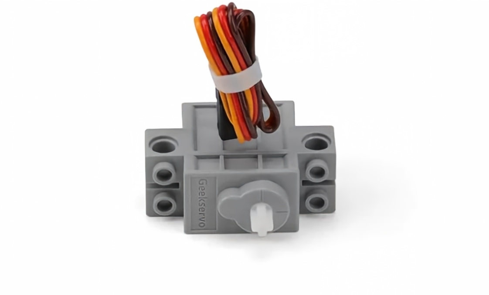

| 参数            | 对应范围 |     | 参数     | 对应范围         |
|:---------------:|:--------:| --- |:--------:|:----------------:|
| type端子        | 杜邦     |     | 控制角度 | 180°/270°        |
| 空载电流        | 169mA    |     | 工作电压 | 3-6V             |
| 堵转电流        | 528mA    |     | 空载速度 | 0.12±0.01sec/60° |
| 旋转方向        | 顺时针   |     | 停止扭力 | 1.2kg±0.2kg-cm   |
| PWM信号宽度范围 | 600-2400 |     | 输出轴   | 乐高十字轴       |

· PWM信号控制舵机的旋转角度，600-2400的PWM信号宽度对应控制舵机的0-180°/0-270°角度旋转，一个PWM值对应一个角度。

### 红色9g积木电机

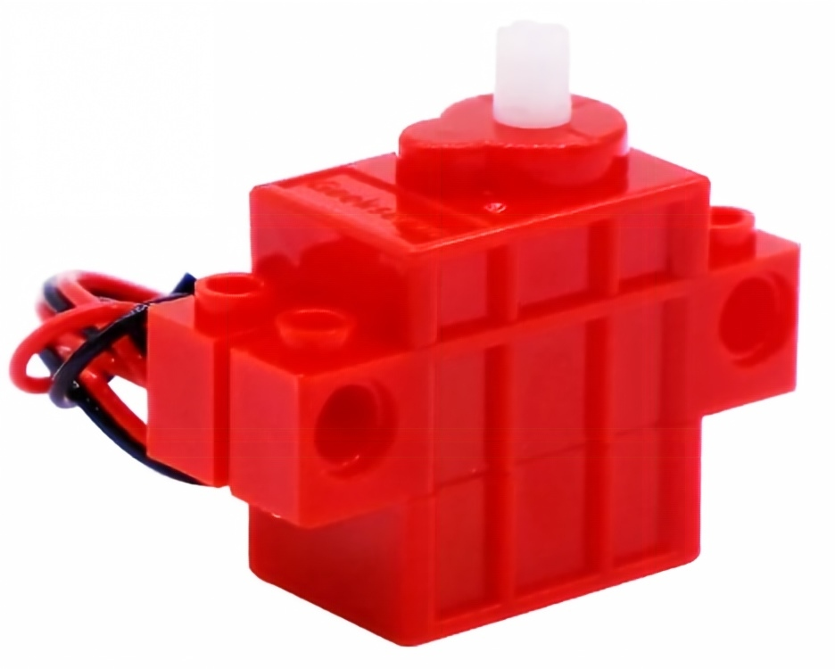

· 电机采用PH2.0接口接入电机驱动端口。两根线黑色为GND(负极)、红色VCC（正极），电机的方向控制为数字输出（高/低电平），速度为模拟输出（0-255）。

### 橙色/绿色360°正反连续旋转-9g积木舵机

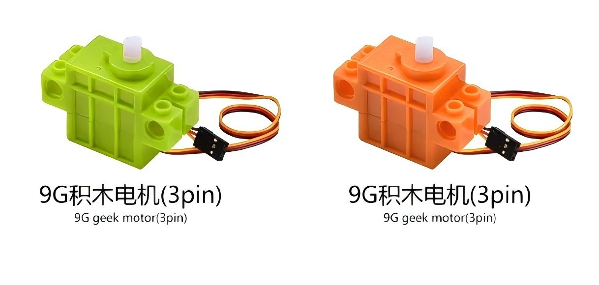

| 参数            | 对应范围 |     |     | 参数     | 对应范围       |
|:---------------:|:--------:| --- | --- |:--------:|:--------------:|
| type端子        | 杜邦     |     |     | 控制角度 | 360°连续旋转   |
| 空载电流        | 126mA    |     |     | 工作电压 | 3-5V           |
| 堵转电流        | 332mA    |     |     | 空载速度 | 75±5r/min      |
| 旋转方向        | 顺时针   |     |     | 停止扭力 | 1.2kg±0.2kg-cm |
| PWM信号宽度范围 | 500-2500 |     |     | 输出轴   | 乐高十字轴     |

### 绿色360°正反连续旋转-积木舵机

· 360舵机是PWM控制它的旋转速度和旋转方向，500-1500us的PWM是控制它正转，值越小旋转速度越大；1500-2500us的PWM是控制反转，值越大旋转速度越大（舵机的中位不同，有些可能是1520才会停止，实际使用需要自己测出中位。）

· 360舵机就是一个普通直流电机+电机驱动板的组合，所以只能连续旋转，不能定位，也没办法知道它的角度和圈数（除非自己在舵机外面加装其他传感器）

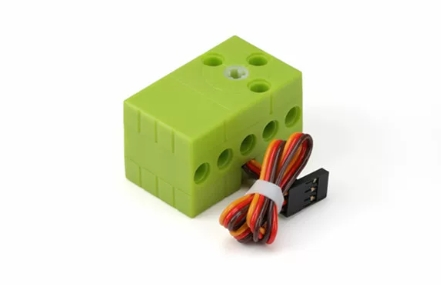

| 参数            | 对应范围 |     | 参数     | 对应范围      |
|:---------------:|:--------:| --- |:--------:|:-------------:|
| type端子        | 杜邦     |     | 控制角度 | 360°连续旋转  |
| 产品扭力        | 0.7KG    |     | 工作电压 | 3-5V          |
| 齿轮减速比      | 1：140   |     | 空载速度 | 160/min（6V） |
| PWM信号宽度范围 | 500-2500 |     | 输出轴   | 双十字轴沉孔  |

### 0-360°2KG积木舵机（灰色-慢速；橙色-快速）

· 0-360°舵机按颜色区分功能，灰色-慢速舵机、橙色-快速舵机；区别于360舵机，不可以连续旋转、只能在0-360°的范围内转到指定角度；与普通舵机一样，PWM值500-2500对应控制舵机0-360°转动。中位180°PWM-1500。

· 慢速电机的扭力相对较大，快速电机的扭力相对较小。应对不同场景需求；

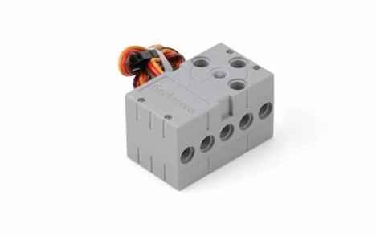

| 参数            | 对应范围 |     | 参数     | 对应范围         |
| --------------- |:--------:| --- |:--------:|:----------------:|
| type端子        | 杜邦     |     | 控制角度 | 0-360°           |
| 空载电流        | 90mA     |     | 工作电压 | 4.2-6V           |
| 堵转电流        | 1.3A     |     | 空载速度 | 0.10±0.01sec/60° |
| 旋转方向        | 顺时针   |     | 停止扭力 | 4.5±0.2kg-cm     |
| PWM信号宽度范围 | 500-2500 |     | 输出轴   | 双十字轴沉孔     |

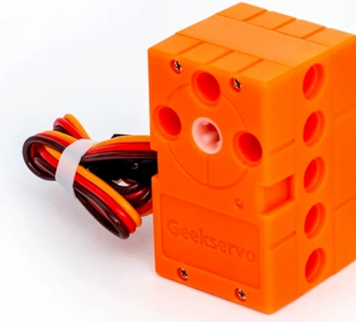

| 参数            | 对应范围 |     | 参数     | 对应范围         |
|:---------------:|:--------:| --- |:--------:|:----------------:|
| type端子        | 杜邦     |     | 控制角度 | 180°/270°        |
| 空载电流        | 72mA     |     | 工作电压 | 3-6V             |
| 堵转电流        | 1.1A     |     | 空载速度 | 0.70±0.01sec/60° |
| 旋转方向        | 顺时针   |     | 停止扭力 | 2.6kg±0.2kg-cm   |
| PWM信号宽度范围 | 500-2500 |     | 输出轴   | 双十字轴沉孔     |

### 蓝色慢速电机/红色快速电机

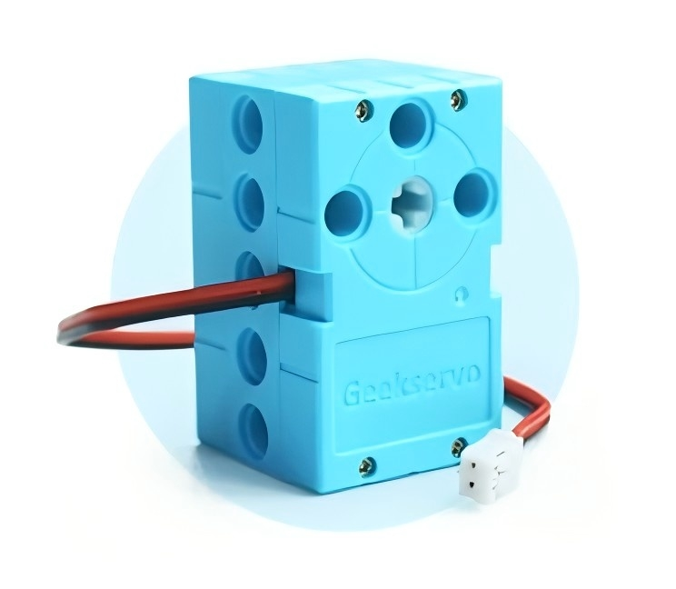

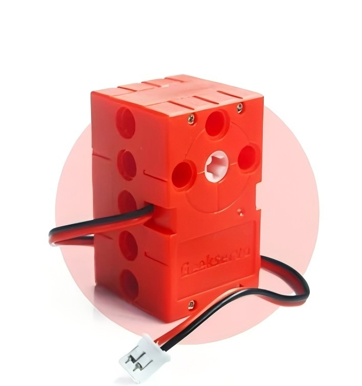

| 参数           | 红色快速电机 | 蓝色慢速电机 |
|:--------------:|:------------:|:------------:|
| 工作角度       | 连续正反转   | 连续正反转   |
| 工作电压       | 4.8-6V       | 4.8-6V       |
| 工作扭力（6v） | 1.8±0.2KG    | 2.0±0.2KG    |
| 空载速度       | 160±10r/min  | 90±10r/min   |

· 电机采用PH2.0接口接入电机驱动端口。两根线黑色为GND(负极)、红色VCC（正极），电机的方向控制为数字输出（高/低电平），速度为模拟输出（0-255）。

## Mixly图形化程序

· Mixly图形化编写舵机程序时，通用积木块只有0-180°的。如果想对360舵机进行控制，可复用通用舵机模块；此时数值不是角度，而是代表速度和方向，90=中位停止，0=逆时针全速，180=顺时针全速。数值越接近90速度越小；

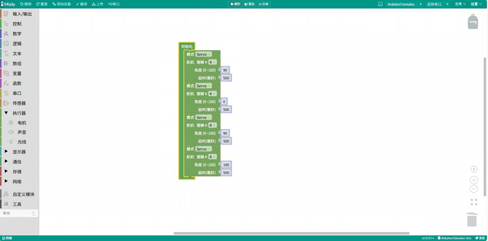

· 电机程序编辑上，数字输出为（高/低）电平控制方向、模拟输出（0-255）代表速度；

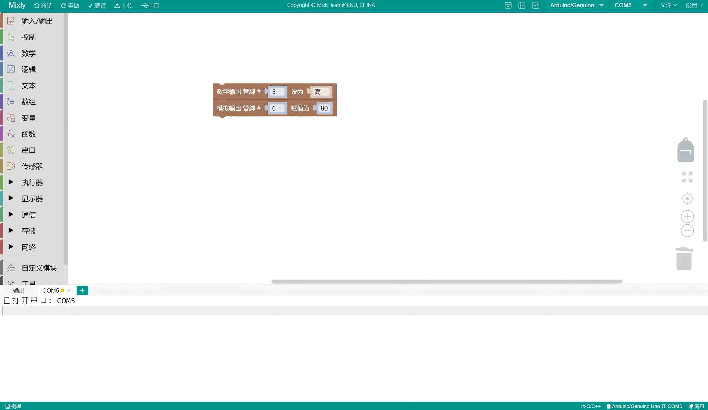

· 如果没有安装Mixly离线版，也可以用在线版进行编程

<a href="http://go.mixly.cn/">点击访问Mixly在线版</a>

[点击下载或查看示例程序文件.zip](./Geekservo_Mixly.zip ":ignore")

## BlockCode图形化程序

· BlockCode选择对应主控板即可进行编辑程序；

· BlockCode选好主控板左下角可添加拓展，执行器里有封装好的Geekservo舵机拓展、电机拓展；

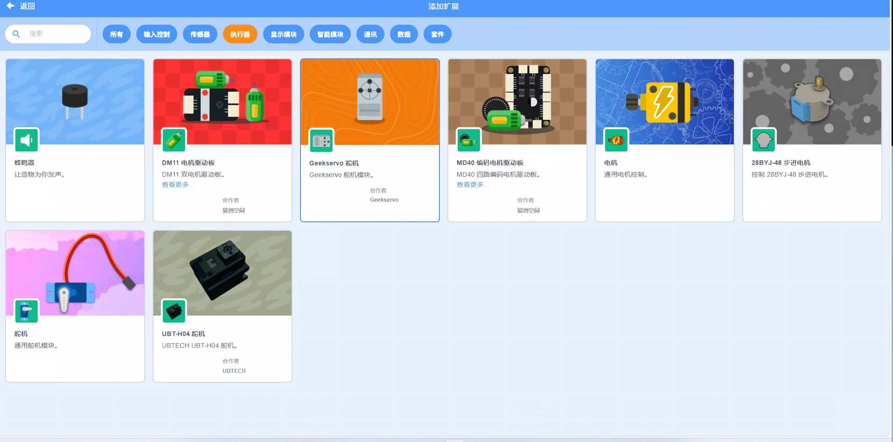

·舵机控制程序示例

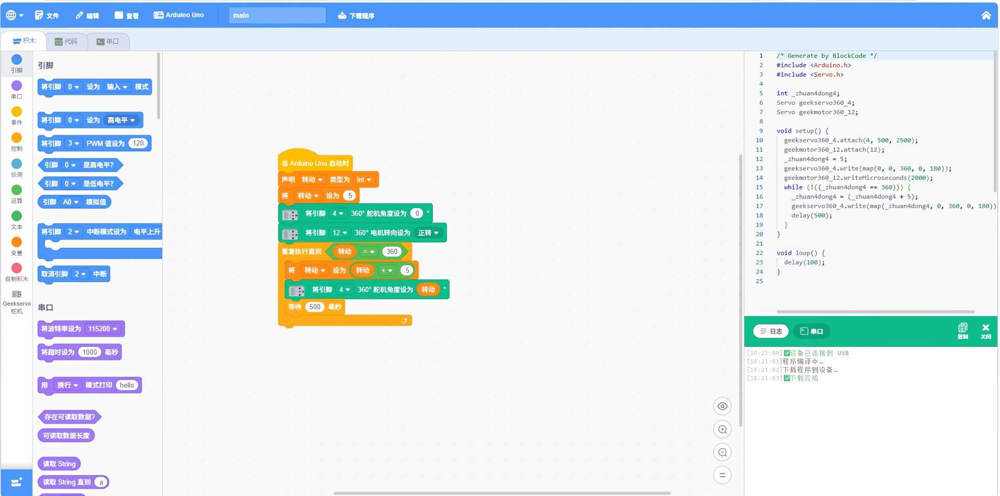

· 电机启动程序示例

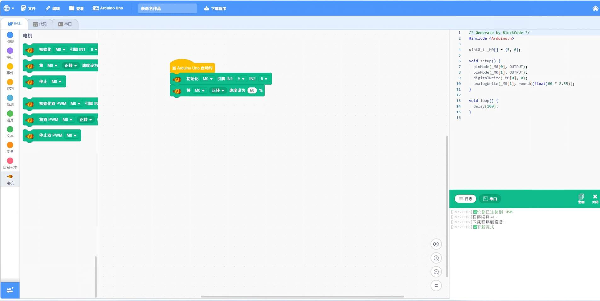

·没安装BlockCode离线版可点击链接进行在线编程

<a href="https://beta.blockcode.fun/">BlockCode在线版</a >

[点击下载或查看示例程序.zip](./Geekservo_BlockCode.zip ":ignore")
