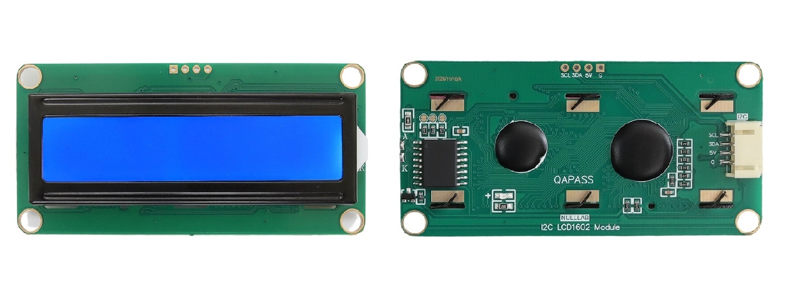
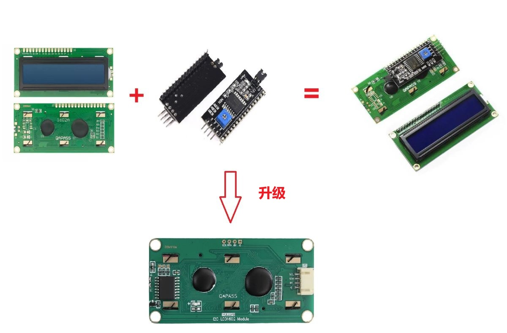
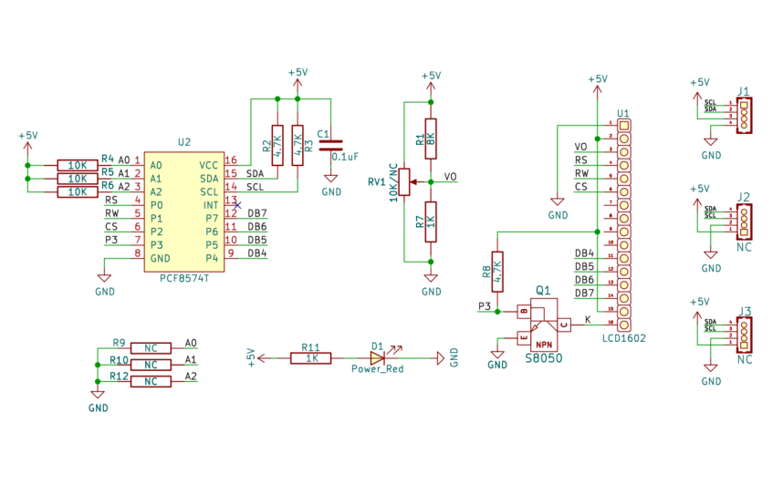
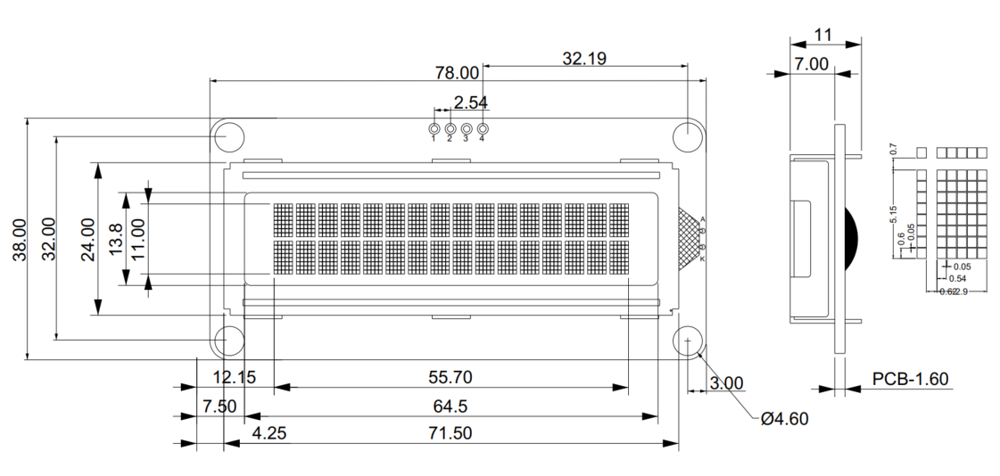

# I2C LCD1602

## 概述

LCD1602是一种专门用于显示字母，数字和符号的字符液晶显示模块。它是由字符型液晶显示屏（LCD）、控制驱动主电路HD44780及其扩展驱动电路HD44100，以及少量电阻、电容元件和结构件等装配在PCB板上而组成。不同厂家生产的LCD1602芯片可能有所不同，但控制原理完全相同、使用方法都一样，为了降低成本目前厂家已经将裸芯片通过COB邦定工艺直接做在PCB板子上（两个黑色黑胶位置）。 “1602”表示可以总共可显示2行、每行可显示16个字符，集成了常见字符字库芯片， 所以它广泛应用于工业，比如电子钟，温度显示器。

标准的LCD1602是一个并行数据驱动模式，在实际使用中会占用大量IO口，所以一般都会增加一个I2C转并口的PCF8574芯片的转接模块。我司为了减少模块的体积，降低焊接带来的产品故障，设计了一款直接将PCF8574集成在LCD1602模块PCB上，大大降低接线安装复杂程度。

<a href="zh-cn/ph2.0_sensors/displayers/lcd1602/1602A-V1.4_datasheet_zh-CN.pdf" target="_blank">显示屏详细参数可以参考并行LCD1602数据数据手册</a>

## 原理图

<a href="zh-cn/ph2.0_sensors/displayers/lcd1602/LCD1602_I2C_switch_board_sch.pdf" target="_blank">点击查看I2C转并口原理图</a>

## 模块参数

- **型号：**I2C-LCD1602
- **显示容量：** 16x2个字符
- **I2C地址：** 0x26（十进制）
- **工作电压电流：**5V 2.0mA
- **尺寸：** 78x38mm
- **数据手册：**<a href="https://documentation.espressif.com/esp32-s3_datasheet_cn.pdf" target="_blank">ESP32-S3规格书</a> | <a href="https://documentation.espressif.com/esp32-s3_technical_reference_manual_cn.pdf" target="_blank">ESP32-S3应用参考手册</a>

## 引脚说明

| 引脚名称 | 描述       |
| -------- | ---------- |
| GND      | GND地      |
| VCC      | 5V电源引脚 |
| SDA      | 数据引脚   |
| SCL      | 时钟引脚   |

## 尺寸图

<a href="zh-cn/ph2.0_sensors/displayers/lcd1602/I2C-LCD1602_dxf.pdf" target="_blank">点击查看尺寸图</a>

<a href="zh-cn/ph2.0_sensors/displayers/lcd1602/I2C-LCD1602.dxf" download>点击下载2d模型文件</a>

## Arduino IDE示例程序

- **依赖库：** [AsyncLiquidCrystal](https://github.com/arduino-libraries/LiquidCrystal)（Arduino 库管理器搜索安装）
- **下载：**<a href="zh-cn/ph2.0_sensors/displayers/lcd1602/Serial_LCD1602_Display.zip" download>I2C LCD1602 demo</a>

## Mixly示例程序

<a href="zh-cn/ph2.0_sensors/displayers/lcd1602/LCD1602_Mixly.zip" download>点击下载Mixly示例程序</a>

## Mind+示例程序

<a href="zh-cn/ph2.0_sensors/displayers/lcd1602/LCD1602_mind_plus.zip" download>点击下载Mind+示例程序</a>

## MicroPython示例程序

<a href="zh-cn/ph2.0_sensors/displayers/lcd1602/lcd1602_microbit_micropython.zip" download>点击下载micro:bit MicroPython示例程序</a>

## micro:bit示例程序

<a href="https://makecode.microbit.org/_f4Mccy84xdcC" target="_blank">动手试一试</a>
