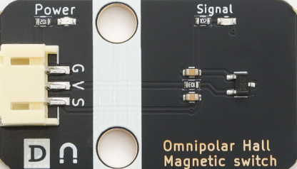
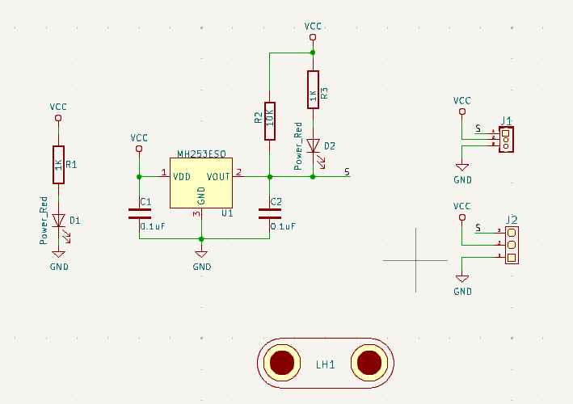
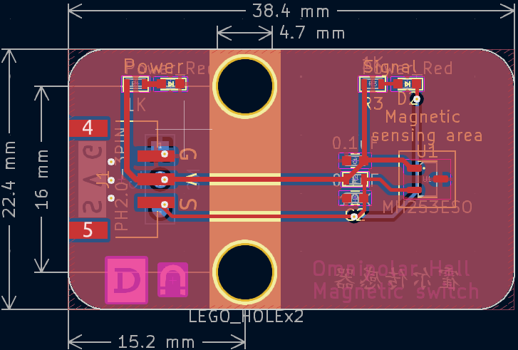
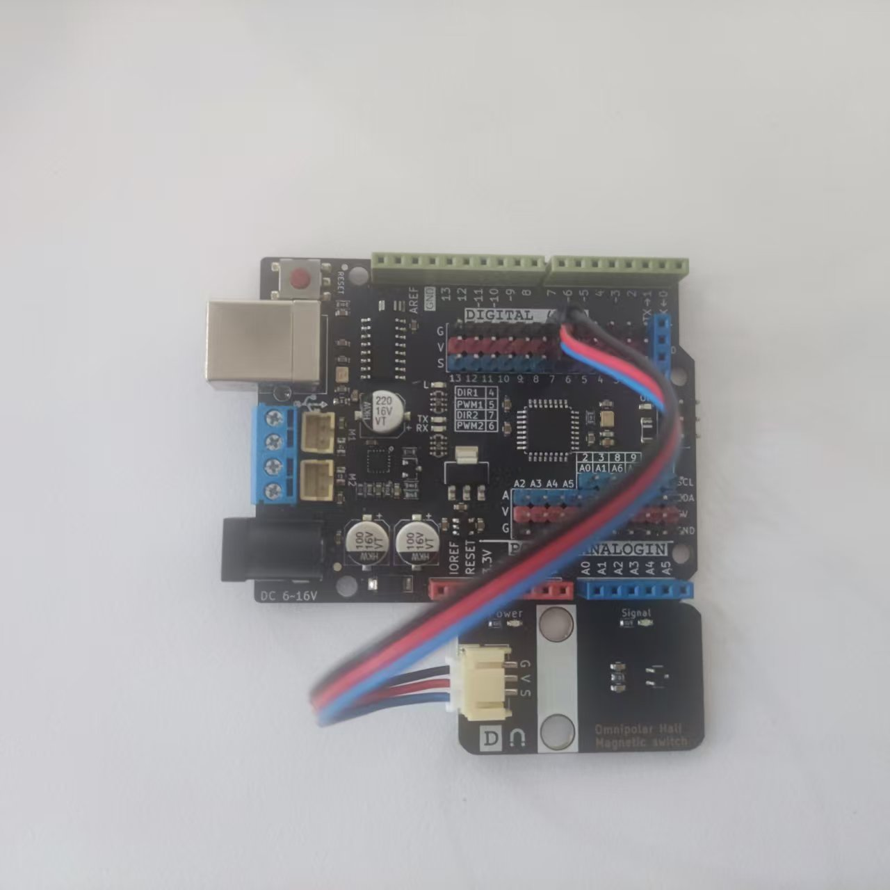

# 霍尔开关传感器

## 实物图




## 概述

霍尔开关传感器是基于霍尔效应原理工作的磁控器件，通过磁场变化触发开关信号。其核心优势在于非接触式工作模式，避免了机械磨损，具备长寿命、高可靠性及毫秒级响应速度，可在-40℃至150℃的严苛环境中稳定运行。该传感器主要分为数字型（输出开关信号，用于位置检测）和模拟型（输出连续信号，测量磁场强度）两类，广泛应用于汽车电子（转速检测）、工业自动化（限位控制）、智能家居（门窗感应）等领域，是实现精准磁感检测的关键元件。

## 原理图



## 尺寸图



<a href="zh-cn/ph2.0_sensors/sensors/hall_switch/hall_switch3d.zip" download>下载霍尔开关3D文件</a>

## 模块参数

- 供电电压：3~5V
- 连接方式：PH2.0-3PIN防反接线
- 模块尺寸：38.4x22.4mm
- 安装方式：M4螺钉兼容乐高插孔固定

| 引脚名称 | 描述                                                     |
| -------- | -------------------------------------------------------- |
| G        | GND                                                      |
| V        | 3~5V 电源输入                                            |
| S        | 信号数字输出，无磁场时输出高电平，检测到磁场时输出低电平 |

## Arduino Uno使用用例

注意：模块 GND 必须与主控板 GND 共地；S 引脚接数字引脚 D7，通过 `digitalRead(7)` 读取磁场状态

**接线端口可自行更改，只需注意编程时选择对应引脚，本教程时按照示例程序接口连接。**



## Arduino示例程序

<a href="zh-cn/ph2.0_sensors/sensors/hall_switch/hall_swtich.zip" download>下载示例程序</a>

```c++
#define DIGITAL_PIN 7  // 霍尔信号引脚
int digital_value = 0;
void setup() {
  Serial.begin(9600);
  pinMode(DIGITAL_PIN, INPUT);
}
void loop() {
  digital_value = digitalRead(DIGITAL_PIN);
  Serial.print("HallSensor Digital:");
  Serial.println(digital_value);
  delay(200);
}
```

磁铁靠近霍尔模块，串口打印的数字会变化，每200毫秒刷新一次。

## MicroPython示例程序

### ESP32 MicroPython示例程序

```python
from machine import Pin
import time

DIGITAL_PIN = Pin(7, Pin.IN)  # 霍尔信号引脚

while True:
    digital_value = DIGITAL_PIN.value()
    print("HallSensor Digital Data:", digital_value)
    time.sleep_ms(200)
```

### micro:bit MicroPython示例程序

```python
from microbit import *

DIGITAL_PIN = pin7  # 霍尔信号接P7
digital_value = 0

while True:
    digital_value = DIGITAL_PIN.read_digital()
    print("HallSensor Digital Data:", digital_value)
    sleep(200)
```

<a href="https://makecode.microbit.org/S65722-49364-86942-21338" target="_blank">动手试一试</a>
