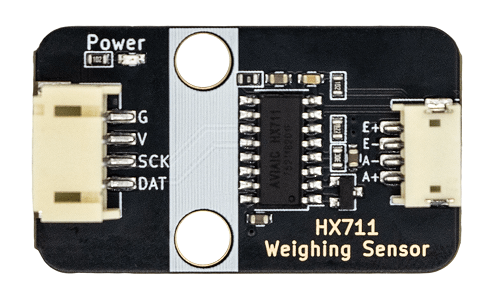
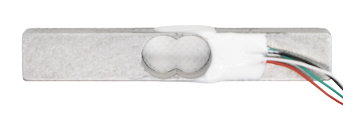
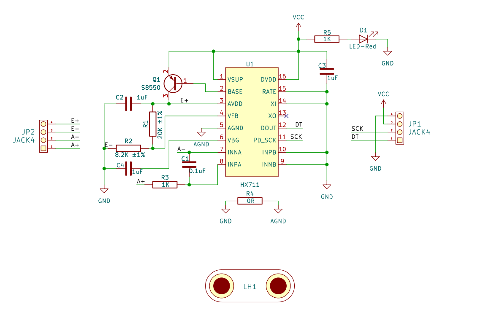
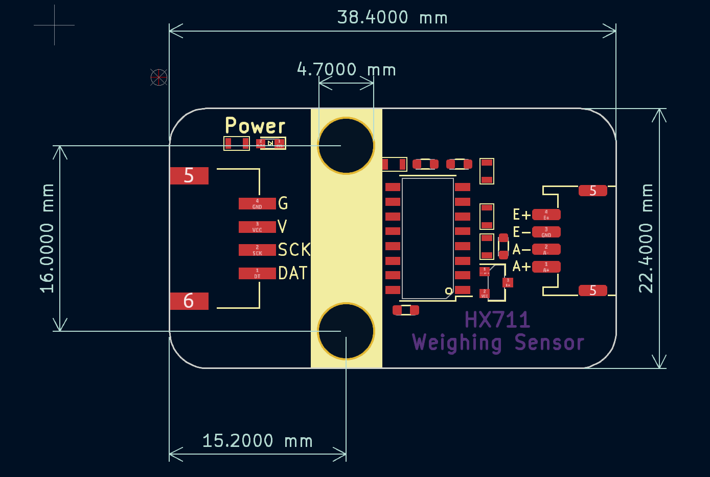
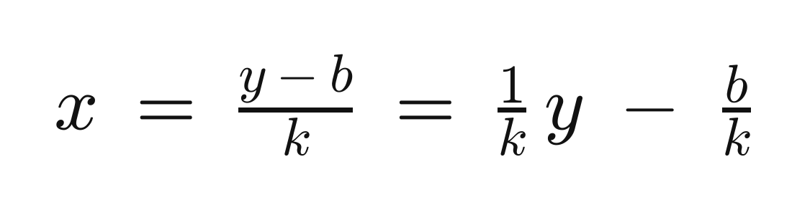

# HX711 称重模块

## 实物图



## 概述

HX711 是一款专为高精度电子秤设计的 24 位 A/D 转换芯片。该芯片内部集成了稳压电源、片内时钟振荡器等，具有集成度高、响应速度快、抗干扰性强等优点。模块采用 HX711 芯片配合压力传感器（电阻应变片），可精确测量重量，广泛应用于电子秤、工业控制、智能家具等场景。

### 称重传感器（Load Cell）



模块配套的**悬臂式称重传感器**，内部采用惠斯通电桥结构的应变片。当受力时，应变片发生微小形变，输出 mV 级差分电压信号，经 HX711 放大并转换为数字量。

| 接线端子 | 颜色 | 功能   |
| :------: | :--: | :----- |
|    E+    |  红  | 激励正 |
|    E-    |  黑  | 激励负 |
|    A-    |  绿  | 信号正 |
|    A+    |  白  | 信号负 |

## 原理图

<a href="zh-cn/ph2.0_sensors/sensors/hx711_weight_sensor/hx711_schematic.pdf" target="_blank">查看原理图</a>



## 模块参数

| 引脚名称 |     描述     |
| :------: | :----------: |
|   VCC    |    电源正    |
|   GND    |    电源地    |
|    DT    | 数据输出引脚 |
|   SCK    | 时钟输入引脚 |

- 供电电压: 5V
- 分辨率: 24 位
- 采样速率: 10/80 Hz
- 工作电压: 2.6~5.5V
- 连接方式: 4PIN 防反接杜邦线

## 机械尺寸图



## Arduino 示例程序

### 简单读取示例

<a href="zh-cn/ph2.0_sensors/sensors/hx711_weight_sensor/hx711_simple.zip" download>点击下载示例</a>

```c
/**
 * @file hx711_simple.ino
 * @brief HX711称重模块
 *
 * 硬件连接：
 *   HX711 DT(数据) → Arduino D9
 *   HX711 SCK(时钟) → Arduino A0
 *   VCC → 5V, GND → GND
 */

#include "HX711.h"

#define DATA_PIN  9
#define CLOCK_PIN A0
#define SCALE_VALUE  -385.081061   // 校准值（已含 1.32% 增益修正）
#define ZERO_TRIM     0.60f        // 零点修正(克)，空载读数是多少就扣掉多少

const uint8_t kReadTimes = 10;
const uint8_t kWindowSize = 5;
const uint16_t kIntervalMs = 500;

HX711 scale;

float window[kWindowSize];
uint8_t index = 0;
uint8_t filled = 0;

void setup() {
  Serial.begin(115200);
  scale.begin(DATA_PIN, CLOCK_PIN);
  scale.wait_ready();
  scale.set_average_mode();
  scale.set_scale(SCALE_VALUE);
  scale.tare(30);                    // 确保托盘完全空置时执行
  for (uint8_t i = 0; i < kWindowSize; i++) window[i] = 0.0f;
  Serial.println("开始精准测量");
}

void loop() {
  float reading = scale.get_units(kReadTimes);

  window[index] = reading;
  index = (index + 1) % kWindowSize;
  if (filled < kWindowSize) filled++;

  float sum = 0.0f;
  for (uint8_t i = 0; i < filled; i++) sum += window[i];
  float weight = sum / filled - ZERO_TRIM;

  Serial.print("重量: ");
  Serial.print(weight, 3);
  Serial.println(" g");

  delay(kIntervalMs);
}

```

### 校准 + 测量示例

<a href="zh-cn/ph2.0_sensors/sensors/hx711_weight_sensor/hx711_calibration.zip" download>点击下载示例</a>

```c
/**
 * @file hx711_calibration.ino
 * @brief HX711校准+测量一体程序
 *
 * 硬件连接：
 *   HX711 DT(数据) → Arduino D9
 *   HX711 SCK(时钟) → Arduino A0
 *   VCC → 5V, GND → GND
 * 流程：上电 → 去皮 → 输入已知重量校准 → 自动开始测量
 */

#include "HX711.h"

#define DATA_PIN  9
#define CLOCK_PIN A0

HX711 scale;

void setup() {
  Serial.begin(115200);
  scale.begin(DATA_PIN, CLOCK_PIN);
  scale.wait_ready();
  scale.set_median_mode();

  Serial.println("=== HX711校准 ===\n");
  // 步骤1: 去皮
  Serial.println("1. 移除所有物品，按回车去皮...");
  wait_enter();
  scale.tare(20);
  Serial.println("   去皮完成！\n");
  // 步骤2: 输入已知重量
  Serial.println("2. 放置已知重量(克)，输入数值后按回车:");
  float weight = read_float();
  Serial.print("   已知重量: ");
  Serial.print(weight);
  Serial.println(" g\n");
  // 步骤3: 校准
  Serial.println("3. 正在校准...");
  scale.calibrate_scale(weight, 30);
  Serial.print("\n校准完成！scale=");
  Serial.println(scale.get_scale(), 6);
  // 步骤4: 重新去皮，准备测量
  Serial.println("\n4. 请移除校准重量，按回车开始测量...");
  wait_enter();
  scale.tare(20);
  Serial.println("\n=== 开始测量 ===\n");
}
void loop() {
  float weight = scale.get_units(5);
  Serial.print("重量: ");
  Serial.print(weight, 2);
  Serial.println(" g");
  delay(300);
}
void wait_enter() {
  while (!Serial.available());
  Serial.readStringUntil('\n');
}

float read_float() {
  while (!Serial.available());
  float val = Serial.parseFloat();
  Serial.readStringUntil('\n');
  return val;
}
```

### LCD1602 实时显示示例

在称重基础上加一块 LCD1602 液晶屏，屏幕上实时显示重量（保留三位小数），并接一个去皮按钮，按一下即可重新清零。

<a href="zh-cn/ph2.0_sensors/sensors/hx711_weight_sensor/hx711_lcd1602_display.zip" download>点击下载示例</a>

**接线补充**

| 模块 | 引脚 | Arduino |
| :---: | :---: | :---: |
| HX711 | DT | D9 |
| HX711 | SCK | A0 |
| LCD1602 | SDA | A4 |
| LCD1602 | SCL | A5 |
| 去皮按钮 | S（信号） | A2 |

> 去皮按钮另一端接 **GND**，按下时把 A2 拉低；程序里已开启内部上拉，不需要外接电阻。
> 屏幕通电全黑无字时，把 `lcd(0x27, 16, 2)` 的地址换成 `0x3F` 再试。

```c
/**
 * @file hx711_lcd1602_display.ino
 * @brief HX711 称重 + LCD1602 实时显示（保留三位小数）
 *
 * 硬件连接：
 *   HX711  DT(数据)   → Arduino D9
 *   HX711  SCK(时钟)  → Arduino A0
 *   HX711  VCC        → 5V
 *   HX711  GND        → GND
 *
 *   LCD1602(I2C) SDA  → Arduino A4
 *   LCD1602(I2C) SCL  → Arduino A5
 *   LCD1602  VCC      → 5V
 *   LCD1602  GND      → GND
 *
 *   去皮按钮 S(信号)  → Arduino A2 （另一端接 GND，按下拉低）
 *
 * 功能：上电自动去皮 → 屏幕实时显示重量（12.345 g）→ 按 A2 按钮随时重新去皮
 */

#include "HX711.h"
#include "LiquidCrystal_I2C.h"
#include <stdlib.h>                     // dtostrf() 声明在这个头文件里

#define DATA_PIN          9
#define CLOCK_PIN         A0
#define TARE_BUTTON_PIN   A2
#define SCALE_VALUE       -385.081061   // 校准值（已含 1.32% 增益修正）

LiquidCrystal_I2C lcd(0x27, 16, 2);     // I2C地址0x27，16列2行（屏幕全黑可改0x3F）
HX711 scale;

const uint8_t  kReadTimes  = 10;        // 每次读数内部采样次数
const uint8_t  kWindowSize = 5;         // 滑动平均窗口
const uint16_t kIntervalMs = 300;       // 刷新间隔
const uint16_t kDebounceMs = 30;        // 按钮消抖时间

float window[kWindowSize];
uint8_t index  = 0;
uint8_t filled = 0;

void setup() {
  Serial.begin(115200);

  // 去皮按钮：内部上拉，不按为高电平，按下为低电平
  pinMode(TARE_BUTTON_PIN, INPUT_PULLUP);

  // 初始化屏幕
  lcd.init();
  lcd.backlight();
  lcd.clear();
  lcd.setCursor(0, 0);
  lcd.print("  HX711 Scale   ");

  // 初始化称重模块
  scale.begin(DATA_PIN, CLOCK_PIN);
  scale.wait_ready();
  scale.set_average_mode();
  scale.set_scale(SCALE_VALUE);

  lcd.setCursor(0, 1);
  lcd.print("  Taring...     ");
  scale.tare(30);                       // 上电自动去皮，此时托盘要空

  for (uint8_t i = 0; i < kWindowSize; i++) window[i] = 0.0f;

  Serial.println("HX711 + LCD1602 就绪");
}

void loop() {
  // ---------- 1. 按钮去皮 ----------
  if (digitalRead(TARE_BUTTON_PIN) == LOW) {
    delay(kDebounceMs);
    if (digitalRead(TARE_BUTTON_PIN) == LOW) {
      lcd.setCursor(0, 1);
      lcd.print("  Taring...     ");
      scale.tare(30);
      for (uint8_t i = 0; i < kWindowSize; i++) window[i] = 0.0f;
      filled = 0;
      index  = 0;
      Serial.println("[去皮] 完成");
      while (digitalRead(TARE_BUTTON_PIN) == LOW) delay(10);  // 等待松手
    }
  }

  // ---------- 2. 读取重量 ----------
  float reading = scale.get_units(kReadTimes);

  // 滑动平均，让数字不乱跳
  window[index] = reading;
  index = (index + 1) % kWindowSize;
  if (filled < kWindowSize) filled++;

  float sum = 0.0f;
  for (uint8_t i = 0; i < filled; i++) sum += window[i];
  float weight = sum / filled;

  // 接近零点时归零，避免空载显示 0.005
  if (weight > -0.05f && weight < 0.05f) weight = 0.0f;

  // ---------- 3. 屏幕显示 ----------
  // 注意：AVR 的 printf 不支持 %f，必须用 dtostrf() 把浮点转成字符串
  char num[12];
  dtostrf(weight, 8, 3, num);           // 8字符宽、3位小数，右对齐

  char buf[17];
  int len = snprintf(buf, sizeof(buf), "%s g", num);

  lcd.setCursor(0, 1);
  lcd.print(buf);
  for (uint8_t i = len; i < 16; i++) lcd.print(' ');   // 补空格清掉旧字符

  // ---------- 4. 串口同步输出 ----------
  Serial.print("重量: ");
  Serial.print(weight, 3);
  Serial.println(" g");

  delay(kIntervalMs);
}
```

### 读数校正（增益修正）

如果称出来的数值**线性好、稳定，但整体始终偏大或偏小一个固定百分比**，那不是传感器坏了，是标定系数差了那一截。不用换硬件，乘一个修正系数即可。

**先分清是哪类误差**

| 现象 | 说明 | 处理方式 |
| :--- | :--- | :--- |
| 放的东西越重，偏差越大，但偏差比例始终不变 | 增益（斜率）偏差 | 乘修正系数 |
| 空载就有固定偏差，加载后偏差基本不变 | 零点偏差 | 重新去皮 |
| 残差忽正忽负、无规律跳动 | 噪声或接触不良 | 多次采样平均、检查接线 |

**修正系数怎么求**

用一组砝码实测，把“真值 x”和“显示值 y”做线性拟合，得到 y = kx + b，则真实重量为：



其中 1/k 就是增益修正系数；b 是零点残差，做去皮时会被一并抵消，实际只需乘这一个系数。

以一组 21 点实测数据为例（拟合得 y = 1.01321x + 0.171）：1/k = 0.98696，乘上之后残差标准差从 1.7g 降到 0.26g，R² 达 0.999999。

**在 Arduino 里怎么用**

不用改程序结构，把系数并进 `SCALE_VALUE` 即可——显示偏大 1.32%，就把灵敏度按同比例放大：

```c
// 修正前
#define SCALE_VALUE -380.060462
// 修正后：× 1/0.98696 = 1.01321
#define SCALE_VALUE -385.081061
```

如果希望修正系数单独可调、便于以后微调，也可以读出来之后再乘：

```c
#define CAL_SLOPE 0.98696f    // 1/k，增益修正系数
float weight = scale.get_units(kReadTimes) * CAL_SLOPE;
```

## Mixly示例程序

<a href="zh-cn/ph2.0_sensors/sensors/hx711_weight_sensor/hx711_mixly_demo.zip" download>下载示例程序</a>

## Mind+示例程序

<a href="zh-cn/ph2.0_sensors/sensors/hx711_weight_sensor/hx711_mind+_demo.zip" download>下载示例程序</a>

## MicroPython示例程序

### Esp32 MicroPython示例程序

待补充

### micro:bit MicroPython示例程序

待补充

## micro:bit示例程序

待补充

## 使用说明

### 接线

| HX711 模块 | Arduino |
| :---: | :---: |
| DT | D9 |
| SCK | A0 |
| VCC | 5V |
| GND | GND |

### 首次校准

1. 烧录 `hx711_calibration.ino`，打开串口监视器（波特率 **115200**）
2. 按提示去皮 → 放上已知重量 → 输入重量值 → 获取 `scale` 校准值
3. 将校准值填入 `hx711_simple.ino` 的 `SCALE_VALUE` 宏定义

```
校准完成！scale=-1092.673828   ← 记录此值
```

```c
#define SCALE_VALUE -1092.673828   // 替换为你的校准值
```

### 日常使用

1. 上电后自动去皮后，再将测量物品放入，开始测量
2. 测量时保持传感器稳定，避免震动
3. 接了 LCD1602 的工程同样支持：上电自动去皮，测量中按一下 A2 按钮即可重新清零
