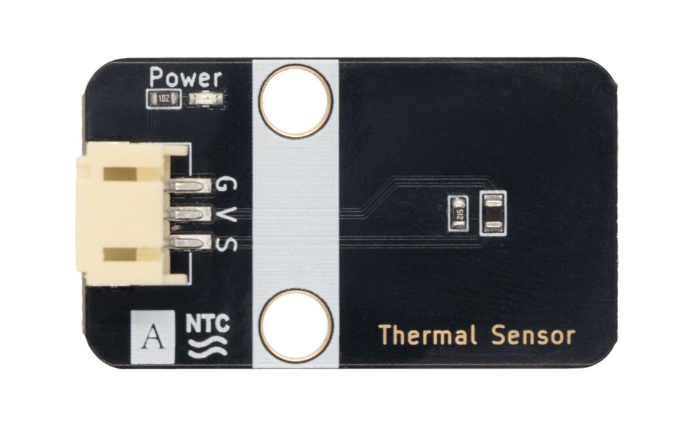
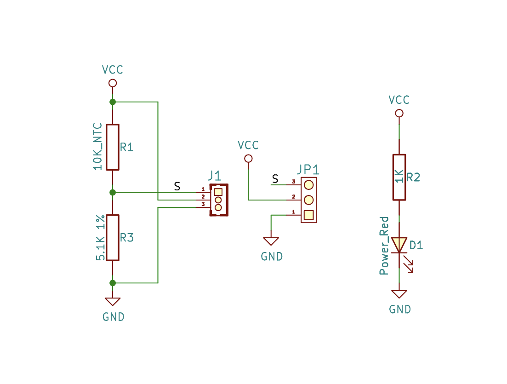
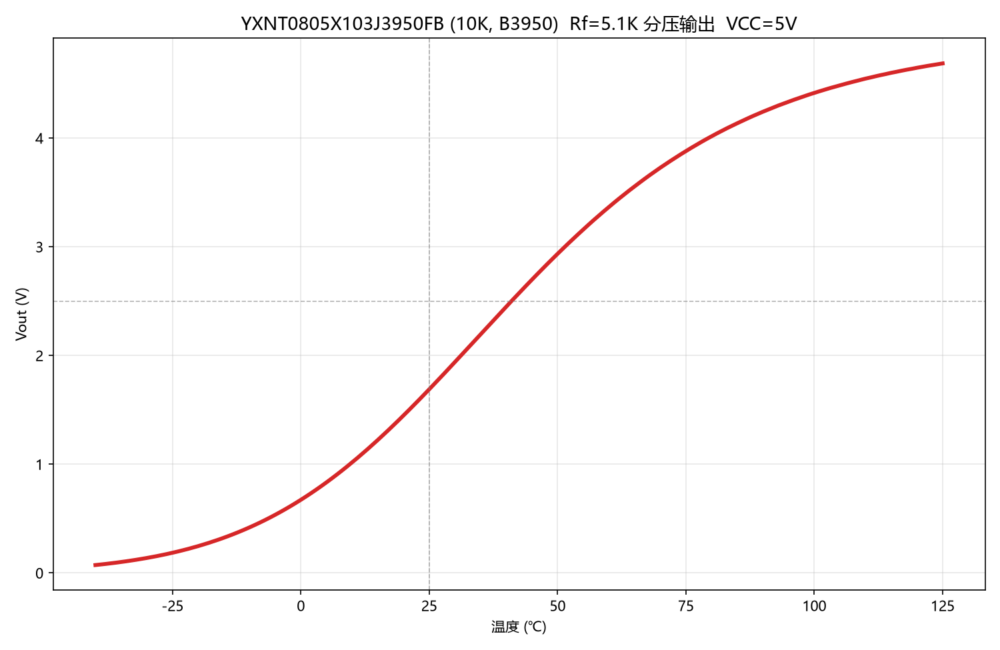
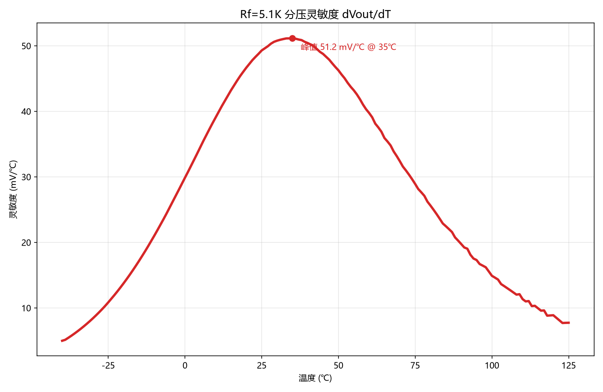
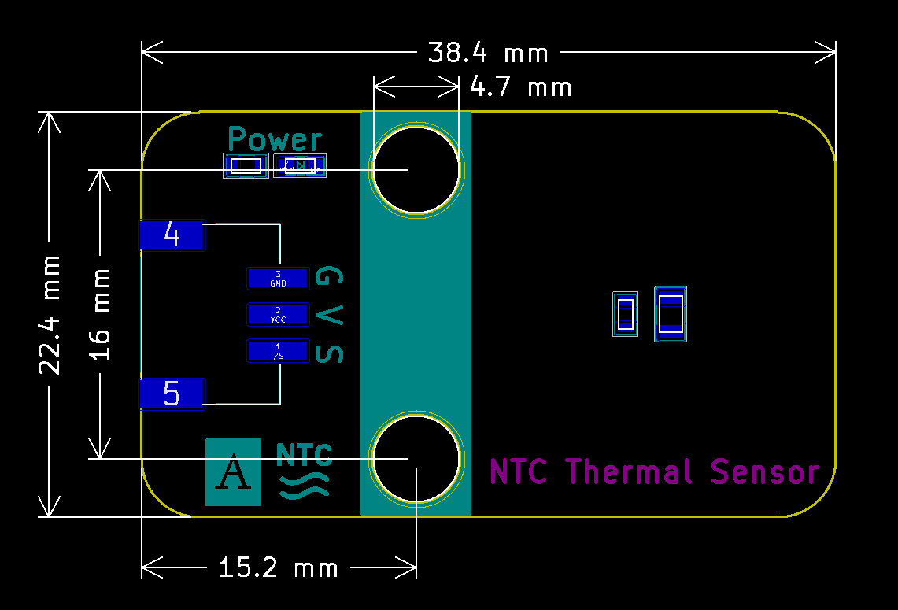

# 热敏传感器



## 概述

热敏电阻器是敏感元件的一类，按照温度系数不同分为正温度系数热敏电阻器(PTC)和负温度系数热敏电阻器(NTC)。热敏电阻器的典型特点是对温度敏感，不同的温度下表现出不同的电阻值。正温度系数热敏电阻器(PTC)在温度越高时电阻值越大，负温度系数热敏电阻器(NTC)在温度越高时电阻值越低，它们同属于半导体器件。  

## 原理图

<a href="zh-cn/ph2.0_sensors/sensors/ntc_thermistor/ntc_thermistor.pdf" target="_blank">查看原理图</a>



## 工作原理

本模块由NTC热敏电阻（10K，B3950）与5.1KΩ分压电阻组成分压电路：NTC一端接VCC，另一端经分压电阻接地，S引脚从中间取出分压电压输出。温度升高时，NTC阻值下降，S信号引脚输出电压升高，因此读取到的模拟值随温度升高而增大。

## 特性曲线

下图为VCC=5V、分压电阻Rf=5.1KΩ、NTC（YXNT0805X103J3950FB，10K/B3950）条件下的输出特性曲线：



- 25℃（室温）时输出电压约1.69V，10位ADC读数约346。
- 输出电压为2.5V（VCC/2）时约对应41℃，此时NTC阻值约等于分压电阻5.1KΩ。
- 40℃以上输出电压增速放缓，逐渐接近供电电压。



- 灵敏度（输出电压随温度的变化率）在35℃附近达到峰值51.2mV/℃，该温度区间每变化1℃，输出约51.2mV。
- 10位ADC在5V参考下1个读数（LSB）约4.88mV，对应温度分辨率约0.1℃。

## 温度对照表

下表为VCC=5V、10位ADC条件下，按规格书R-T特性换算的常用温度区间数据（-20~80℃，每5℃一行）：

| 温度(℃) | R_ntc(Ω) | Vout(V) | ADC读数 | 温度(℃) | R_ntc(Ω) | Vout(V) | ADC读数 |
| :-----: | -------: | ------: | ------: |:-----: | -------: | ------: | ------: |
| -20 | 98185 | 0.247 | 51 | 30 | 8049 | 1.939 | 397 |
| -15 | 73626 | 0.324 | 66 | 35 | 6520 | 2.195 | 449 |
| -10 | 55744 | 0.419 | 86 | 40 | 5313 | 2.449 | 501 |
| -5  | 42592 | 0.535 | 109 | 45 | 4354 | 2.697 | 552 |
| 0   | 32814 | 0.673 | 138 | 50 | 3588 | 2.935 | 601 |
| 5   | 25497 | 0.833 | 171 | 55 | 2973 | 3.159 | 646 |
| 10 | 19958 | 1.018 | 208 | 60 | 2476 | 3.366 | 689 |
| 15 | 15742 | 1.224 | 250 | 65 | 2072 | 3.556 | 727 |
| 20 | 12504 | 1.449 | 296 | 70 | 1742 | 3.727 | 763 |
| 25 | 10000 | 1.689 | 346 | 75 | 1472 | 3.880 | 794 |
|  |  |  |  | 80 | 1249 | 4.016 | 822 |

完整-40~125℃每1℃查表（含ADC舍入误差列）可下载：<a href="zh-cn/ph2.0_sensors/sensors/ntc_thermistor/NTC_B3950_Rf5.1K_ADC_Table.csv" download>温度对照表（CSV）</a>

## 规格书

型号YXNT0805X103J3950FB（10K，B3950）完整规格书：<a href="zh-cn/ph2.0_sensors/sensors/ntc_thermistor/YXNT0805X103J3950FB.pdf" target="_blank">查看规格书</a>

## 模块参数

| 引脚名称 |                    描述                     |
| :------: | :-----------------------------------------: |
|    G     |                   电源地                    |
|    V     |                电源正极 3~5V                |
|    S     | 温度越高时，NTC阻值越小，读取的模拟值则越大 |

- 供电电压：3V~5V

- 连接方式：3Pin-PH2.0接口

- 模块尺寸：38.4 x 22.5 mm

- 安装方式：M4螺钉兼容乐高插孔固定

## 机械尺寸图



<a href="zh-cn/ph2.0_sensors/sensors/ntc_thermistor/ntc_thermistor_3d" download>下载平面和3D文件</a>

## Arduino示例程序

```c++
int ntc_pin = A3  // 定义热敏传感器模块引脚

int thermal_value = 0;  // 定义变量,读取热敏值

void setup() {
  Serial.begin(9600);           // 设置串口波特率
  pinMode(ntc_pin, INPUT);  // 设置热敏传感器模块引脚为输入
}

void loop() {
  thermal_value = analogRead(ntc_pin);  // 读取热敏值，并赋值给ThermalValue
  Serial.print("Thermal Data:  ");
  Serial.println(thermal_value);  // 打印热敏值
  delay(200);
}
```

## MicroPython示例程序

### Esp32 MicroPython示例程序

```python
from machine import ADC,Pin
import time

analog_pin = 15  # 定义热敏传感器模拟接口引脚

p1 = ADC(analog_pin)
    
while True:
    analog_value = p1.read_u16()  # 读取热敏传感器模拟值
    print(analog_value)  # 打印热敏传感器模拟值
    time.sleep_ms(200)
```

### micro:bit  MicroPython示例程序

```python
from microbit import *

analog_pin = pin1  # 定义热敏传感器模拟接口引脚

while True:
    analog_value = AnalogPin.read_analog()  # 读取热敏传感器模拟值
    print("Analog Data:", analog_value)  # 打印热敏传感器模拟值
    sleep(0.2)
```

## MakeCode示例程序

<a href="https://makecode.microbit.org/_LTdekc9H3b9u" target="_blank">动手试一试</a>
