# ASR-V2离线特定语音识别

## 实物图

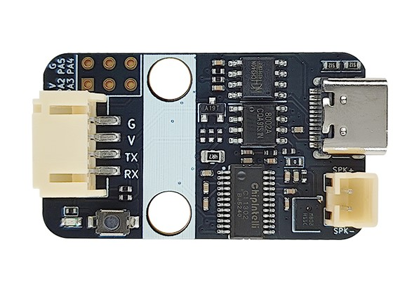

## 概述

本语音识别模块采用了启英泰伦CI1302芯片，集成了语音识别功能，支持中文、英文等语言的语音识别。支持通过串口与单片机通信，允许客户自己开发模块固件，实现语音识别功能。操作简单，安装方便，价格便宜。

## 模块特点

1. 内置脑神经网络处理器/启英泰伦CI130X系列处理器。
2. 支持DNN/TDNN/RNN等神经网络及卷积运算硬件运算，非软件运算。
3. 支持语音识别、 语音增强、 语音检测、 播报打断(AEC打断)。
4. 360度全方位拾音支持单麦克风降噪、增强单麦 克风回声消除。
5. 支持中/英和方言定制等功能。
6. 支持双麦，支持声源定位，抗噪音能力更强。

## 原理图

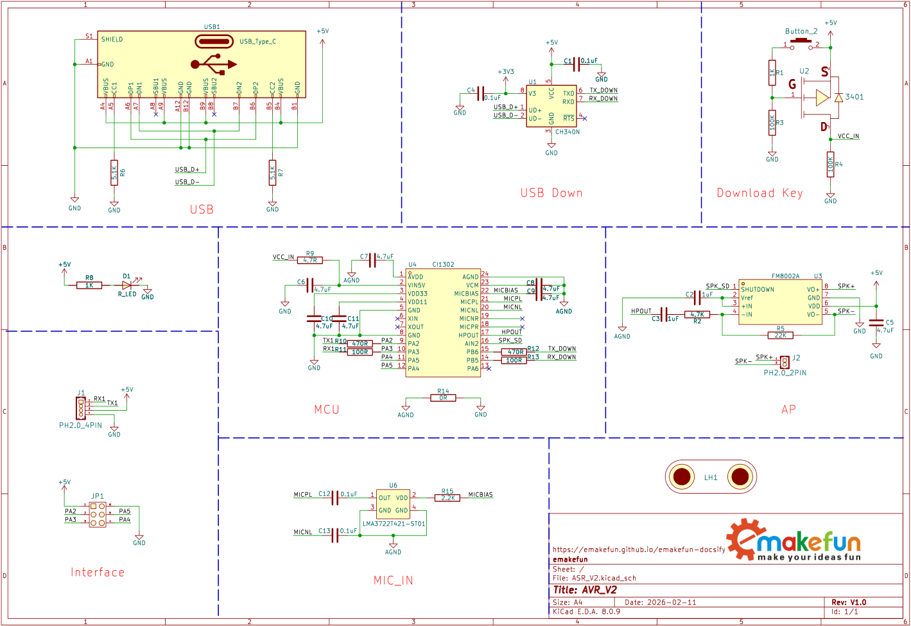

点击查看：<a href="zh-cn/ph2.0_sensors/smart_module/asr_speech_recognition/ASR-V2_Schematic.pdf" target="_blank">原理图</a>、<a href="zh-cn/ph2.0_sensors/smart_module/asr_speech_recognition/ASR-V2_Datasheet（CI1302）.pdf" target="_blank">CI1302芯片规格书</a>

## 尺寸图

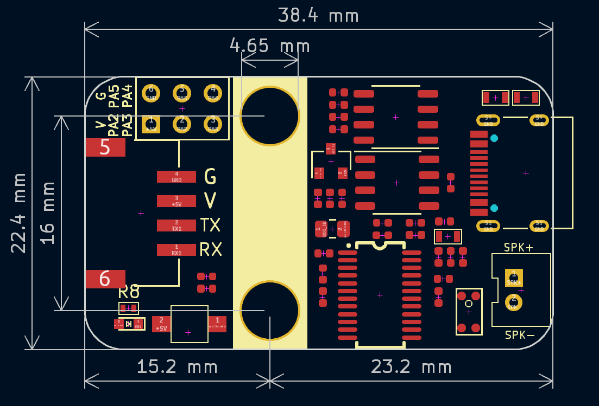

点击下载：<a href="zh-cn/ph2.0_sensors/smart_module/asr_speech_recognition/ASR-V2_2D.zip" download>2D文件</a>、<a href="zh-cn/ph2.0_sensors/smart_module/asr_speech_recognition/ASR-V2_3D.zip" download>3D文件</a>

## 在线制作固件

点击查看：[官方制作教程](https://document.chipintelli.com/%E8%A7%86%E9%A2%91%E6%95%99%E7%A8%8B/%E8%BD%AF%E4%BB%B6%E5%BC%80%E5%8F%91%E7%AF%87/) 
点击进入：[固件制作入口](https://aiplatform.chipintelli.com/begin)，或者<a href="zh-cn/ph2.0_sensors/smart_module/asr_speech_recognition/CI1302-Firmware.zip" download>点击直接下载示例固件</a>

步骤1：选择离线语音识别大模型应用。

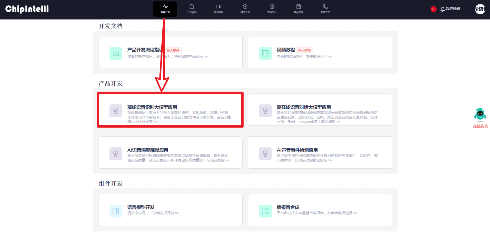

步骤2：选择语音识别固件及SDK开发。

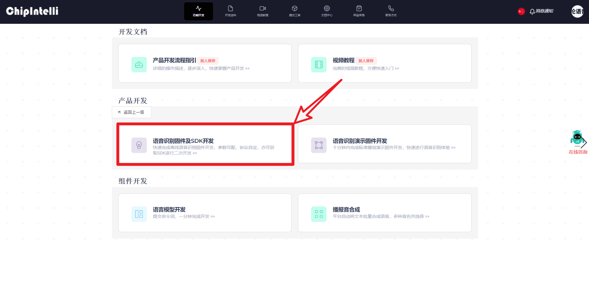

步骤3：点击新建项目。

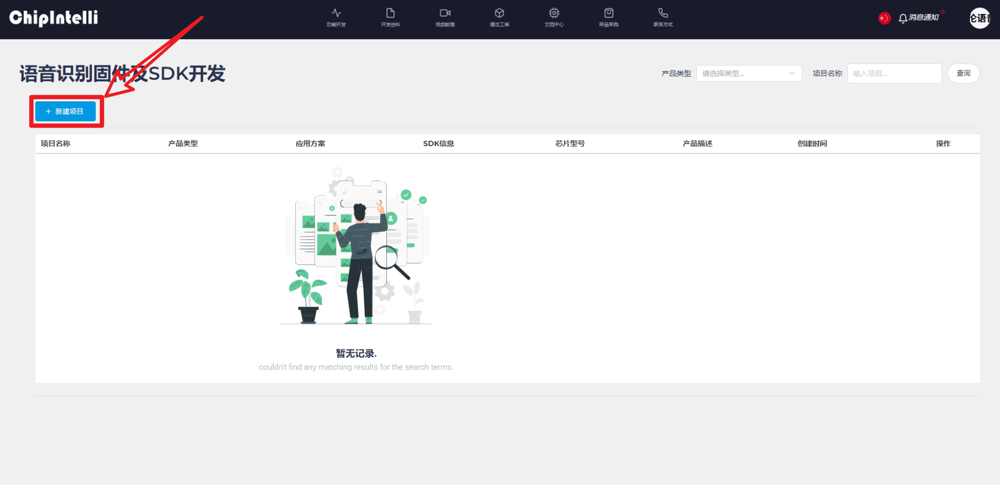

步骤4：按图示依次填写内容，然后点击创建。

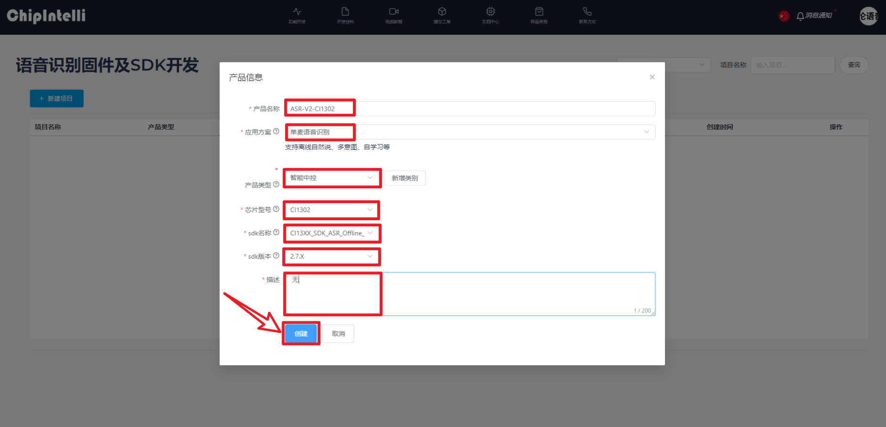

步骤5：按图示依次填写内容，然后点击继续。

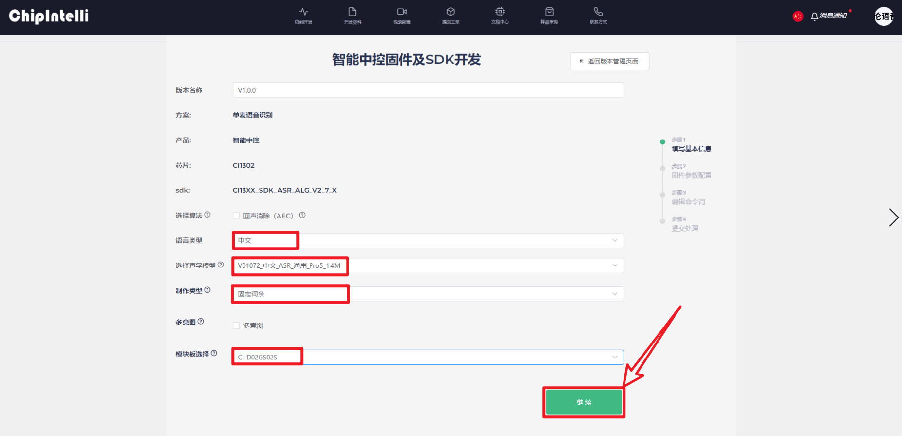

步骤6：按图示依次选择内容，然后点击继续。

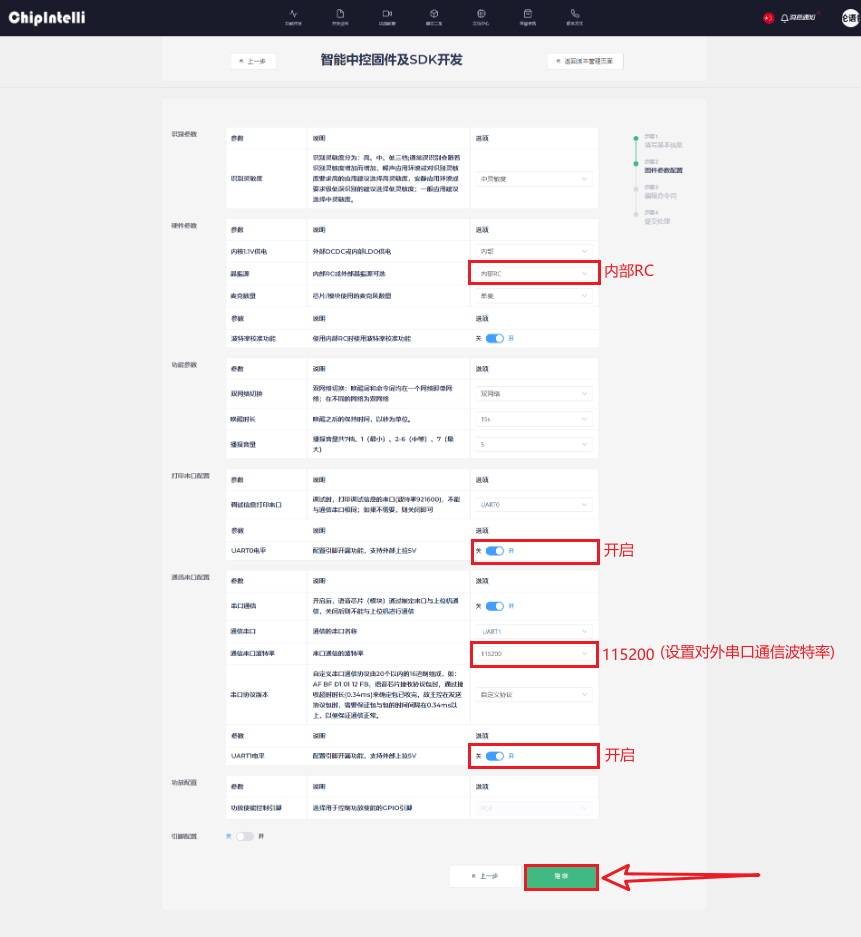

步骤7：<a href="zh-cn/ph2.0_sensors/smart_module/asr_speech_recognition/Voice_Protocol_Table.zip" download>点击下载语音词汇协议表</a>，用户可自定义修改命令，然后上传语音词汇协议表，点击保存后，再点击立即提交。

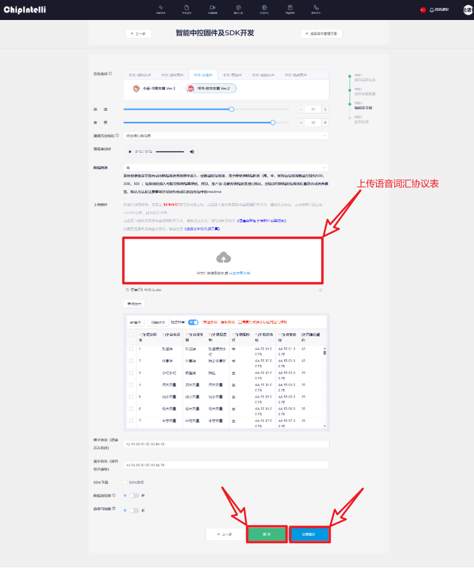

步骤8：耐心等待片刻时间，然后点击下载文件，压缩包中的.bin文件就是所需固件，至此固件制作完成。

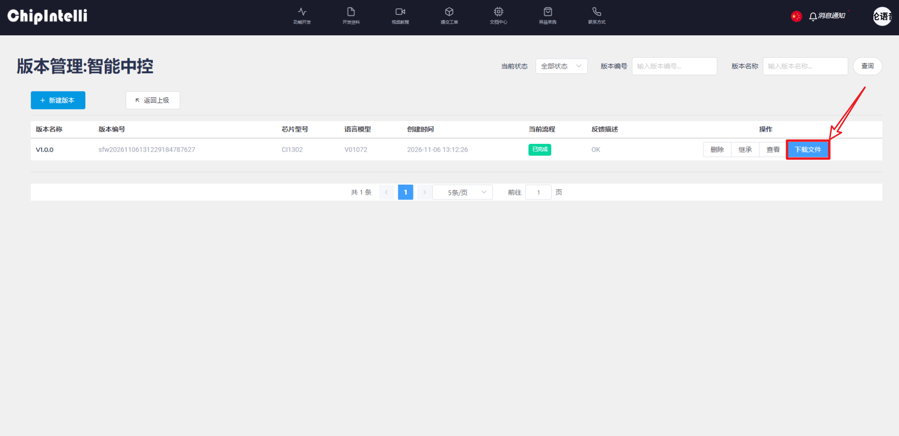

## 离线烧录固件

点击查看：<a href="zh-cn/ph2.0_sensors/smart_module/asr_speech_recognition/firmware_flashing_procedure.pdf" target="_blank">官方烧录教程</a> 
点击下载：<a href="zh-cn/ph2.0_sensors/smart_module/asr_speech_recognition/PACK_UPDATE_TOOL.zip" download>离线烧录工具</a>

步骤1：选择CI13X系列的CI1302芯片，然后点击固件升级。

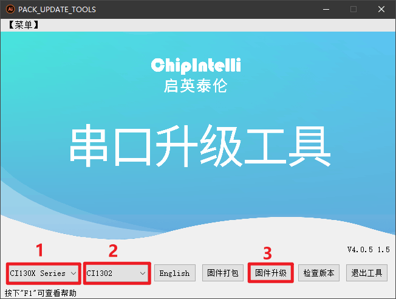

步骤2：选择固件后，将语音模块通过USB连接到电脑，然后在对应COM行最后点击蓝色框，形成绿色对勾框，至此软件已做好烧录准备。

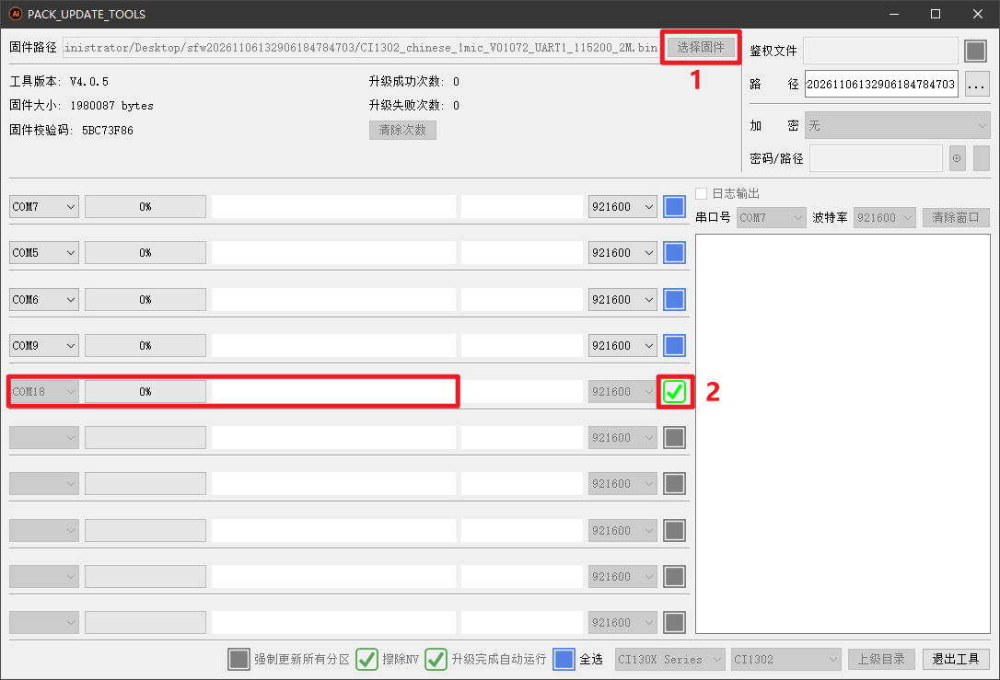

步骤3：按下语音模块上的RST按键，开始自动烧录，图示展示烧录完成。

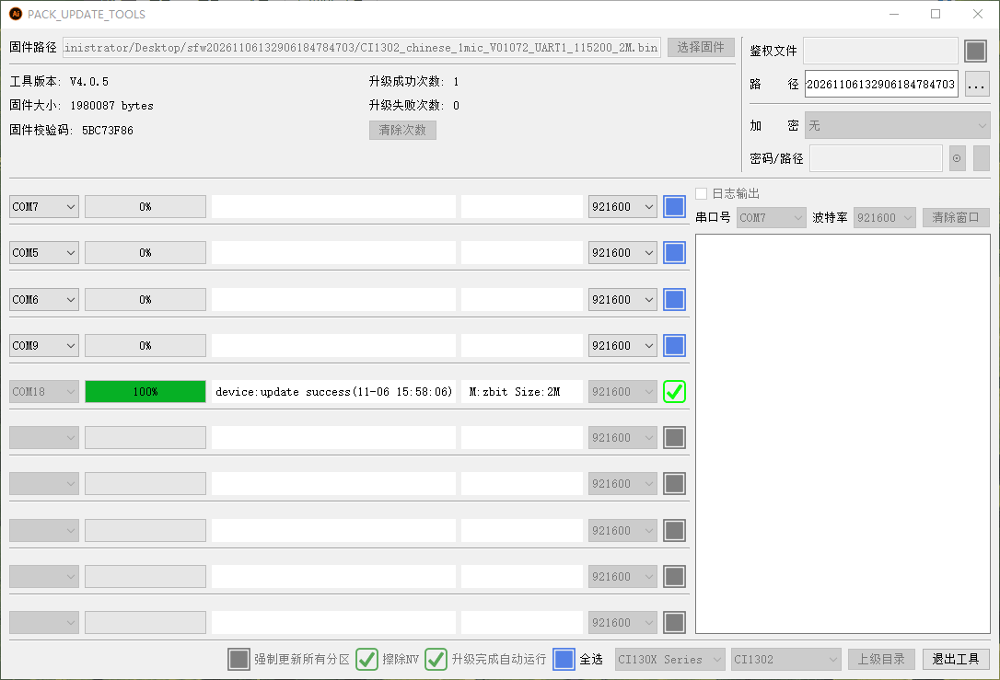

步骤4：对着语音模块呼叫（小慧小慧）、回复（我在），至此固件烧录完成。

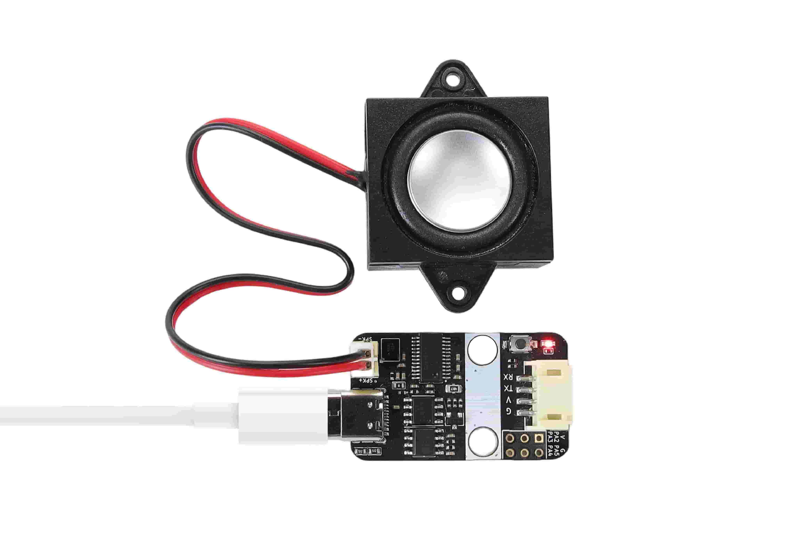

## 串口通信测试

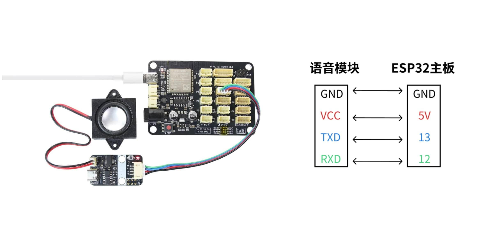

点击下载：<a href="zh-cn/ph2.0_sensors/smart_module/asr_speech_recognition/示例程序.zip" download>Arduino IDE示例程序</a>

呼叫小慧：程序上传到ESP32主板后，打开串口监视器，波特率选择115200，呼叫（小慧小慧），回复内容便会显示在串口页面。

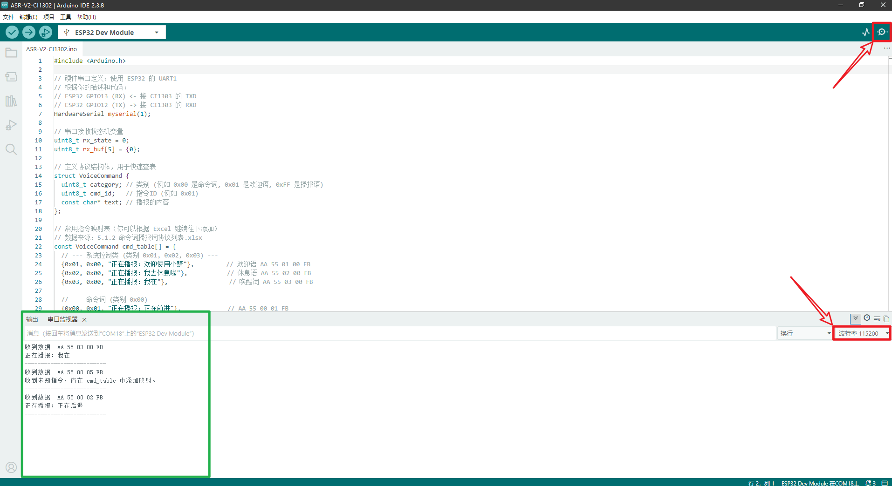
