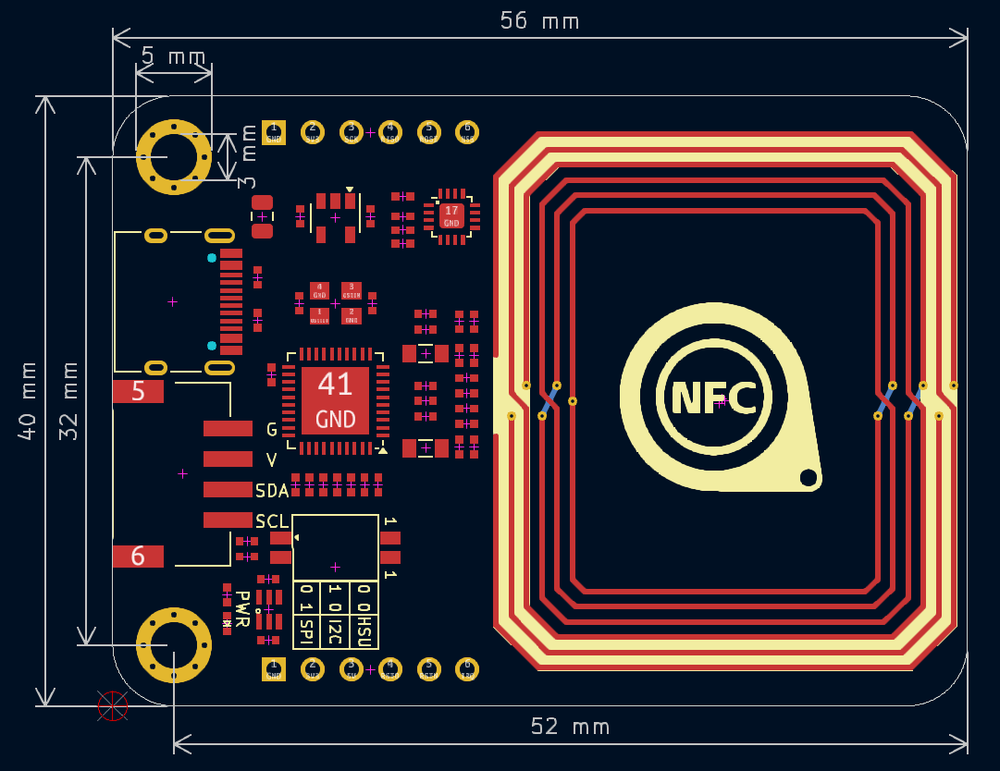
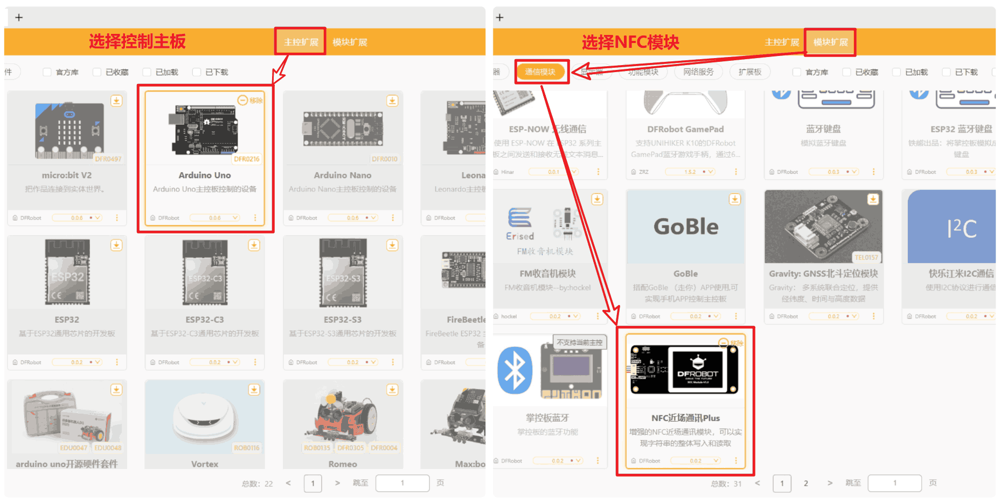
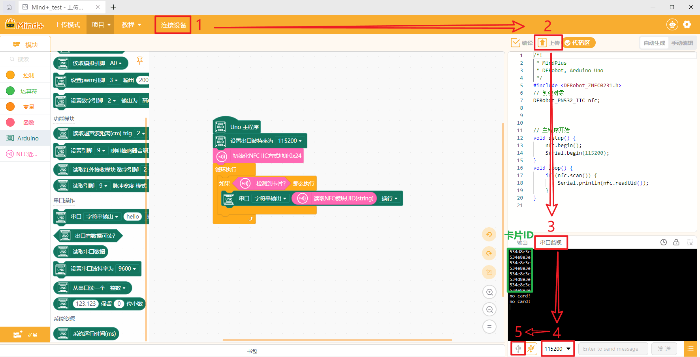
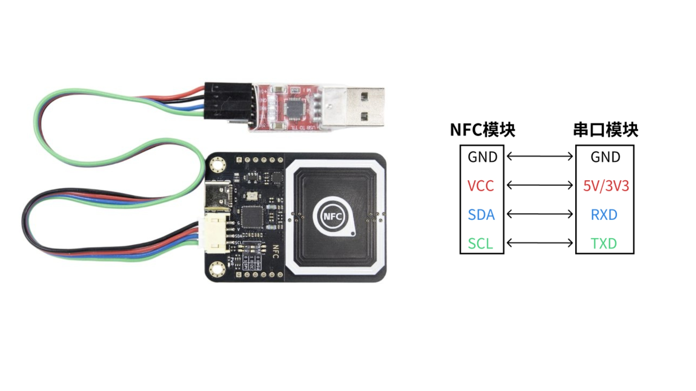
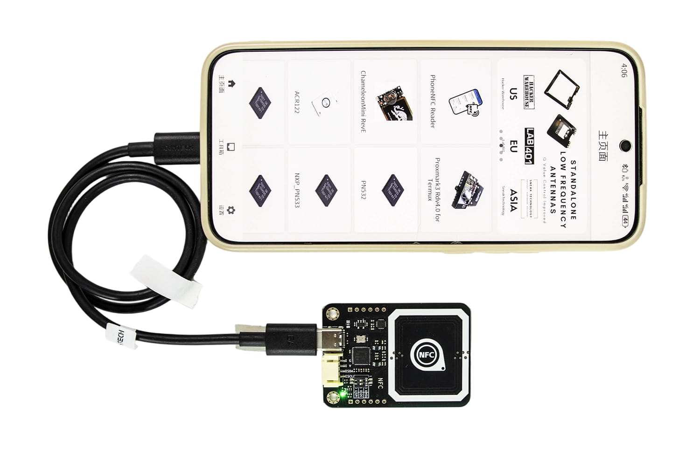
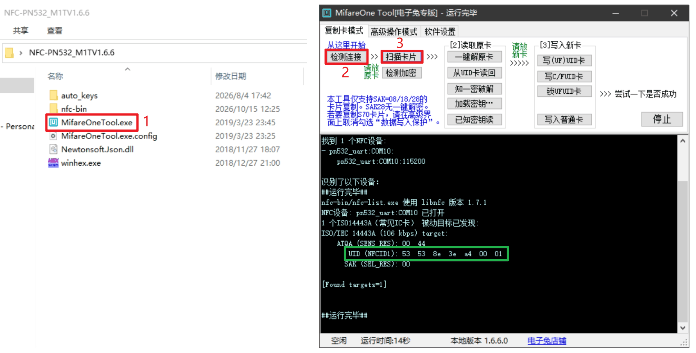

# NFC-PN532模块

## 实物图

## 概述

本NFC模块采用NXP高度集成的非接触式读写芯片PN532，内置 80C51 内核、40KB ROM、1KB RAM。底层可选用I2C、SPI或高速UART协议时序，支持读写器、卡模拟和点对点三种工作模式，可应用于校园一卡通、水卡充值消费、公交卡充值消费、门禁卡、NFC标签读写及设备快速配对等。非接触式IC卡与读卡器之间通过无线电波完成读写操作，二者之间的通讯频率为13.56MHz。非接触式IC卡本身是无源卡，当读写器对卡进行读写操作时，读写器发出的信号由两部分叠加组成：一部分是电源信号，该信号由卡接收后，与本身的L/C电路产生一个瞬间能量来供给芯片工作；另一部分则是指令和数据信号，指挥芯片完成数据的读取、修改、储存等，并返回信号给读写器，完成一次读写操作。

| 工作模式 | 说明 | 典型应用 |
| -------------------- | -------------------- | -------------------- |
| 读卡器模式（Initiator） | 主动读写NFC卡片 | 门禁读卡器、NFC 读写器 |
| 卡模拟模式（Target） | 被动模拟成一张NFC卡 | 模拟门禁卡、电子钱包 |
| P2P 模式 | 两台PN532设备点对点通信 | 设备间数据交换 |

支持的卡类型：Mifare Classic 1K、Mifare Classic 4K、NTAG213/215/216、Mifare Ultralight

## 原理图

点击查看：<a href="zh-cn/ph2.0_sensors/smart_module/nfc_pn532/NFC-PN532_Schematic.pdf" target="_blank">原理图</a>、<a href="zh-cn/ph2.0_sensors/smart_module/nfc_pn532/NFC-PN532_Datasheet.pdf" target="_blank">PN532芯片规格书</a>

## 尺寸图

点击下载：<a href="zh-cn/ph2.0_sensors/smart_module/nfc_pn532/NFC-PN532_3D.zip" target="_blank">3D文件</a>

## 模块参数

| 工作电压3~5V | 工作电流：13-100mA/DC 5V |
| -------------------- | -------------------------------------- |
| 空闲电流：约73~83mA | 休眠电流：约5mA |
| 峰值电流：<150mA | 工作频率：13.56MHz |
| 通讯协议：I2C、SPI、高速UART(HSU) | 功率：<0.5W |
| 长宽尺寸：56*40mm | 重量：7.6g |
| 支持多种卡片读写：mifare1 S50、mifare1 S70、mifare Ult等 | RFID电子标签，钥匙扣，钱币卡，IC白卡等 |
| 通信地址：I2C模式下默认地址为0x24 | 编程默认波特率：115200 |

## 模式切换

## 应用场景

### 1、控制主板 + NFC模块

#### 软件（Arduino IDE）

步骤1：选择通信模式，在NFC模块上电前通过拨码开关选择通信模式，严禁上电后切换通信模式，此测试选择I2C通信(A4:SDA、A5:SCL)。 
步骤2：<a href="zh-cn/ph2.0_sensors/smart_module/nfc_pn532/NFC-PN532_Arduino" download>下载示例程序</a>，打开工程文件，通过TypeC数据线将主板连接至PC端，选择Arduino Uno主板和对应设备COM，点击上传程序。 
步骤3：打开串口监视，将卡片放到NFC模块上，串口输出显示读取到的卡片ID信息。

#### 软件（Mind+）

步骤1：选择通信模式，在NFC模块上电前通过拨码开关选择通信模式，严禁上电后切换通信模式，此测试选择I2C通信(A4:SDA、A5:SCL)。 
步骤2：<a href="https://mindplus.cc/" download>下载Mind+软件</a>，由于在线版Mind+软件需要单独配置Mind+Link，所以本次测试采用离线版Mind+软件。 
步骤3：软件切换到"上传模式"，在"扩展"中选择"主控扩展"中的"Arduino Uno"，在"模块扩展"中选择"通信模块"中的"NFC近场通讯Plus"。 
步骤4：<a href="zh-cn/ph2.0_sensors/smart_module/nfc_pn532/NFC-PN532_Mind+.zip" download>下载示例程序</a>，用户也可自行在软件编写相关程序，检查通讯模式为I2C后，通过TypeC数据线将主板连接至PC端。 
步骤5：将卡片放到NFC模块上，按下面图示步骤上传程序后，打开串口监视器，查看读取到的卡片ID信息。

### 2、串口模块 + NFC模块

### 3、手机软件 + NFC模块

步骤1：选择通信模式，在NFC模块上电前通过拨码开关选择通信模式，严禁上电后切换通信模式，此测试选择HSU串口通信。 
步骤2：<a href="zh-cn/ph2.0_sensors/smart_module/nfc_pn532/NFC-PN532_App.zip" download>本地下载手机APP</a>或<a href="https://learn.adafruit.com/adafruit-pn532-rfid-nfc/downloads" download>在线网页下载APP</a>，再通过双头TypeC数据线连接手机与NFC模块。 
步骤3：打开手机APP软件，将卡片放到NFC模块上，按下面图示步骤读取卡片ID信息。

### 4、上位机软件 + NFC模块

步骤1：选择通信模式，在NFC模块上电前通过拨码开关选择通信模式，严禁上电后切换通信模式，此测试选择HSU串口通信。 
步骤2：<a href="zh-cn/ph2.0_sensors/smart_module/nfc_pn532/NFC-PN532_Driver" download>下载驱动程序</a>，若无法识别到串口，先下载并安装驱动程序后重试。 
步骤3：<a href="zh-cn/ph2.0_sensors/smart_module/nfc_pn532/NFC-PN532_M1TV1.6.6.zip" download>下载上位机软件</a>，检查通信模式是否切换到HSU，然后通过TypeC数据线连接PC端。 
步骤4：打开上位机软件，将卡片放到NFC模块上，按下面图示步骤读取卡片ID信息。

