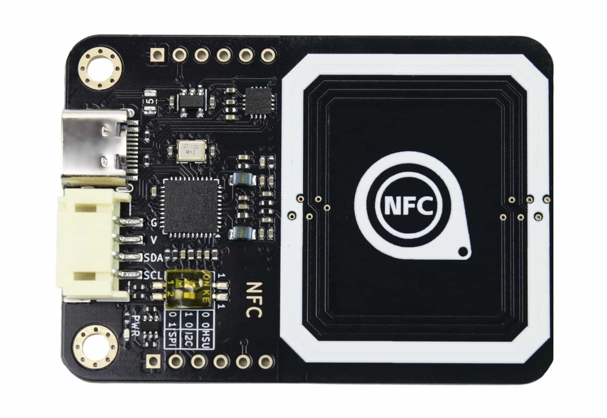
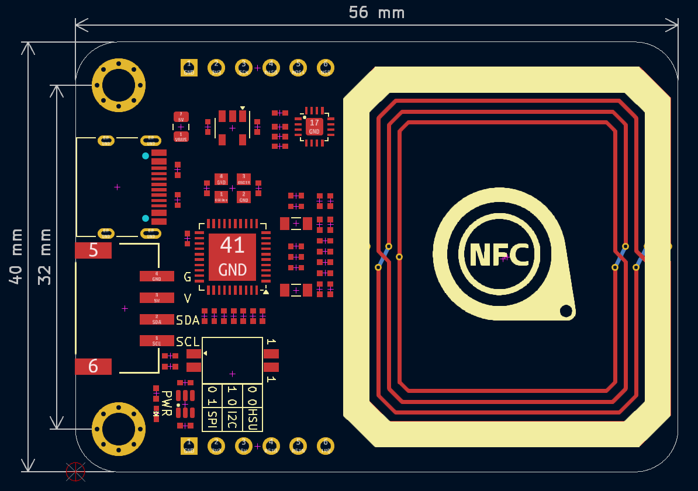
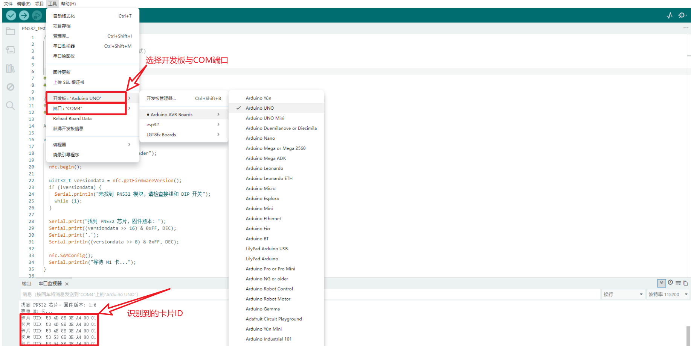
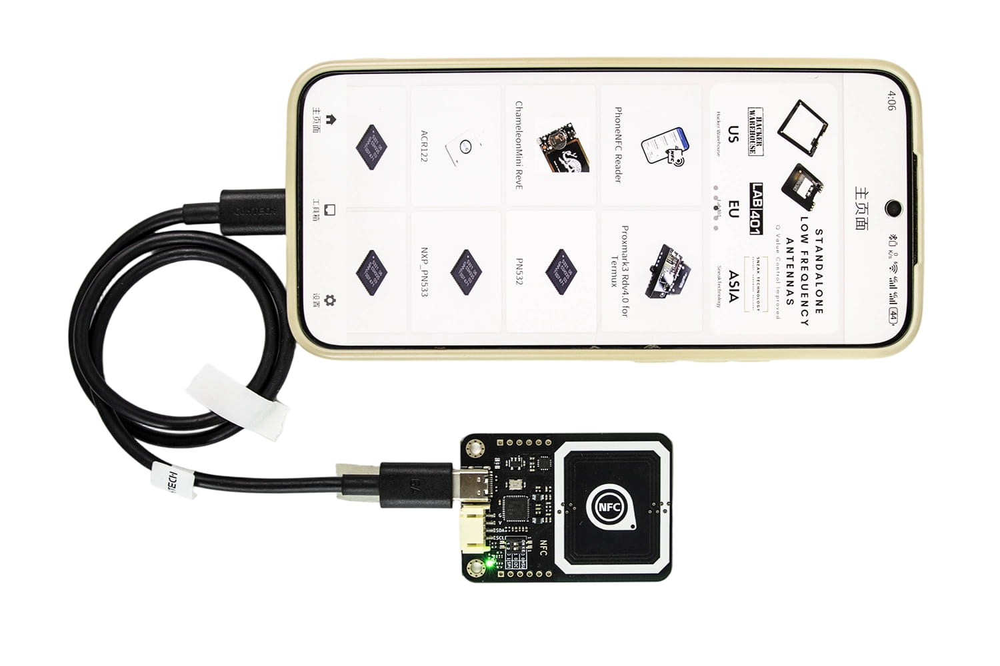
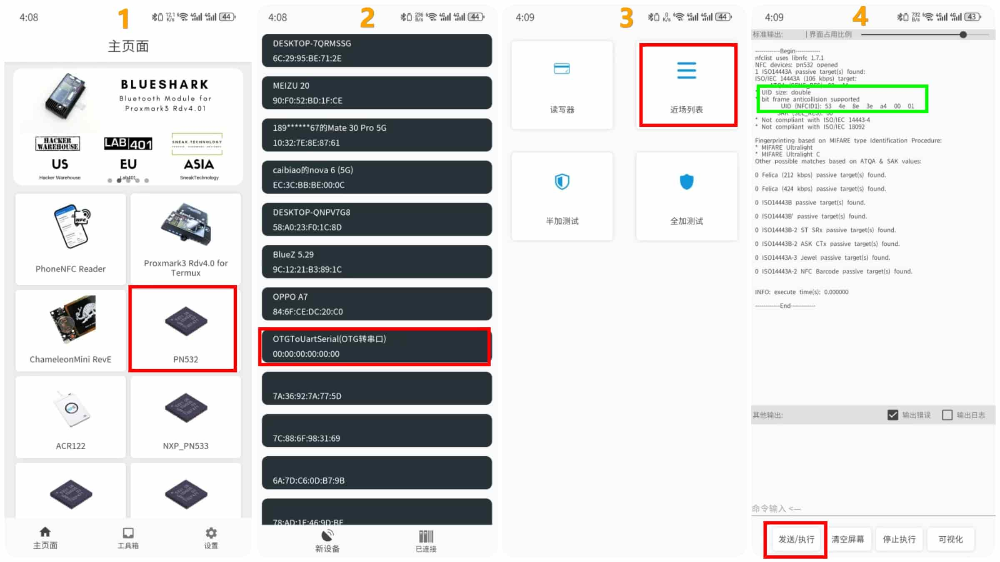

# NFC-PN532模块

## 一、实物图

## 二、概述

本NFC模块采用NXP高度集成的非接触式读写芯片PN532。底层可选用I2C、SPI或高速UART协议时序，支持读写器、卡模拟和点对点三种工作模式，可应用于校园一卡通、水卡充值消费、公交卡充值消费、门禁卡、NFC标签读写及设备快速配对等。非接触式IC卡与读卡器之间通过无线电波完成读写操作，二者之间的通讯频率为13.56MHz。非接触式IC卡本身是无源卡，当读写器对卡进行读写操作时，读写器发出的信号由两部分叠加组成：一部分是电源信号，该信号由卡接收后，与本身的L/C电路产生一个瞬间能量来供给芯片工作；另一部分则是指令和数据信号，指挥芯片完成数据的读取、修改、储存等，并返回信号给读写器，完成一次读写操作。

## 三、芯片规格书

<a href="zh-cn/ph2.0_sensors/smart_module/nfc_pn532/pn532_chip_manual.pdf" target="_blank">芯片规格书点击此处查看</a>

## 四、尺寸图

## 五、模块参数

| 工作电压3~5V | 工作电流：13-100mA/DC 5V |
| -------------------- | -------------------------------------- |
| 空闲电流：约73~83mA | 休眠电流：约5mA |
| 峰值电流：<150mA | 工作频率：13.56MHz |
| 通讯协议：I2C、SPI、高速UART(HSU) | 功率：<0.5W |
| 长宽尺寸：56*40mm | 重量：7.6g |
| 支持多种卡片读写：mifare1 S50、mifare1 S70、mifare Ult等 | RFID电子标签，钥匙扣，钱币卡，IC白卡等 |
| 通信地址：I2C模式下默认地址为0x48 | |

## 六、模块测试

### 1、主板测试：Arduino Uno + NFC模块

步骤1：选择通信模式，在NFC模块上电前通过拨码开关选择通信模式，严禁上电后切换通信模式，此测试选择I2C通信(A4:SDA、A5:SCL)。 
步骤2：<a href="zh-cn/ph2.0_sensors/smart_module/nfc_pn532/PN532_Test.zip" download>下载示例程序</a>，打开工程文件，选择Arduino Uno主板和对应设备COM，点击上传程序。 
步骤3：打开串口监视，将卡片放到NFC模块上，串口输出显示读取到的卡片ID信息。

### 2、手机测试：RFID App + NFC模块

步骤1：选择通信模式，在NFC模块上电前通过拨码开关选择通信模式，严禁上电后切换通信模式，此测试选择HSU串口通信。 
步骤2：<a href="zh-cn/ph2.0_sensors/smart_module/nfc_pn532/NFC_APP.zip" download>下载手机APP</a>，通过双头TypeC数据线连接手机与NFC模块，打开手机APP软件，将卡片放到NFC模块上，按图示步骤读取卡片ID信息。

