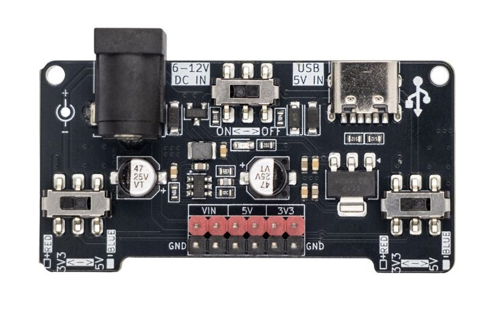
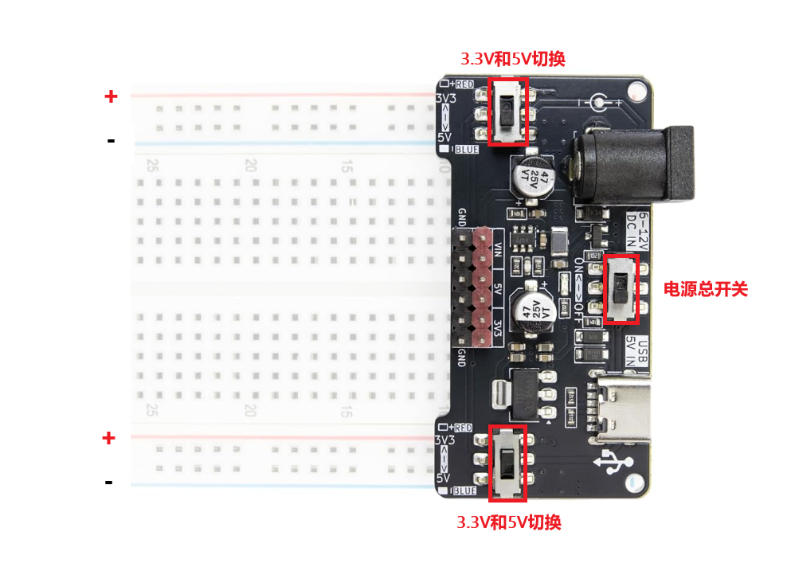

# 面包板电源

## 概述

面包板电源模块是一款专为面包板供电尔设计的微型稳压电源模块，可直接插入标准面包板的电源轨，为电路提供3.3V或5V的稳定直流电压。模块支持6~12V DC头输入或5V USB-C输入，板载双通道线性稳压电路，两路输出可独立选择电压，是创客实验、原型开发中快速搭建供电系统的理想方案。

## 产品参数

| 参数 | 规格 |
| :----- | :----- |
| 稳压方案 | 5V为DC-DC 1A降压， 3.3V为LDO 1A |
| DC输入 | 6~12V DC（5.5×2.1mm，内正外负） |
| USB输入 | 5V（USB-C接口） |
| 输出电压 | 3.3V / 5V（可选），左右路独立切换 |
| 输出电流 | 单路最大500mA |
| 电源开关 | 拨动式 ON/OFF |
| 输入保护 | USB与DC输入隔离，不可同时使用 |

## 硬件说明

### 输入接口

模块顶部设有两种输入方式，使用时**只能选择其中一种**：

| 接口 | 说明 |
| :----- | :----- |
| DC IN | 5.5×2.1mm 桶座，输入6~12V DC（内正外负），适用于7.4V锂电池、9V/12V电源适配器 |
| USB IN | USB-C接口，输入5V（手机充电器、电脑USB口均可） |

>注：不可同时将DC和USB接入，虽然板载有隔离保护二极管，但同时接入可能损坏供电设备。

### 电源开关与指示灯

- **电源开关**：位于DC座与USB口之间，拨至左侧（ON）通电，拨至右侧（OFF）断电
- **电源指示灯**：板载红色LED，上电后点亮，方便确认供电状态

### 电压切换开关

模块左右两侧各有一个拨动开关，分别独立控制左/右电源轨的输出电压，左侧开关拨向5V、右侧开关拨向3.3V，即可在面包板上同时获得两种供电。

### 输出排针

模块底部中间设有一组2×6排针（红色上排、黑色下排），用于引出电源供外部设备使用：

| 排针 | 丝印 | 说明 |
| :----- | :----- | :----- |
| 红色上排 | VIN / 5V / 3V3 | 分别对应原始输入电压、5V稳压输出、3.3V稳压输出 |
| 黑色下排 | GND | 公共接地 |

红色排针与黑色排针为对应关系，每列上下配对为一个电源输出通道。

### 面包板导轨标识

模块两侧印有面包板导轨极性标记：
- `+RED`：红色导轨（正极）
- `-BLUE`：蓝色导轨（负极/GND）
- 左上角印有电源符号（圆圈内 + / -），插入面包板时红色导轨对应正极侧、蓝色导轨对应负极侧

## 使用方法

### 安装到面包板

1. 确认面包板电源轨宽度与模块引脚间距匹配（适用于标准6.5cm宽面包板）
2. 将模块红色导轨标记（+RED）对准面包板红色正极轨，蓝色导轨标记（BLUE）对准蓝色负极轨，垂直插入
3. 确认模块插入牢固，无松动歪斜

## 注意事项

- **输入电压上限**：DC输入不得超过12V，超过会烧毁稳压芯片
- **输入方式互斥**：DC与USB不可同时接入，虽然板载有保护二极管，但同时使用可能损坏供电设备
- **输出电流**：最大输出电流1A为单路峰值，持续使用时建议留有余量（持续负载不超过500mA）
- **发热问题**：线性稳压原理是将多余电压以热量形式耗散，输入电压越高、输出电流越大时发热越明显。例如12V输入、5V输出、500mA负载时，稳压芯片功耗达3.5W，请注意散热
- **电压切换**：拨动开关时需确保该侧导轨上无敏感器件带电，建议断电后再切换开关
- **短路保护**：模块本身无短路自恢复功能，接线时注意防止电源轨短路
